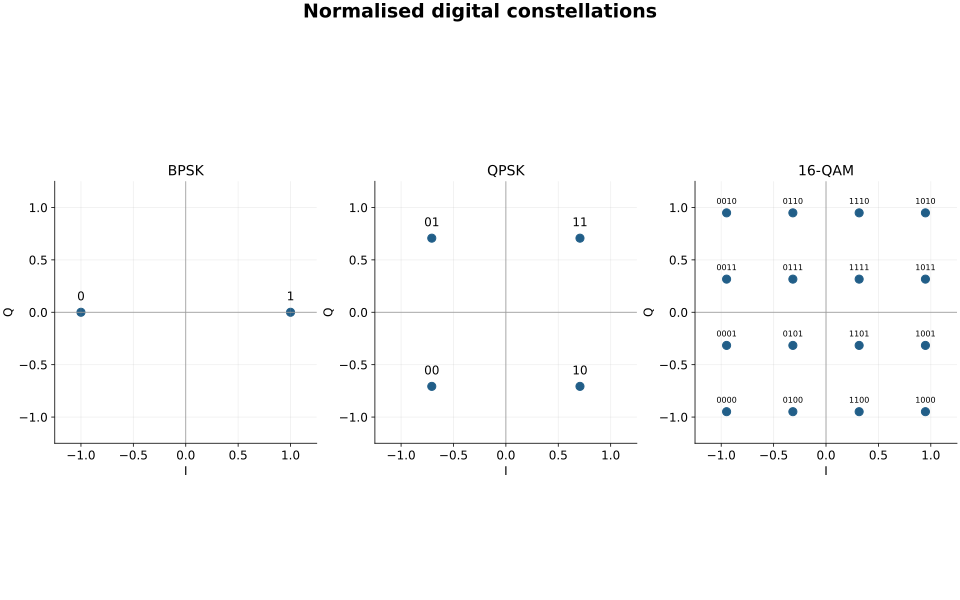

# M17-L1 – Baseband, Carriers and Modulation Models {#L1}

**Course area:** M17 – Bachelor: Communication Systems

**Level:** Bachelor · Elective

**Prerequisites:** [M5-L1](M5-L1.md), [M2-L6](M2-L6.md).

**Learning objective:** Map a bit sequence to complex symbols, distinguish carrier signals from bandwidth, and normalise constellations.

## From Information to Waveform {#S1}

A digital message initially consists of bits. A transmitter groups them, maps them to symbols and generates a continuous-time waveform. The channel modifies this waveform; the receiver must reconstruct the transmitted bits from an observed waveform. Source coding (representation of information) and channel coding (redundancy for error correction) are separate stages. We initially consider uncoded symbols without packet overhead.

With $M$ equally frequent symbols and $M=2^k$, one symbol carries $k$ bits. For symbol duration $T$, we have $R_s=1/T$ and $R_b=kR_s$. A symbol is not an individual voltage pulse: it can represent a pair of orthogonal signal components at a carrier frequency. Bit rate and symbol rate are identical only for binary modulation.

## Complex Baseband {#S2}

With a real pulse $p(t)$ and complex symbols $a_n=I_n+jQ_n$, we write

$$u(t)=\sum_n a_n p(t-nT),\qquad x(t)=\sqrt{2}\operatorname{Re}\{u(t)e^{j2\pi f_ct}\}.$$

The real radio-frequency waveform consists of $\sqrt{2}(I(t)\cos 2\pi f_ct-Q(t)\sin 2\pi f_ct)$. The sign of the Q branch is a convention that the receiver must preserve. With sufficiently separated positive and negative spectral components, the chosen scaling preserves energy between baseband and passband. The complex representation is a mathematical model, not an imaginary voltage at the antenna output.

## Constellations and Energy {#S3}

BPSK uses $a=\pm1$ (bit 0 → −1, bit 1 → +1). QPSK uses $a=(\pm1\pm j)/\sqrt{2}$; one bit each determines the sign of the I and Q components. 16-QAM uses four amplitudes per axis: −3, −1, +1, +3. For equally probable points, the mean energy of the unnormalised constellation is $2(9+1+1+9)/4=10$. Dividing by $\sqrt{10}$ gives a mean symbol energy of 1. For a unit-energy pulse these are normalised energies; actual energies follow from physical scaling.

| Scheme | Bits/symbol | Minimum distance at $E_s=1$ |
| --- | ---: | ---: |
| BPSK | 1 | 2 |
| QPSK | 2 | $\sqrt{2}$ |
| 16-QAM | 4 | $2/\sqrt{10}$ |

With Gray mapping, only one bit changes between immediately adjacent points. For each 16-QAM axis, we use −3 → 00, −1 → 01, +1 → 11, +3 → 10. This does not alter the geometric decision regions, but it changes the number of erroneous bits in an incorrect decision. 16-QAM also has variable symbol amplitude; its peak energy is 1.8 for a mean of 1 (before pulse overlap). A nonlinear amplifier can therefore introduce errors different from those of a purely additive noise model.

## Rate and Bandwidth as Design Variables {#S4}

At 100 kSym/s, the raw bit rates are 100, 200 or 400 kbit/s. With raised-cosine pulse shaping and roll-off $\alpha=0.25$, the total positive RF bandwidth is $B=(1+\alpha)R_s=125$ kHz in the ideal model (see [M17-L3](M17-L3.md)). At the same rate of 200 kbit/s, BPSK requires 250 kHz, QPSK 125 kHz and 16-QAM 62.5 kHz. However, the decision also depends on transmitted energy per bit and error rate, not just on the spectrum. More bits per symbol mean less energy per bit at fixed $E_s$. The model in the next lesson explicitly distinguishes these comparison conditions.

## Exercises with Solutions {#S5}

1. Calculate the gross bit rate for 16-QAM at 250 kSym/s. **Solution:** 1 Mbit/s.
2. Encode 1011 using the specified 16-QAM mapping (I first). **Solution:** $(3+j)/\sqrt{10}$.
3. Why is QPSK divided by $\sqrt{2}$? **Solution:** Without normalisation, every point would have energy 2 rather than 1.
4. A 200-kbit/s transmitter uses QPSK and $\alpha=0.35$. **Solution:** $R_s=100$ kSym/s, $B=135$ kHz ideally.

## Sources {#S6}

- [MIT OpenCourseWare – Principles of Digital Communications I, topics 11–19 and 20–23](https://ocw.mit.edu/courses/6-450-principles-of-digital-communications-i-fall-2006/pages/syllabus/)
- [MIT OpenCourseWare – Principles of Digital Communication I, Lecture Notes](https://ocw.mit.edu/courses/6-450-principles-of-digital-communication-i-fall-2009/pages/lecture-notes/)
