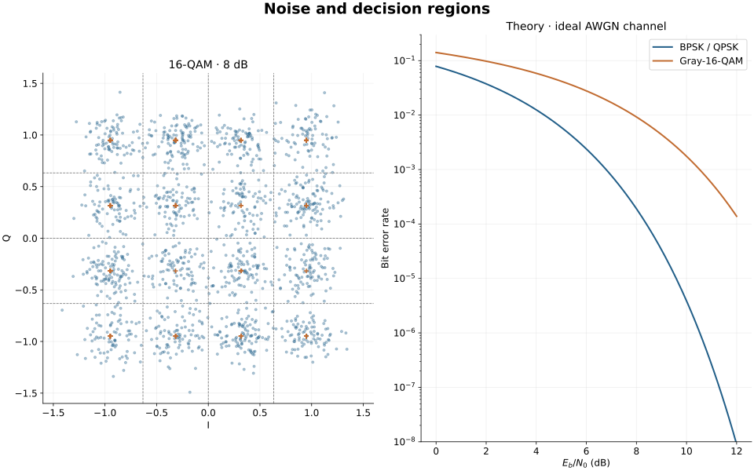

# M17-L2 – Channel, Noise and Detection {#L2}

**Course area:** M17 – Bachelor: Communication Systems

**Level:** Bachelor · Elective

**Prerequisites:** [M17-L1](M17-L1.md), [M2-L6](M2-L6.md).

**Learning objective:** Normalise an AWGN model, derive decision boundaries and calculate bit error rates.

## The Model at the Decision Stage {#S1}

After ideal pulse shaping, receive filtering and symbol sampling, let $r_n=a_n+w_n$. We assume correct timing and carrier synchronisation. Additive white Gaussian noise (AWGN) has a two-sided power spectral density of $N_0/2$ in the continuous real-valued model. The noise components projected onto orthonormal real signal axes are independent and normally distributed with variance $N_0/2$. Complex baseband therefore requires precisely this variance per axis, not $N_0$; jointly, $E|w|^2=N_0$. For BPSK, the real axis suffices.

Let $E_s=E|a|^2$, $E_b=E_s/k$ for uncoded data. With $\gamma_b=E_b/N_0$ and normalised $E_s=1$, we obtain

$$\sigma^2=\frac{N_0}{2}=\frac{1}{2k\gamma_b},\quad \gamma_b=10^{(E_b/N_0)_{\mathrm{dB}}/10}.$$

At 4 dB with QPSK, $\gamma_b=2.512$, $N_0=0.1991$ and $\sigma\approx0.3155$. A 4 dB energy ratio is not converted by dividing by 20. In real receivers, noise at the decision stage depends on the receive filter; arbitrary noise per ADC sample does not automatically correspond to this model.

## Minimum-Distance Decisions {#S2}

For equally probable symbols and isotropic Gaussian noise, the maximum-likelihood decision is also the maximum-a-posteriori decision. As the density is proportional to $\exp(-|r-a|^2/N_0)$, the receiver chooses

$$\hat a=\arg\min_{a\in\mathcal A}|r-a|^2.$$

For BPSK the boundary is at zero, for QPSK along both axes, and for normalised 16-QAM along the lines $-2/\sqrt{10},0,2/\sqrt{10}$ on each axis. With unequal priors or correlated noise, Euclidean distance and fixed midpoints are not generally optimal. A hard decision discards information about the distance to the boundaries; soft information can assist a channel decoder.

{alt="Received 16-QAM points at 8 dB and theoretical bit error rates for BPSK, QPSK and 16-QAM."}

## Error Rate and Theoretical Reference {#S3}

For the Gaussian tail probability $Q(x)=\frac1{\sqrt{2\pi}}\int_x^\infty e^{-t^2/2}\,dt$, the following holds for coherent BPSK: if +1 is transmitted, an error occurs precisely when $w<-1$. By symmetry, $P_b=Q(\sqrt{2\gamma_b})$. QPSK separates into two independent BPSK decisions with the same bit energy and has the same bit error rate. The QPSK symbol error rate is $1-(1-P_b)^2$.

For Gray-coded 16-QAM, we can average over the four possible amplitudes and all decision regions on each axis. With $d=\sqrt{0.8\gamma_b}$, we obtain

$$P_b=\tfrac34 Q(d)+\tfrac12 Q(3d)-\tfrac14 Q(5d).$$

The common high-SNR approximation $\tfrac34 Q(d)$ neglects incorrect decisions farther away. The exact equation follows by counting Hamming distances: the outer point −3 has expected erroneous bit count $Q(d)+Q(3d)-Q(5d)$; the inner point −1 has $2Q(d)+Q(3d)$. Symmetry gives the two positive points. Averaging and dividing by two bits yields the formula.

## Measuring Rather Than Just Observing an Error {#S4}

The empirical BER is $N_{\mathrm{fehler}}/N_{\mathrm{bits}}$ (subscript fehler denotes errors). With 10 errors in 10000 bits it is $10^{-3}$, but this is only an estimate. Under an independent bit error model, the standard deviation of the estimator is $\sqrt{p(1-p)/N}$. A 16-QAM symbol decision can affect several bits simultaneously; the independent bit model is therefore only an approximation in this case. Zero observed errors are not proof of error-free transmission; with independent errors, the approximate one-sided 95% upper bound is $3/N$. In the presence of error bursts, several independent segments must be examined. BER, packet error rate and EVM (Error Vector Magnitude: the RMS magnitude of the error vectors between received and ideal symbols, normalised to a reference amplitude) are distinct measures.

## Exercises with Solutions {#S5}

1. For BPSK at 0 dB, $\gamma_b=1$. **Solution:** $P_b=Q(\sqrt2)\approx0.07865$.
2. What is the variance per axis for normalised 16-QAM at 0 dB? **Solution:** $1/8$.
3. For QPSK with $P_b=0.01$: **Solution:** symbol error rate $1-0.99^2=0.0199$.
4. No errors in 100000 independent bits: **Solution:** approximate upper 95% bound $3\cdot10^{-5}$; this does not establish that BER is zero.

## Sources {#S6}

- [MIT OpenCourseWare – Principles of Digital Communications I, topics 11–19 and 20–23](https://ocw.mit.edu/courses/6-450-principles-of-digital-communications-i-fall-2006/pages/syllabus/) · Principles of Digital Communications I, topics 11–19 and 20–23; Thematic relevance to lesson: S2: Minimum-Distance Decisions · Last accessed: 2026-11-22
- [MIT OpenCourseWare – Principles of Digital Communication I, Lecture Notes](https://ocw.mit.edu/courses/6-450-principles-of-digital-communication-i-fall-2009/pages/lecture-notes/) · Principles of Digital Communication I, Lecture Notes (overview/index page); Thematic relevance to lesson: S3: Error Rate and Theoretical Reference · Last accessed: 2026-11-22
