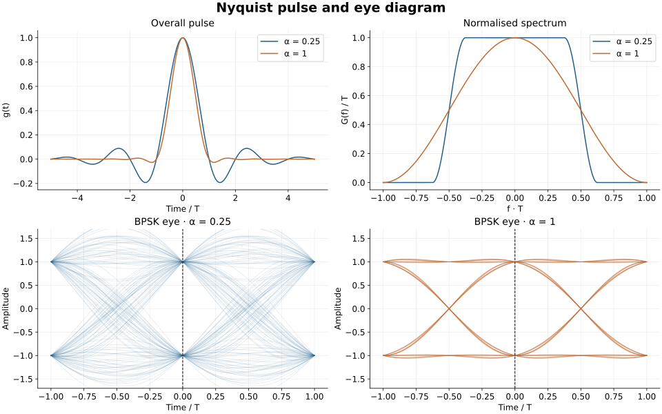

# M17-L3 – Pulse Shaping and Intersymbol Interference {#L3}

**Course area:** M17 – Bachelor: Communication Systems

**Level:** Bachelor · Elective

**Prerequisites:** [M17-L1](M17-L1.md), [M5-L1](M5-L1.md).

**Learning objective:** Apply the Nyquist criterion to an overall pulse, and weigh bandwidth, filter length and timing tolerance against one another.

## Why Rectangular Pulses Are Not Enough {#S1}

A symbol stream can be modelled as a weighted impulse train. The transmit filter generates continuous-time pulses from it. The channel and receive filter change their shape. The overall pulse $g(t)$ combines all three transfer functions; for linear time-invariant stages, $g=p_T*h_C*p_R$. Rectangular pulses in simple NRZ signals have finite duration, but a theoretically infinitely extended spectrum. A sharply limited frequency response in turn produces long tails in time.

After delay compensation, sampling at the symbol instant gives

$$r(mT)=a_m g(0)+\sum_{n\ne m}a_n g((m-n)T)+w_m.$$

The second term is intersymbol interference (ISI). With $g(0)=1$ and $g(kT)=0$ for every integer $k\ne0$, it vanishes. Pulses may overlap in time; their sum at the correct sampling instants is what matters. This is the first Nyquist criterion in the time domain. In the ideal low-pass case, the minimum one-sided baseband bandwidth is $1/(2T)$; it must not be confused with the Nyquist sampling frequency of an ADC.

## Raised Cosine {#S2}

An ideal overall pulse satisfying the criterion is given, with $x=t/T$, by

$$g(t)=\operatorname{sinc}(x)\frac{\cos(\pi\alpha x)}{1-(2\alpha x)^2},\qquad \operatorname{sinc}(x)=\frac{\sin(\pi x)}{\pi x}.$$

At $x=0$ and $x=\pm1/(2\alpha)$, the continuous limiting values must be used: 1 and $(\pi/4)\operatorname{sinc}(1/(2\alpha))$, respectively. For $\alpha=0$, the sinc pulse remains. The Fourier transform is constant in baseband up to $(1-\alpha)/(2T)$ (value $T$), falls over half a cosine period and is zero from $(1+\alpha)/(2T)$ onwards. For a real RF channel, the bandwidth around the positive carrier frequency is therefore $(1+\alpha)/T$. The negative spectral component is the mirror image, not a second usable channel.

{alt="Raised-cosine pulses, corresponding spectra and superimposed BPSK signal segments for two roll-off factors."}

## Transmit and Receive Filters {#S3}

In a flat channel, the transmitter can use a root-raised-cosine (RRC) pulse with frequency response $\sqrt{G(f)}$. The time-reversed conjugate receive pulse is the matched filter; the product of both frequency responses is then $G(f)$. The overall pulse has the Nyquist zeros; the transmit pulse alone need not have them. In white noise, the matched filter maximises the SNR for a known pulse at the intended instant. It does not automatically correct a frequency-selective channel and assumes an appropriate pulse shape and time reference.

A finite FIR filter approximates the infinite pulse. At eight samples per symbol and a symmetric length of 81 coefficients (ten symbol intervals from −5T to +5T), the group delay of an individual filter is 40 samples or 5T. For two such filters, it is 10T. Normalisation, truncated tails and quantisation can cause residual ISI. Oversampling is a numerical design variable, not a new bit rate.

## The Eye as a Diagnostic Tool {#S4}

An eye diagram superimposes many time segments, typically two symbol periods long. For binary real symbols, the values at ideal sampling instants are −1 and +1. The vertical separation between the groups is the noise margin in the interference-free model. The horizontal opening indicates how far the sampling instant can deviate from the optimum while the groups remain distinguishable. A more closed eye can result from bandwidth limitation, noise, reflections or timing errors; it does not establish a specific cause.

The illustrated eyes use a finite raised-cosine overall pulse and a random BPSK sequence without noise; edge effects are excluded. Both roll-off factors approximately satisfy the same sampling condition. The larger factor occupies more spectrum but has shorter tails. Sensitivity also depends on the channel and data pattern; the eye gives only a visual estimate, not an exact BER without a statistical model.

## Exercises with Solutions {#S5}

1. $R_s=200$ kSym/s, $\alpha=0.2$. **Solution:** one-sided bandwidth 120 kHz, RF bandwidth 240 kHz.
2. Why does a Nyquist pulse not have to be confined to the interval $T$? **Solution:** The zeros at the other sampling instants are sufficient with ideal timing.
3. Two FIR filters with 49 coefficients each and six samples/symbol. **Solution:** combined delay 48 samples = 8T.
4. What happens when sampling is $0.2T$ too late? **Solution:** The other pulses are generally no longer sampled at their zeros; data dependence and ISI result.

## Sources {#S6}

- [MIT OpenCourseWare – Principles of Digital Communications I, topics 11–19 and 20–23](https://ocw.mit.edu/courses/6-450-principles-of-digital-communications-i-fall-2006/pages/syllabus/)
- [University of Texas at Austin – EE 445S, Lab 5: Digital Data Transmission by Baseband PAM](https://users.ece.utexas.edu/~bevans/courses/realtime/lectures/laboratory/c6748winDSK/lab5/index.html)
