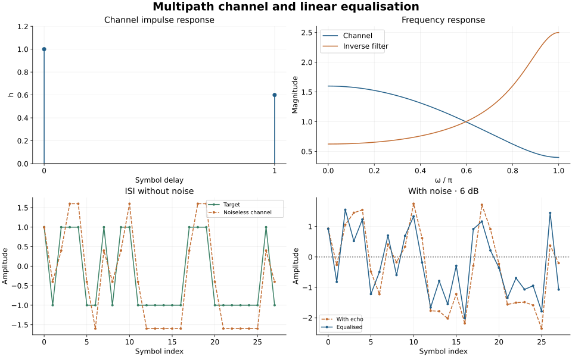

# M17-L4 – Synchronisation, Multipath Channels and Equalisation {#L4}

**Course area:** M17 – Bachelor: Communication Systems

**Level:** Bachelor · Elective

**Prerequisites:** [M17-L2](M17-L2.md), [M17-L3](M17-L3.md).

**Learning objective:** Distinguish timing, frequency and phase errors, and quantitatively assess linear equalisation of a simple channel.

## Synchronisation as a Prerequisite {#S1}

A receiver knows neither the start of the data block nor necessarily its timing, frequency and phase. A symbol timing error $\tau$ shifts the samples to $g(kT+\tau)$; even small deviations produce ISI when pulses overlap. A frequency error $\Delta f$, by contrast, produces a time-dependent rotation with ideal timing:

$$r_n=a_n e^{j(2\pi\Delta f nT+\phi)}+w_n.$$

At 100 kSym/s and a frequency error of 500 Hz, the constellation rotates by 1.8° per symbol; after 50 symbol intervals it has rotated by 90°. A one-off phase correction does not eliminate a frequency error. Preambles can provide coarse estimates of packet start, timing and frequency; pilots and tracking loops follow the remaining deviations. With unknown carrier phase, QPSK has an ambiguity of multiples of 90°, which known symbols or suitable coding must resolve. Timing recovery, frequency estimation and framing are logically distinct tasks.

## A Discrete Multipath Model {#S2}

Reflections from buildings or transmission-line ends produce delayed signal components. The continuous channel can be described by a sum of delayed paths. After filtering and sampling, we use the effective symbol-rate channel

$$r_n=\sum_{\ell=0}^{L-1}h_\ell a_{n-\ell}+w_n.$$

The taps are generally complex and time-varying. A path with a fractional-symbol delay is usually distributed across several taps after filtering. For a stationary example, we choose real coefficients $h_0=1$, $h_1=0.6$, $H(z)=1+0.6z^{-1}$. Two successive identical BPSK symbols produce a magnitude of 1.6; opposite symbols produce a magnitude of 0.4. Both remain distinguishable without noise, but the noise margin depends on the data. $|H(e^{j\omega})|$ lies between 0.4 and 1.6. A uniform gain cannot compensate for this frequency response.

{alt="Two-tap channel, magnitude response and BPSK samples before and after recursive equalisation."}

## Zero Forcing and Noise Enhancement {#S3}

If the channel is known, an ideal zero-forcing equaliser can invert its effect. Here,

$$G(z)=\frac1{1+0.6z^{-1}},\qquad y_n=r_n-0.6y_{n-1}.$$

With both systems initially in the zero state, the output without noise is exactly $a_n$. The feedback uses previous **continuous-valued equaliser outputs**, not hard symbol decisions. The impulse response $(-0.6)^m$ is absolutely summable, so this causal inverse filter is stable. For independent white noise with variance $\sigma^2$, the steady-state result is

$$\operatorname{Var}(y_n-a_n)=\sigma^2\sum_{m=0}^\infty0.6^{2m}=\frac{\sigma^2}{1-0.36}=1.5625\sigma^2.$$

The mean noise variance increases by 1.94 dB. A channel with a zero on the unit circle does not permit bounded exact inversion of this kind; a non-minimum-phase channel does not permit stable causal exact inversion without further measures. An MMSE equaliser accepts residual distortion in order to limit the overall mean squared error. For known $H$, white symbols of variance $E_s$ and white noise with a flat spectrum, the unconstrained frequency-by-frequency solution is $G=H^*/(|H|^2+N_0/E_s)$ in the complex model. A realisable finite filter length and desired delay must be considered separately.

## Channel Estimation and Testing {#S4}

With a known training sequence, a tapped-delay model can be written as a linear system of equations $\mathbf r=\mathbf A\mathbf h+\mathbf w$. The rows of $\mathbf A$ contain current and delayed training symbols. With full column rank, the least-squares estimate minimises the squared norm of the residual; numerically, QR or SVD should be used rather than explicit inversion of the normal equations. A constant training sequence cannot reliably distinguish the taps. An independent test sequence checks whether the estimated channel also applies outside the training data. In the model experiment [M17-L5](M17-L5.md), we deliberately assume that the channel is known in order to isolate the effect of inversion.

## Exercises with Solutions {#S5}

1. $\Delta f=100$ Hz at 10 kSym/s. **Solution:** 3.6° rotation per symbol interval.
2. Calculate the two-tap output for $a_{n-1}=-1$, $a_n=+1$. **Solution:** 0.4 before noise is added.
3. Replace 0.6 with 0.9. **Solution:** Noise variance factor $1/(1-0.81)=5.263$, or 7.21 dB; inversion becomes more sensitive.
4. Why can a known pilot symbol resolve a QPSK phase ambiguity? **Solution:** It provides a reference for the absolute orientation of the constellation.

## Sources {#S6}

- [MIT OpenCourseWare – Principles of Digital Communication I, Lecture Notes](https://ocw.mit.edu/courses/6-450-principles-of-digital-communication-i-fall-2009/pages/lecture-notes/) · Principles of Digital Communication I, Lecture Notes (overview/index page); Thematic relevance to lesson: S3: Zero Forcing and Noise Enhancement · Last accessed: 2026-11-22
- [University of Texas at Austin – EE 445S, Lab 5: Digital Data Transmission by Baseband PAM](https://users.ece.utexas.edu/~bevans/courses/realtime/lectures/laboratory/c6748winDSK/lab5/index.html) · Lab 5: Digital Data Transmission by Baseband PAM; Reference listed for the lesson “Synchronisation, Multipath Channels and Equalisation” · Last accessed: 2026-11-22
