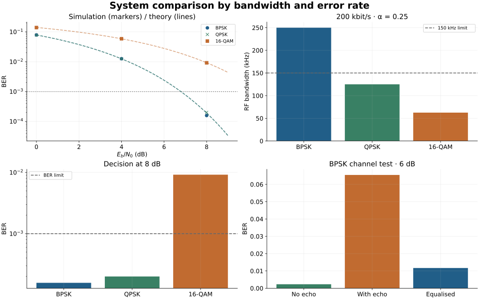

# M17-L5 – Comparing Transmission Systems {#L5}

**Course area:** M17 – Bachelor: Communication Systems

**Level:** Bachelor · Elective

**Prerequisites:** [M17-L1](M17-L1.md) to [M17-L4](M17-L4.md).

**Learning objective:** Compare modulation schemes at equal bit energy and equal gross bit rate, and document a justified system decision.

## Requirements for a Modelled Data Link {#S1}

A civilian telemetry link is to transmit uncoded data at a gross rate of 200 kbit/s. The ideal model specifies a maximum occupied RF bandwidth of 150 kHz, a BER below $10^{-3}$ and 8 dB at the ideally synchronised AWGN detector. This is neither a real radio standard nor a complete link budget; transmit power, propagation, packet headers, channel coding and noise figure have not yet been specified. The question is: which of the three schemes meets all three model requirements simultaneously?

For all schemes, we assume overall raised-cosine pulse shaping with $\alpha=0.25$. The symbol energy is normalised to 1 for each scheme; the noise variance is adjusted according to [M17-L2](M17-L2.md) to achieve equal bit energy relative to $N_0$. The experiment simulates the sufficient symbol samples, not the DAC, RF carrier or practical RRC filters. The bandwidth is calculated from the theoretical pulse model. At the same gross bit rate and the same $E_b/N_0$, the physical mean received power can be the same for equal $N_0$, because $P=E_bR_b$; the symbol energy is then proportional to $k$.

## Experiment and Reproducible Code {#S2}

The same 400,000 random bits are used for each scheme. New normally distributed values are generated for each of the three noise levels. BPSK and QPSK have the same theoretical BER at equal $E_b/N_0$; 16-QAM uses Gray mapping and minimum-distance detection. The script first checks error-free demapping and mean energy, then the deviation from the analytical BER. The final part simulates BPSK in the known two-tap channel from M17-L4 at 6 dB. For this, 100,000 bits and the same noise values for all three comparison cases are used. NumPy is the only external dependency.

```python
import numpy as np
from math import erfc, sqrt
rng = np.random.default_rng(1705)
N = 400_000
bits = rng.integers(0, 2, N)
gray = np.array([-3, -1, 3, 1])
Q = lambda x: 0.5 * erfc(x / sqrt(2))
rows = []
for k in (1, 2, 4):
    b = bits.reshape(-1, k)
    if k == 1:
        s = 2*b[:, 0]-1
    elif k == 2:
        s = (2*b[:, 0]-1 + 1j*(2*b[:, 1]-1))/sqrt(2)
    else:
        s = (gray[2*b[:, 0]+b[:, 1]] + 1j*gray[2*b[:, 2]+b[:, 3]])/sqrt(10)
    def detect(r):
        if k == 1:
            return (r.real >= 0).astype(int)[:, None]
        if k == 2:
            return np.column_stack((r.real >= 0, r.imag >= 0)).astype(int)
        i = np.argmin(abs(r.real[:, None]*sqrt(10)-gray), axis=1)
        q = np.argmin(abs(r.imag[:, None]*sqrt(10)-gray), axis=1)
        return np.column_stack((i//2, i%2, q//2, q%2))
    assert np.array_equal(detect(s), b)
    assert abs(np.mean(abs(s)**2)-1) < .015
    for db in (0, 4, 8):
        g = 10**(db/10)
        sigma = sqrt(1/(2*k*g))
        n = sigma*rng.standard_normal(s.size)
        if k > 1:
            n = n + 1j*sigma*rng.standard_normal(s.size)
        errors = np.count_nonzero(detect(s+n) != b)
        a = sqrt(.8*g)
        theory = Q(sqrt(2*g)) if k < 4 else .75*Q(a)+.5*Q(3*a)-.25*Q(5*a)
        # Binomial approximation as a broad numerical sanity check, not a CI.
        assert abs(errors/N-theory) < 7*sqrt(theory*(1-theory)/N)+5/N
        rows.append((k, db, errors, errors/N, theory))
# Two-tap known channel; zero-state recursive linear inverse, no decisions fed back.
b = bits[:100_000]; s = 2*b-1
h = .6; clean = np.convolve(s, [1, h])[:len(s)]
n = sqrt(1/(2*10**(.6)))*rng.standard_normal(len(s))
def inverse(r):
    z = np.empty(len(r)); prev = 0.
    for j, v in enumerate(r):
        prev = v-h*prev; z[j] = prev
    return z
assert np.max(abs(inverse(clean)-s)) < 1e-12
r = clean+n; z = inverse(r)
isi = [np.mean((v>=0)!=b) for v in (s+n, r, z)]
ratio = np.var(z-s)/np.var(n)
assert abs(ratio-1/(1-h*h)) < .04
if __name__ == '__main__':
    for row in rows: print(*row)
    print('ISI:', isi, 'noise ratio:', ratio)
```

## Results and Selection {#S3}

| $E_b/N_0$ | BPSK BER (errors) | QPSK BER (errors) | 16-QAM BER (errors) |
| ---: | ---: | ---: | ---: |
| 0 dB | 0.078885 (31554) | 0.0777125 (31085) | 0.1396625 (55865) |
| 4 dB | 0.0125875 (5035) | 0.012580 (5032) | 0.0586825 (23473) |
| 8 dB | 0.0001575 (63) | 0.000200 (80) | 0.009190 (3676) |

At 8 dB, the theoretical BPSK/QPSK value is $1.909\cdot10^{-4}$, and the exact Gray-coded 16-QAM value is $9.247\cdot10^{-3}$. The Monte Carlo values fluctuate around their references. The broad test limit used in the code is a numerical plausibility check and not a formal confidence test. A reproducible random seed does not replace a measurement campaign.

| Scheme | Symbol rate (kSym/s) | Ideal RF bandwidth (kHz) | Requirement: 150 kHz / BER < 0.001 |
| --- | ---: | ---: | --- |
| BPSK | 200 | 250 | Bandwidth requirement not met |
| QPSK | 100 | 125 | Both requirements met |
| 16-QAM | 50 | 62.5 | BER requirement not met |

{alt="Simulated bit error rates, theoretical comparison curves, bandwidth at equal gross bit rate and errors in the multipath channel."}

QPSK is the suitable starting point for these requirements. A difference of 25 kHz from the model bandwidth limit is not a guaranteed guard band for a real transmitter. 16-QAM would be of interest at a higher energy ratio: for $P_b=10^{-3}$, the high-SNR approximation gives $Q(d)\approx0.001333$, hence $d\approx3.004$ and $\gamma_b\approx11.28$ (10.52 dB). QPSK theoretically requires about 6.79 dB for the same target value; at 8 dB, approximately 1.21 dB of margin remains in this AWGN model. At 200 kbit/s, a fair energy comparison must therefore not be confused with identical noise standard deviations in the normalised symbol model.

## Impairment Scenario and Limitations {#S4}

In the two-tap experiment at 6 dB, BPSK gives a BER of 0.00230 without an echo, 0.06545 with an echo and no equaliser, and 0.01168 with recursive equalisation. The empirical noise variance enhancement factor is 1.562506, virtually identical to the theoretical factor of 1.5625. Inversion removes ISI in the absence of noise but enhances noise; it does not restore the original ideal BER. This additional measurement is not a QPSK channel test and does not permit a direct conclusion about the QPSK specification. It demonstrates why the AWGN-only selection must be supplemented by channel and synchronisation tests.

To extend the work to a real link, an RRC transmit/receive model of finite length, training and channel estimation, sampling and frequency errors, power amplifiers and a spectrum measurement are needed. Packet error rate also depends on block length and error correlation. Even with independent errors, 1000 bits at a BER of $2\cdot10^{-4}$ have a probability of $1-(1-0.0002)^{1000}\approx18.1\%$ of containing at least one error. Channel coding, CRC and retransmission are therefore separate system decisions. The radio-link parameters are explored further in [M18 – Antennas](pages/study-path.md#S3) once that module has been developed.

## Exercises with Solutions {#S5}

1. With a bandwidth of 125 kHz and $\alpha=0.25$: **Solution:** $R_s=100$ kSym/s; 16-QAM theoretically carries a gross bit rate of 400 kbit/s.
2. Determine the 16-QAM BER at 8 dB from the table. **Solution:** $3676/400000=0.00919$, more than nine times the target value.
3. A code rate of 3/4 is introduced. **Solution:** To maintain 200 kbit/s of payload bits (without further overhead), a gross rate of 266.67 kbit/s is needed. QPSK then requires 166.67 kHz; the original bandwidth limit would be exceeded. The BER of the coded system must be recalculated.
4. Why is a zero-forcing equaliser problematic at a channel null? **Solution:** It would require unbounded gain at that point; even small channel magnitudes lead to substantial noise enhancement.

## Sources {#S6}

- [MIT OpenCourseWare – Principles of Digital Communications I, Topics 11–19 and 20–23](https://ocw.mit.edu/courses/6-450-principles-of-digital-communications-i-fall-2006/pages/syllabus/)
- [MIT OpenCourseWare – Principles of Digital Communication I, Lecture Notes](https://ocw.mit.edu/courses/6-450-principles-of-digital-communication-i-fall-2009/pages/lecture-notes/)
- [University of Texas at Austin – EE 445S, Lab 5: Digital Data Transmission by Baseband PAM](https://users.ece.utexas.edu/~bevans/courses/realtime/lectures/laboratory/c6748winDSK/lab5/index.html)
