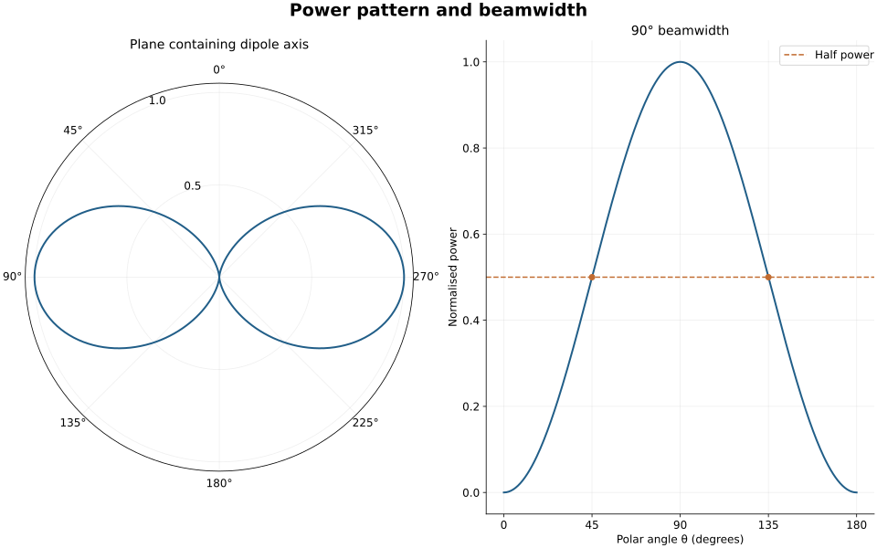

# M18-L2 – Antenna Parameters and Radiation Patterns {#L2}

**Course area:** M18 – Bachelor: Antennas

**Level:** Bachelor · Elective

**Prerequisites:** [M18-L1](M18-L1.md), [M2-L3](M2-L3.md).

**Learning objective:** Integrate a radiation pattern, distinguish gain from directivity and use dBi correctly.

## Direction-Dependent Power Radiation {#S1}

In the far field, the radiation intensity is $U(\theta,\phi)=r^2 S_r$ in W/sr. Integrating over solid angle gives the radiated power:

$$P_\mathrm{rad}=\int_0^{2\pi}\int_0^\pi U(\theta,\phi)\sin\theta\,d\theta\,d\phi.$$

$\theta$ is the polar angle relative to the z-axis, and $\phi$ is the azimuth. The weighting factor $\sin\theta$ must not be omitted, because an angular rectangle near a pole covers less solid angle than one at the equator. For a normalised power pattern $F=U/U_\mathrm{max}$, the beam solid angle is $\Omega_A=\int F\,d\Omega$. The maximum directivity is $D_0=4\pi/\Omega_A$. Directivity is dimensionless; it compares the intensity in a given direction with the spatial average for the same radiated power.

## Gain, Efficiency and Reference Power {#S2}

We distinguish the power accepted at the antenna terminal, $P_a$, from the power actually radiated. With radiation efficiency $\eta=P_\mathrm{rad}/P_a$,

$$G(\theta,\phi)=\eta D(\theta,\phi),\qquad G_\mathrm{dBi}=10\log_{10}G.$$

Realised gain additionally accounts for mismatch at the specified input; this must not be deducted a second time in a link budget. Feed-line losses are accounted for separately unless the reference plane for the data-sheet gain is already upstream of the line. dBi refers to an ideal isotropic radiator. dBd refers to an ideal half-wave dipole in its direction of maximum radiation (approximately 2.15 dBi). A passive system generates no additional energy: its directional gain results from redistribution.

## Reading a Radiation Pattern {#S3}

An electrically short z-oriented dipole has $F(\theta)=\sin^2\theta$. The maximum is at $90^\circ$, with nulls along the axis. A cut in a plane containing the dipole axis forms two opposing lobes; the azimuthal cut at $\theta=90^\circ$ is circular. The three-dimensional pattern is not spherical. The half-power points of a main lobe are at $45^\circ$ and $135^\circ$, giving a half-power beamwidth of 90°. In dB, the half-power points are at approximately −3.01 dB. A field-amplitude ratio of 0.5, by contrast, corresponds to −6.02 dB.

For a directional antenna, sidelobes, nulls and the front-to-back ratio are also relevant. A single half-power beamwidth cannot replace a three-dimensional pattern, and a narrow beam in only one plane does not guarantee high directivity.

## Integration and Numerical Example {#S4}

For the short dipole, analytical integration gives

$$\Omega_A=2\pi\int_0^\pi\sin^3\theta\,d\theta=\frac{8\pi}{3},\qquad D_0=\frac32.$$

The directivity is therefore 1.76 dBi. With $\eta=0.8$, the maximum gain is $1.2$, or 0.79 dBi. If 5 W is accepted, 4 W is radiated and 1 W is dissipated. The maximum radiation intensity is $4\cdot1.5/(4\pi)=0.4775$ W/sr. For a receiver at a distance of 100 m, this gives $47.75\,\mu$W/m² in that direction. In [M18-L5](M18-L5.md), the numerical integration is checked at several resolutions. The efficiency is a chosen model parameter, not a typical measured value for arbitrary short dipoles.

## Exercises with Solutions {#S5}

1. What is 10 dBi as a linear ratio? **Solution:** 10.
2. $D_0=4$, $\eta=0.5$. **Solution:** $G_0=2$, approximately 3.01 dBi.
3. Why is an azimuthal cut of a vertical dipole described as omnidirectional? **Solution:** at a fixed polar angle, it is independent of azimuth; it is not the same in all spatial directions.
4. A pattern has half-power points at 20° and 50°. **Solution:** a half-power beamwidth of 30° in this cut.

## Sources {#S6}

- [IIT Madras – EE6323 Wireless System Design: Antennas](https://www.ee.iitm.ac.in/uday/notes/wsd/antennas.html)
- [IIT Madras – EE7500 Advanced topics in RF & Photonics, Antenna Descriptions and Friis Transmission Relations](https://www.ee.iitm.ac.in/~uday/2026a-EE7500/index.html)
