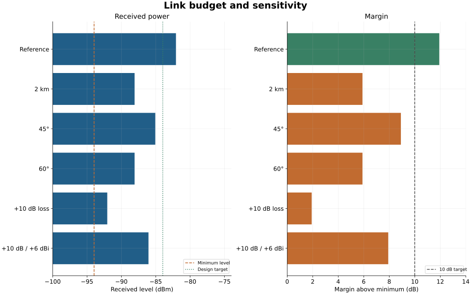

# M18-L5 – Model Case of a Terrestrial Radio Link {#L5}

**Course area:** M18 – Bachelor: Antennas

**Level:** Bachelor · Elective

**Prerequisites:** [M18-L1](M18-L1.md) to [M18-L4](M18-L4.md), [M17-L2](M17-L2.md).

**Learning objective:** Establish a reproducible link budget, examine its limits and justify a conditional selection.

## Problem Statement and Reference Quantities {#S1}

A civilian telemetry link is to operate over an unobstructed 1 km path in the model. The selected parameters are 2.4 GHz, 10 dBm transmitter output power, 1 dB of line/connection loss at each end, 2 dBi transmit gain and 8 dBi receive gain in the beam direction. The gains refer to accepted power; the specified connection losses include all mismatch losses in this case. The antennas are assumed to have a maximum dimension of 0.8 m; the far-field guideline is then approximately 10.25 m. The model specifies no particular hardware, frequency allocation or authorisation.

| Input | Value |
| --- | ---: |
| Equivalent noise bandwidth $B$ | 1 MHz |
| Reference temperature (matched source) | 290 K |
| Receiver noise figure (after receive line) | 5 dB |
| Required SNR at the receiver | 15 dB |
| Additional target margin | 10 dB |

The SNR requirement is an instructional assumption, not a modem threshold derived from M17. The source noise temperature at the receiver input is assumed to be 290 K (including a feed line in thermal equilibrium, if applicable); the noise bandwidth need not equal the occupied RF bandwidth. With $k_B=1.380649\cdot10^{-23}$ J/K, we calculate

$$N_\mathrm{dBm}=10\log_{10}\left(\frac{k_B T B}{1\,\mathrm{mW}}\right)+NF,\quad P_\mathrm{min}=N_\mathrm{dBm}+15\,\mathrm{dB}.$$

The reference noise power is −108.975 dBm, and the minimum level is −93.975 dBm. The target margin requires a level of at least −83.975 dBm. The reference EIRP (equivalent isotropically radiated power) is 11 dBm; this does not establish compliance in a real deployment.

## Implementation and Independent Checks {#S2}

The following calculation uses NumPy for the integration check from M18-L2 and otherwise only the Python standard library. It treats distance, polarisation and additional attenuation separately. The additional loss is freely chosen, not derived from a terrain database. The angles remain below 90°; for exactly orthogonal polarisation, the ideal loss would be infinite. All distances are in metres and frequency is in Hz.

```python
from math import log10, pi, cos, radians, sqrt
import numpy as np
c = 299792458.0
k = 1.380649e-23
f = 2.4e9
lam = c/f
T, B, NF = 290, 1e6, 5
noise = 10*log10(k*T*B/1e-3)+NF
threshold = noise+15

def case(d, angle=0, extra=0, gr=8):
    fspl = 20*log10(4*pi*d/lam)
    pol = -20*log10(abs(cos(radians(angle))))
    rx = 10-1+2-fspl-1+gr-pol-extra
    return fspl, rx, rx-noise, rx-threshold, sqrt(lam*d/4)

cases = [('Referenz',1000,0,0,8),('Doppelte Distanz',2000,0,0,8),
         ('45 Grad',1000,45,0,8),('60 Grad',1000,60,0,8),
         ('Zusatzverlust',1000,0,10,8),('Mehr Richtgewinn',1000,0,10,14)]
print(f'lambda={lam:.6f}, N={noise:.3f}, P_min={threshold:.3f}')
for name,*args in cases:
    print(name, *(f'{x:.3f}' for x in case(*args)))
assert abs(case(2000)[0]-case(1000)[0]-20*log10(2)) < 1e-10
assert abs(case(1000,60)[1]-case(1000)[1]+20*log10(2)) < 1e-10
assert abs(case(1000,0,10,14)[1]-case(1000)[1]+4) < 1e-10
# Integration des normierten Leistungsdiagramms des kurzen Dipols
for n in (1001,2001,4001):
    th = np.linspace(0,pi,n)
    area = 2*pi*np.trapezoid(np.sin(th)**3,th)
    D = 4*pi/area
    assert abs(D-1.5) < 1e-8
    print('Dipol',n,D)
```

The original German output labels correspond to Reference, Double distance, 45 degrees, 60 degrees, Additional loss and Higher directional gain; `Dipol` means dipole.

## Results {#S3}

| Case | FS path loss (dB) | Received power (dBm) | SNR (dB) | Margin (dB) |
| --- | ---: | ---: | ---: | ---: |
| Reference 1 km | 100.05 | −82.05 | 26.92 | 11.92 |
| Double distance | 106.07 | −88.07 | 20.90 | 5.90 |
| Polarisation 45° | 100.05 | −85.06 | 23.91 | 8.91 |
| Polarisation 60° | 100.05 | −88.07 | 20.90 | 5.90 |
| Additional loss 10 dB | 100.05 | −92.05 | 16.92 | 1.92 |
| Additional loss 10 dB, receive gain 14 dBi | 100.05 | −86.05 | 22.92 | 7.92 |



All six cases exceed the modelled minimum power, but only the reference case achieves the required additional 10 dB. Saying that the link works would therefore be imprecise without distinguishing between the threshold and the design target. In the final scenario, the additional 6 dB of gain directly improves the received level by 6 dB; the requirement is nevertheless not met. To restore a margin of at least 10 dB with 10 dB of additional loss, the calculated improvement required relative to the original gain is 8.08 dB. Whether this can be achieved using antennas, lower losses or other system parameters must be investigated separately.

## Sensitivity and Validation {#S4}

Doubling the distance reduces the margin by 6.02 dB, as does a 60° linear polarisation offset in the selected model. The equal numerical values have different causes. From $M(r)=11.923-20\log_{10}(r/1000)$, a maximum distance of approximately 1.25 km is calculated for a 10 dB margin. This is solely the model limit under unchanged assumptions. The Fresnel-zone radii at the path midpoint are 5.59 m at 1 km and 7.90 m at 2 km. Without an elevation profile, shadowing and reflections can neither be confirmed nor ruled out.

The specified directional gains are not measured data. A real investigation would have to record antenna parameters, cable losses, obstacles, noise and interference spectra, and packet error rates under different conditions. Margins cannot be converted into availability percentages without a statistical propagation model. For 1001, 2001 and 4001 sample points, trapezoidal integration gives 1.5 in each case, with an absolute difference of less than $10^{-8}$ from the analytical short-dipole result. This confirms the calculation of the ideal model, not the properties of real antennas.

## Exercises with Solutions {#S5}

1. Halve the noise bandwidth while keeping all other values constant. **Solution:** the noise level decreases by 3.01 dB, so the margin increases by 3.01 dB. The data rate may nevertheless be affected.
2. Which case meets the 10 dB margin? **Solution:** only the reference case without additional impairments, with 11.92 dB.
3. An additional line loss of 2 dB occurs. **Solution:** the reference margin becomes 9.92 dB, narrowly missing the target.
4. Why is the range not reliable without an elevation profile? **Solution:** line of sight, Fresnel clearance, ground reflections and shadowing are not determined by free-space distance alone.

## Sources {#S6}

- [IIT Madras – EE6323 Wireless System Design: Antennas](https://www.ee.iitm.ac.in/uday/notes/wsd/antennas.html)
- [IIT Madras – EE7500 Advanced topics in RF & Photonics, Antenna Descriptions and Friis Transmission Relations](https://www.ee.iitm.ac.in/~uday/2026a-EE7500/index.html)
- [ITU-R P.525-5 – Calculation of free-space attenuation (11/2024)](https://www.itu.int/rec/R-REC-P.525-5-202411-I/en)
