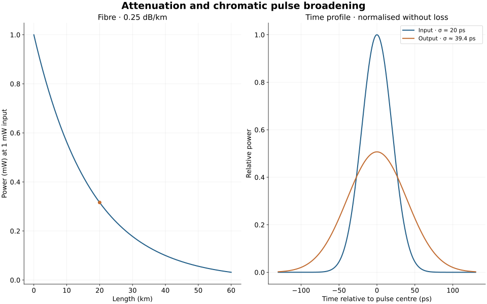

# M19-L4 – Modulation, Fibre Attenuation and Dispersion {#L4}

**Course area:** M19 – Bachelor: Fundamentals of Photonics

**Level:** Bachelor · Elective

**Prerequisites:** [M17-L2](M17-L2.md), [M19-L2](M19-L2.md), [M19-L3](M19-L3.md).

**Learning objective:** Model optical attenuation and temporal signal distortion separately.

## Information on an Optical Carrier {#S1}

Optical data links can modulate the amplitude, phase, frequency or polarisation of the field. In intensity modulation with direct detection (IM/DD), the optical power itself carries the signal, as in binary on-off keying (OOK). A simple receiver uses a photodiode, amplifier and decision circuit. Without an additional reference, it does not directly measure the optical carrier phase. Coherent receivers mix the signal with a local optical oscillator and can use the field quadratures. Wavelength-division multiplexing transmits several optical channels simultaneously; filters separate them at the receiver.

## Attenuation as a Power Budget {#S2}

For constant attenuation per unit length, the decrease in power is described exponentially:

$$P(L)=P(0)\,10^{-\alpha_\mathrm{dB}L/10}.$$

Here $\alpha_\mathrm{dB}$ is in dB/km and L in km. Optical power in dBm is $P_\mathrm{dBm}=10\log_{10}(P/1\,\mathrm{mW})$. Halving the power corresponds to approximately −3.01 dB; 0 dBm denotes a power level, not the absence of loss. Connector, splice, coupler and fibre losses add in dB if back-reflection and coherent multipath propagation can be neglected. Contaminated connector faces, macrobending and microbending may cause additional losses. Absorption and scattering contribute to intrinsic fibre attenuation.

## Group Delay and Dispersion {#S3}

In the narrowband linear model, the group velocity $v_g=(d\beta/d\omega)^{-1}$ describes the motion of a pulse envelope. The group delay is $\tau_g=L/v_g$. Since $v_g$ depends on frequency, the spectral components of a pulse arrive at different times. Using the chromatic dispersion parameter $D=(1/L)\,d\tau_g/d\lambda$, the first-order RMS delay spread is

$$\sigma_\tau\approx |D|L\sigma_\lambda.$$

D is often expressed in ps/(nm·km). This delay spread is not generally equal to the total output pulse duration. For a suitable uncorrelated Gaussian model without significant initial correlation (chirp), one can use the approximation $\sigma_\mathrm{out}=\sqrt{\sigma_\mathrm{in}^2+\sigma_\tau^2}$. With chirp, the pulse may initially compress; at high bandwidth, higher-order terms and the complex field model must be considered. Multimode fibres also exhibit modal delay differences; polarisation can likewise produce different group delays.

{alt="Received power versus fibre length and schematic Gaussian pulses before and after dispersion."}

## Worked Example and Model Limitations {#S4}

A 20-km fibre with 0.25 dB/km loses 5 dB. Of 1 mW at the fibre input, 0.316 mW remains in the absence of additional losses. With $D=17$ ps/(nm·km) and $\sigma_\lambda=0.1$ nm, the delay spread is 34 ps. For an input RMS pulse duration of 20 ps, the uncorrelated model above gives approximately 39.4 ps at the output. At 10 Gbit/s, the bit period is 100 ps. Overlapping pulses can produce intersymbol interference. The same attenuation can therefore lead to different transmission quality at different data rates. A calculation limited to delay spread does not replace an eye-diagram or BER measurement.

## Exercises with Solutions {#S5}

1. Connector loss of 4 dB and fibre loss of 6 dB: **Solution:** 10 dB in total; 10% of the input power remains.
2. 0.2 dB/km over 50 km: **Solution:** 10 dB.
3. D doubles and the spectral width is halved. **Solution:** The linear delay spread remains unchanged.
4. What is the bit period at 2.5 Gbit/s? **Solution:** 400 ps.

## Sources {#S6}

- [The Fiber Optic Association – Optical Fiber for Outside Plant Networks](https://www.thefoa.org/tech/ref/OSP/fiber.html)
- [The Fiber Optic Association – Fiber Optic Data Links](https://www.thefoa.org/tech/ref/appln/datalink.html)
- [MIT OpenCourseWare – Fundamentals of Photonics: Quantum Electronics, Lecture Notes](https://www.ocw.mit.edu/courses/6-974-fundamentals-of-photonics-quantum-electronics-spring-2006/pages/lecture-notes/)
