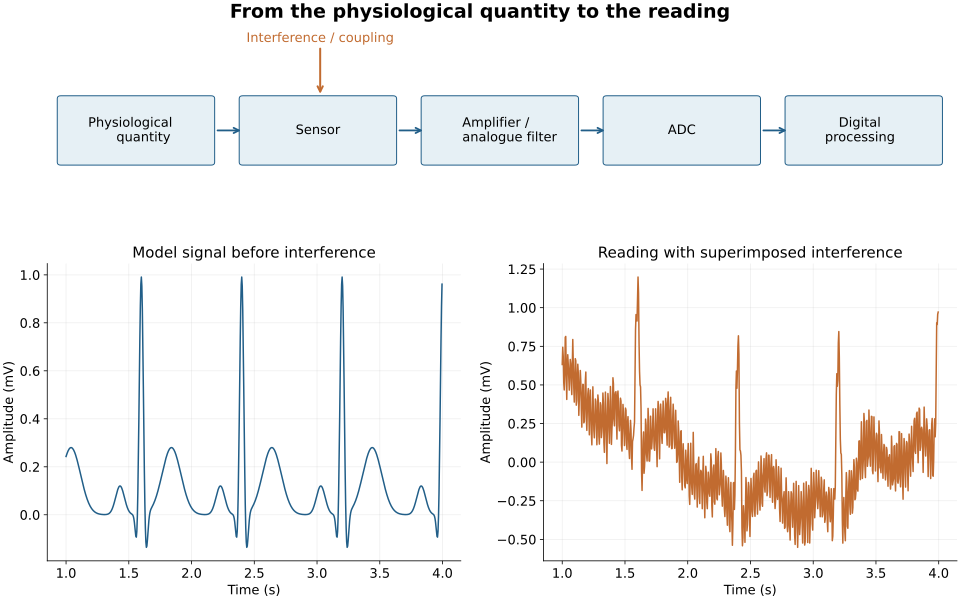

# M20-L1 – From the Medical Question to the Measurand {#L1}

**Course area:** M20 – Bachelor: Biomedical Measurement Technology

**Level:** Bachelor · Elective

**Prerequisites:** [M6-L1](M6-L1.md), [M16-L1](M16-L1.md).

**Learning objective:** Distinguish the physiological target quantity, the quantity that can actually be measured and the technical measurement requirement.

## Measurement Task and Physiological Origin {#S1}

A medical question is not yet an electrical measurement task. For example, to study the temporal sequence of cardiac activity, an electrocardiogram (ECG) can record electrical potential differences on the body surface. An optical pulse sensor, by contrast, records changes in local tissue perfusion. Both signals may be periodic, but they measure different processes with different delays. A reading from a single channel neither represents the entire organ directly nor constitutes a diagnosis on its own.

| Target quantity or process | Measurand | Possible interference |
| --- | --- | --- |
| Electrical cardiac activity | Potential difference (mV) | Electrode movement, muscle activity |
| Peripheral pulse wave | Modulation of optical power | Movement, ambient light |
| Pressure | Force per unit area (Pa) | Zero drift, height difference |
| Movement | Acceleration (m/s²) | Orientation, gravity |

## Measurement Chain and Identifiability {#S2}

A simplified linear model is

$$y(t)=g\,(h*x)(t)+b+n(t)+a(t).$$

$x$ is the target measurand, $h$ the sensor impulse response, $g$ the scaling factor, $b$ the offset, $n$ random noise and $a$ a non-stationary artefact. The convolution describes the temporal dynamics. With a slow sensor, a rapid change in the target quantity may appear attenuated. Movement may even make $g$ time-dependent; the purely additive interference model is then insufficient.

The inference from $y$ back to $x$ is only unambiguous if the mapping preserves sufficient information. If $H(f)$ has a zero at a particular frequency, that component cannot be recovered by linear inversion. Two physiological processes that produce the same observable pattern may also be indistinguishable without additional information.

{alt="Measurement chain with sensor, amplification, digitisation and processing, together with superimposed interference."}

## Requirements and Uncertainty {#S3}

The measurement requirement is described by the measurement range, bandwidth, temporal resolution, permissible errors and operating conditions. To record a signal with relevant components up to 35 Hz, the sampling rate must exceed 70 Hz; a real analogue low-pass filter also needs a transition band. Choosing 250 Hz is one possible teaching example, not a universally applicable medical standard. ADC sampling every 4 ms limits temporal resolution when simply searching for maxima; interpolation can provide sub-sample estimates but cannot reconstruct lost data.

Independent standard uncertainties are approximately combined in quadrature. For $x=(y-b)/g$, assuming independent input quantities,

$$u_x^2\approx\frac{u_y^2+u_b^2}{g^2}+\frac{(y-b)^2}{g^4}u_g^2.$$

Unknown systematic artefacts are not automatically covered by this uncertainty. A quality flag or rejection of a segment may therefore be technically preferable to an apparently precise numerical result.

## Worked Example and Limits of the Exercises {#S4}

A synthetic sensor delivers $y=0.84$ V with an offset of $b=0.04$ V and sensitivity $g=0.40$ V/mV. Thus $x=2.0$ mV. For $u_y=0.012$ V, $u_b=0.008$ V and $u_g=0.010$ V/mV, the result is $u_x\approx0.062$ mV. The result describes the assumed calibration model; an undetected motion artefact can cause a substantially larger error.

All exercises in this module use synthetic signals or data from suitable published archives. Do not connect any self-built circuit to a person. Patient protection, electrical isolation, risk management and clinical validation are separate tasks that the teaching model does not cover. Even battery-powered devices may have additional current paths through data cables.

## Exercises with Solutions {#S5}

1. What distinguishes ECG and PPG? **Solution:** Electrical potential difference versus optically detected volume change; their timing markers are not identical.
2. A channel has $g=0.5$ V/mV, $b=0.1$ V and $y=0.85$ V. **Solution:** 1.5 mV.
3. Two independent error contributions have standard uncertainties of 3 and 4 units. **Solution:** 5 units, not 7; independence is essential.
4. Why can a stronger amplifier not recover a feature outside the sensor bandwidth? **Solution:** The feature is missing or has already been attenuated too strongly relative to interference.

## Sources {#S6}

- [Stony Brook University – BME 313: Bioinstrumentation](https://you.stonybrook.edu/milab/courses/bme-313-bioinstrumentation/)
- [MIT OpenCourseWare – Biomedical Signal and Image Processing](https://ocw.mit.edu/courses/hst-582j-biomedical-signal-and-image-processing-spring-2007/)
- [Park et al. – Photoplethysmogram Analysis and Applications: An Integrative Review (2022)](https://doi.org/10.3389/fphys.2021.808451)
