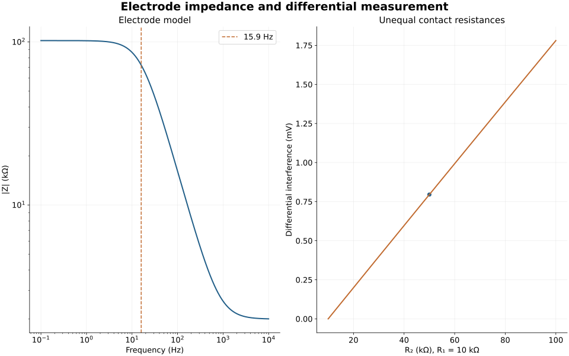

# M20-L2 – Bioelectrical Signals and Electrode Models {#L2}

**Course area:** M20 – Bachelor: Biomedical Measurement Technology

**Level:** Bachelor · Elective

**Prerequisites:** [M1-L6](M1-L6.md), [M3-L4](M3-L4.md), [M20-L1](M20-L1.md).

**Learning objective:** Calculate electrode impedance, common-mode rejection and errors caused by unequal contacts.

## Bioelectrical Potentials {#S1}

Ion transport across cell membranes is one cause of time-dependent electrical potentials. An ECG does not measure the voltage within an individual cell, but the potential differences between electrodes arising from distributed bioelectrical sources. Position, orientation, spatial conductivity and lead configuration affect the measured waveform. The P wave, QRS complex and T wave in a surface ECG provide a temporal description of electrical cardiac activity; mechanical activity follows with dynamics of its own.

The synthetic signal used in M20-L5 combines individual bell-shaped pulses. It imitates only selected waveform features, not the physics of cardiac muscle or a clinical lead system.

## Electrical Equivalent Circuit {#S2}

In the small-signal regime, the electrode–electrolyte interface can be described by an offset source $E$ and an impedance consisting of a series resistance $R_s$ and a parallel resistance $R_p$ and capacitance $C_p$:

$$Z_e(j\omega)=R_s+\frac{R_p}{1+j\omega R_p C_p}.$$

This teaching model accounts neither for all electrochemical processes nor for the nonlinearity and temporal variation of real contacts. At DC, the impedance is $R_s+R_p$; at very high frequencies, it approaches $R_s$. For $R_s=2$ kΩ, $R_p=100$ kΩ and $C_p=100$ nF, the time constant is 10 ms and the characteristic frequency is 15.9 Hz. The voltage at the amplifier input also depends on its input impedance $Z_i$: $V_i=V_q Z_i/(Z_i+Z_e)$.

## Differential Measurement and Common Mode {#S3}

For two input potentials, $v_d=v_+-v_-$ and $v_c=(v_++v_-)/2$. With differential gain $A_d$ and common-mode gain $A_c$, it follows that

$$v_o=A_d v_d+A_c v_c,\qquad \mathrm{CMRR}=20\log_{10}|A_d/A_c|.$$

At 100 dB CMRR and a common-mode voltage of 0.2 V, the equivalent input-referred differential error is 2 µV. This applies to the amplifier alone at the frequency under consideration. Unequal contact impedances convert part of the common-mode signal into a differential voltage even before subtraction. In the purely resistive model with two equal input impedances $R_i$ and contact resistances $R_1,R_2$,

$$v_{d,c}=v_c\left(\frac{R_i}{R_i+R_1}-\frac{R_i}{R_i+R_2}\right).$$

{alt="Magnitude of a complex electrode impedance and modelled common-mode conversion caused by unequal contact resistances."}

## Worked Example and Artefacts {#S4}

For $R_i=10$ MΩ, $R_1=10$ kΩ, $R_2=50$ kΩ and $v_c=0.2$ V, the result is $v_{d,c}\approx0.795$ mV. The error can therefore be of the same order of magnitude as an educational ECG signal, even though the amplifier itself has a high CMRR. The simple calculation assumes an ideal common source relative to the modelled reference. Real capacitive coupling, return paths, input filters and protection circuits alter the result.

Contact movement can change the interface potentials and impedances. Muscle activity is another electrical source, not merely electronic noise. Both types of interference may share spectral components with the desired signal. Separation cannot then be achieved by a cutoff frequency alone. PhysioNet documents empirically recorded interference signals for this purpose; it is cited here as a further resource, not as the data used in the simulation.

## Exercises with Solutions {#S5}

1. Determine $Z_e$ at zero frequency in the example above. **Solution:** 102 kΩ.
2. What is the effect of a very large $Z_i$? **Solution:** Reduced loading of the source; other sources of error remain possible.
3. Calculate the input-referred common-mode error for 80 dB and 0.1 V. **Solution:** 10 µV.
4. Set both contact resistances equal. **Solution:** The differential error caused by common-mode conversion in the voltage-divider model becomes zero; the finite CMRR remains.

## Sources {#S6}

- [Stony Brook University – BME 313: Bioinstrumentation](https://you.stonybrook.edu/milab/courses/bme-313-bioinstrumentation/)
- [MIT OpenCourseWare – Biomedical Signal and Image Processing](https://ocw.mit.edu/courses/hst-582j-biomedical-signal-and-image-processing-spring-2007/)
- [PhysioNet – MIT-BIH Noise Stress Test Database v1.0.0](https://physionet.org/content/nstdb/1.0.0/)
