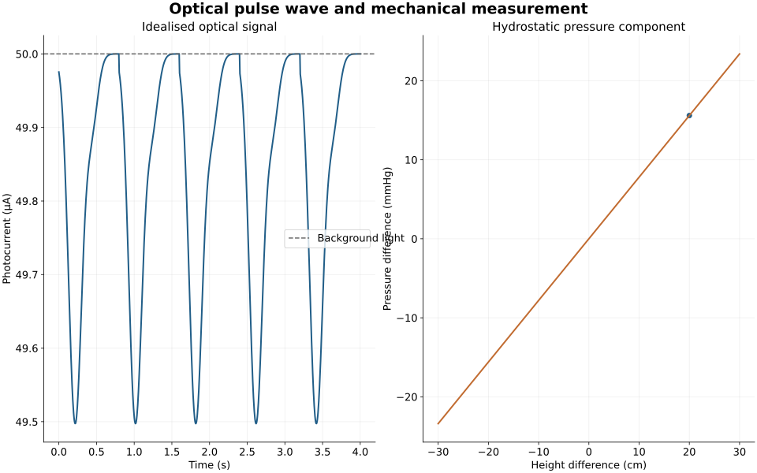

# M20-L3 – Optical and Mechanical Measurement Principles {#L3}

**Course area:** M20 – Bachelor: Biomedical Measurement Technology

**Level:** Bachelor · Elective

**Prerequisites:** [M16-L2](M16-L2.md), [M19-L3](M19-L3.md), [M20-L1](M20-L1.md).

**Learning objective:** Interpret optical pulse modulation and mechanical sensor characteristics quantitatively.

## Photoplethysmography {#S1}

In photoplethysmography (PPG), a light source illuminates tissue and a photodiode measures transmitted or backscattered light. The signal contains a slowly varying background (DC) and a pulsatile component (AC). The sign of the latter depends, among other things, on the optical arrangement and electrical signal definition. Pronounced movement, changes in contact force and ambient light may affect the measured signal.

For an idealised homogeneous medium, $P=P_0\exp(-\mu l)$ applies. For small changes $\Delta l$ in the effective path length,

$$\frac{\Delta P}{P}\approx-\mu\Delta l.$$

In scattering tissue, $l$ is not a simple geometric thickness but, at best, an effective model parameter. An example with $\mu=1$ cm$^{-1}$ and $\Delta l=0{.}01$ cm yields a relative change of approximately -1%. A high background optical power therefore does not automatically imply high pulsatile signal quality.

## Two Wavelengths and Pulse Features {#S2}

Pulse oximetry exploits the wavelength-dependent absorption properties of oxygenated and deoxygenated haemoglobin. A widely used intermediate quantity is the ratio of the normalised pulsatile components at two wavelengths:

$$R=\frac{AC_{rot}/DC_{rot}}{AC_{infrarot}/DC_{infrarot}}.$$

The original subscripts rot and infrarot denote red and infrared, respectively. Converting $R$ into a saturation value requires suitable device-specific calibration. This conversion cannot be performed using an arbitrary single PPG channel. If the normalised components are 0.006 and 0.010, then $R=0{.}6$; deliberately, no saturation value is derived here. The time between pulse maxima also provides an estimate of the pulse period. Due to mechanical delay and pulse propagation, ECG and PPG have different time markers; changes in the time offset cannot be uniquely attributed to blood pressure without further modelling.

## Pressure and Motion {#S3}

A pressure sensor converts force per unit area into an electrical quantity. For an ideally linearly calibrated measurement bridge, $v=g_p p+b$ may serve as a model. Pressure is a local scalar quantity. A liquid column of constant density $\rho$ produces an additional hydrostatic pressure

$$\Delta p=\rho g\Delta h.$$

An accelerometer, by contrast, measures specific force along its axes, in a simplified model $\mathbf f=\mathbf a-\mathbf g$. A stationary sensor therefore generally does not produce a zero signal. Orientation and dynamic acceleration cannot be uniquely separated from a single instantaneous acceleration value. Sensor fusion may help; fundamentals of coordinate systems and signal estimation are covered in [M13-L3](M13-L3.md) and [M16-L4](M16-L4.md).

{alt="Synthetic optical pulse modulation and hydrostatic pressure error as a function of height."}

## Worked Example and Limitations {#S4}

For a liquid with $\rho=1060$ kg/m³ and a height difference of 20 cm, the pressure difference is approximately 2080 Pa or 15.6 mmHg (1 mmHg corresponds to approximately 133.322 Pa). The sign depends on which measurement point is higher. This calculation illustrates the order of magnitude of a hydrostatic effect; it simulates neither vascular circulation nor a specific blood pressure instrument.

If the mean photodiode current is 50 µA and the pulsatile peak amplitude is 0.5 µA, the normalised AC/DC ratio is 1%. A change in ambient light that introduces 1 µA within the signal band can exceed the pulsatile component. Shielding, time-controlled illumination and quality indicators address different causes; a low-pass filter alone does not solve this problem.

## Exercises with Solutions {#S5}

1. The pulse maxima are 0.75 s apart. **Solution:** 80 pulses/min as a periodic model estimate.
2. The two AC/DC values are 0.008 and 0.016. **Solution:** $R=0{.}5$; no device-independent saturation value can be derived.
3. What pressure difference results from a height difference of 10 cm and a density of 1000 kg/m³? **Solution:** 981 Pa or approximately 7.36 mmHg.
4. Can an accelerometer alone reliably remove all motion artefacts from a PPG signal? **Solution:** No; local mechanical and optical changes may be independent or nonlinearly coupled.

## Sources {#S6}

- [Park et al. – Photoplethysmogram Analysis and Applications: An Integrative Review (2022)](https://doi.org/10.3389/fphys.2021.808451)
- [Stony Brook University – BME 313: Bioinstrumentation](https://you.stonybrook.edu/milab/courses/bme-313-bioinstrumentation/)
