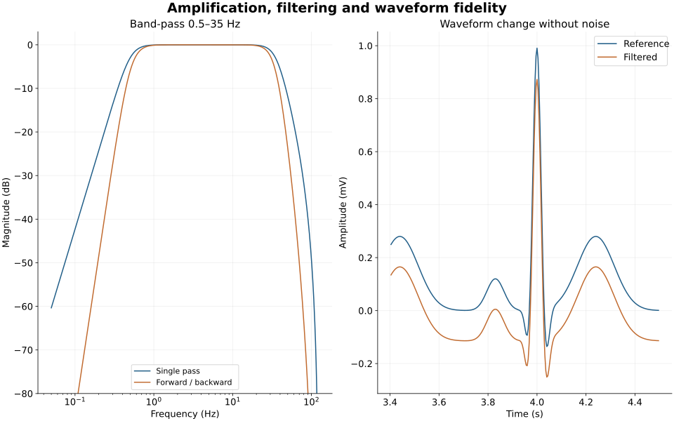

# M20-L4 – Measurement Amplification, Filtering and Feature Extraction {#L4}

**Course area:** M20 – Bachelor: Biomedical Measurement Technology

**Level:** Bachelor · Elective

**Prerequisites:** [M3-L4](M3-L4.md), [M5-L3](M5-L3.md), [M20-L2](M20-L2.md).

**Learning objective:** Size amplification and quantisation appropriately, and assess the benefits and distortion introduced by filters.

## Dynamic Range and Gain {#S1}

A measurement chain must resolve small desired signals without clipping due to offsets or interference. For an ideal bipolar ADC with a range of $\pm U$ and $N$ bits, the step size is

$$q=\frac{2U}{2^N},\qquad q_\mathrm{in}=\frac{q}{A_d}.$$

With $U=1{.}65$ V, $N=12$ and $A_d=200$, the step size is 0.806 mV at the ADC and approximately 4.03 µV referred to the input. A 1 mV pulse produces 0.2 V at the ADC. An additional 10 mV offset, however, would already produce 2 V at the same gain and cause clipping. The position of the offset correction and the available headroom are therefore important. An ideally uniformly distributed quantisation error has $u_q=q/\sqrt{12}$; this assumption does not apply without qualification to slow or deterministic signals.

## Filters and Temporal Resolution {#S2}

An analogue anti-aliasing filter must act before sampling. At $f_s=250$ Hz, an insufficiently attenuated 230 Hz component appears as 20 Hz after sampling. A digital filter can no longer distinguish it by its original frequency. High-pass, low-pass and band-stop filters address different interference components. For a simplified RC low-pass filter,

$$|H(j2\pi f)|=\frac{1}{\sqrt{1+(f/f_c)^2}}.$$

At $f=f_c$, the magnitude decreases to $1/\sqrt2$. A causal filter also changes the phase; frequency-dependent group delay affects time markers. Offline, filtering may be performed in both forward and backward directions. With real filter coefficients, this yields an effective magnitude of $|H|^2$ and zero phase for an idealised infinitely long signal. Transients occur at the boundaries; the method requires future samples and cannot be used as an immediate real-time filter.

{alt="Frequency response of a teaching filter and changes in a synthetic ECG segment caused by filtering."}

## Features, Quality Indicators and Evaluation {#S3}

A simple peak detection method combines a minimum height, prominence and minimum separation. Prominence describes the elevation above the surrounding signal level. Minimum separation prevents multiple detections within a short time but may also suppress genuine events that are close together. Two detected time markers yield the instantaneous event rate $r=60/(t_2-t_1)$ in min$^{-1}$, if time is measured in seconds.

A measurable evaluation requires independently annotated reference events and a specified tolerance. With one-to-one matching, correctly detected events are true positives (TP), incorrectly detected events are false positives (FP), and missed events are false negatives (FN). The following applies:

$$\mathrm{Sensitivity}=\frac{TP}{TP+FN},\qquad \mathrm{Precision}=\frac{TP}{TP+FP}.$$

Both quantities are undefined if their denominators are zero. High sensitivity can coexist with many falsely detected pulses. Timing errors, amplitude distortion, the proportion of rejected signal segments and the conditions under which reference data are collected also matter. Metrics for synthetic pulses must not be generalised as evidence of clinical performance.

## Worked Example {#S4}

With 24 reference pulses and 29 detections, 24 of which are correctly matched, sensitivity is 100%, but precision is $24/29\approx82{.}8$%. A filter can reduce the number of false detections while changing the pulse shape. A narrower bandwidth is therefore an improvement only if it does not distort the target quantities beyond acceptable limits. In [M20-L5](M20-L5.md), these effects are measured separately using known reference signals.

## Exercises with Solutions {#S5}

1. What input-referred quantisation step results from doubling the gain to 400? **Solution:** Approximately 2.01 µV; the undistorted input range is halved.
2. What alias frequency results from a 260 Hz component at a sampling rate of 250 Hz? **Solution:** 10 Hz.
3. There are 20 reference events, 18 true positives and 3 false positives. **Solution:** Sensitivity 90%, precision 85.7%.
4. Why can the forward-backward filtered waveform not directly represent a real-time detector? **Solution:** It uses future signal samples.

## Sources {#S6}

- [MIT OpenCourseWare – Biomedical Signal and Image Processing](https://ocw.mit.edu/courses/hst-582j-biomedical-signal-and-image-processing-spring-2007/)
- [PhysioNet – MIT-BIH Noise Stress Test Database v1.0.0](https://physionet.org/content/nstdb/1.0.0/)
- [Stony Brook University – BME 313: Bioinstrumentation](https://you.stonybrook.edu/milab/courses/bme-313-bioinstrumentation/)
