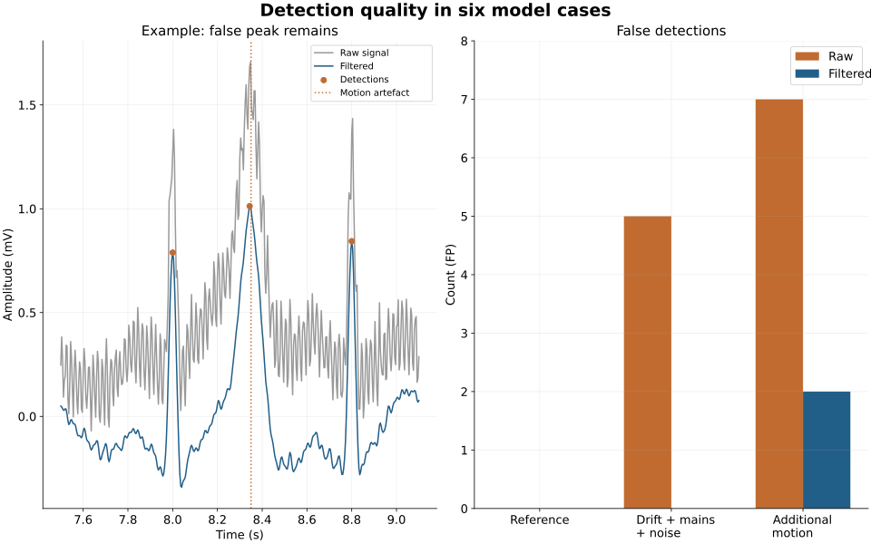

# M20-L5 – Case Study: Biosignal Measurement Chain {#L5}

**Course area:** M20 – Bachelor: Biomedical Measurement Technology

**Level:** Bachelor · Elective

**Prerequisites:** [M20-L1](M20-L1.md) to [M20-L4](M20-L4.md).

**Learning objective:** Evaluate a synthetic biosignal chain reproducibly and distinguish signal quality from detection quality.

## Experimental Setup and Reference {#S1}

A 20 s ECG-like test signal sampled at 250 Hz (5000 samples) is investigated. It contains 24 known reference maxima separated by 0.8 s, corresponding to a constant model rate of 75/min. Idealised Gaussian pulses are added around each time $r_k$:

$$s(t)=\sum_k\sum_i A_i\exp\left[-\frac{(t-r_k-\delta_i)^2}{2\sigma_i^2}\right].$$

| Component | $A_i$ (mV) | $\delta_i$ (s) | $\sigma_i$ (s) |
| --- | ---: | ---: | ---: |
| P-like | 0.12 | -0.170 | 0.035 |
| Q-like | -0.15 | -0.035 | 0.012 |
| R-like | 1.00 | 0 | 0.016 |
| S-like | -0.20 | 0.035 | 0.014 |
| T-like | 0.28 | 0.240 | 0.075 |

The reference markers are the constructed centres of the R-like pulses, not clinically annotated cardiac events. The model waveforms, interference amplitudes and thresholds were selected for demonstration purposes. Three signal variants are compared: the reference; the reference with drift (0.27 Hz, 0.35 mV), 50 Hz interference (0.16 mV) and white noise (standard deviation 0.045 mV); and the same mixture with three additional local motion artefact pulses. The same noise realisation is used in both disturbed cases to reveal the effect of the additional interference.

## Reproducible Evaluation {#S2}

Each variant is evaluated both unfiltered and using a digital Butterworth band-pass filter (prototype order 3, 0.5–35 Hz, forward-backward processing). A height of 0.45 mV, prominence of 0.35 mV, minimum separation of 0.3 s and matching tolerance of 60 ms are identical for all cases. Each detection may be matched to only one reference event. Because the tolerance windows are disjoint, the matching method used is unambiguous with respect to the number of true positives. The root-mean-square error (RMSE) measures deviation from the unfiltered reference signal, while timing RMSE considers only matched pulses. A filter may therefore affect these two quantities differently.

The following Python programme requires NumPy and SciPy and uses a fixed random seed. All signal values are modelled in mV; no measurement files are read. The original output labels Referenz, Drift + Netz + Rauschen and Zusätzlich Bewegung correspond to Reference, Drift + mains interference + noise and Additional motion. False and True indicate unfiltered and filtered processing, respectively.

```python
import numpy as np
from scipy.signal import butter, sosfiltfilt, find_peaks
fs=250; t=np.arange(0,20,1/fs); truth=np.arange(0.8,19.6,0.8)
def gauss(c,w): return np.exp(-0.5*((t-c)/w)**2)
s=sum(.12*gauss(r-.17,.035)-.15*gauss(r-.035,.012)+gauss(r,.016)-.2*gauss(r+.035,.014)+.28*gauss(r+.24,.075) for r in truth)
rng=np.random.default_rng(2026); noise=.045*rng.standard_normal(t.size)
base=.35*np.sin(2*np.pi*.27*t); mains=.16*np.sin(2*np.pi*50*t)
motion=1.1*gauss(8.35,.045)+1.4*gauss(12.35,.025)-.7*gauss(12.48,.07)
sos=butter(3,[.5,35],btype='bandpass',fs=fs,output='sos')
def evaluate(x,filtered):
    y=sosfiltfilt(sos,x) if filtered else x
    p,_=find_peaks(y,height=.45,distance=round(.3*fs),prominence=.35)
    unmatched=list(p/fs); errors=[]
    for r in truth:
        if unmatched:
            k=int(np.argmin(np.abs(np.array(unmatched)-r)))
            if abs(unmatched[k]-r)<=.06: errors.append(unmatched.pop(k)-r)
    tp=len(errors); fp=len(unmatched); fn=len(truth)-tp
    rmse=np.sqrt(np.mean((y-s)**2)); timing=np.sqrt(np.mean(np.square(errors)))*1000 if errors else float('nan')
    assert tp+fn==len(truth) and tp+fp==len(p)
    return y,p,tp,fp,fn,rmse,timing
cases={'Referenz':s,'Drift + Netz + Rauschen':s+base+mains+noise,'Zusätzlich Bewegung':s+base+mains+noise+motion}
if __name__=='__main__':
    for name,x in cases.items():
        for f in [False,True]:
            y,p,tp,fp,fn,rmse,timing=evaluate(x,f)
            print(name,f,tp,fp,fn,f'{rmse:.4f}',f'{timing:.2f}')
```

## Results {#S3}

| Scenario | Filter | TP | FP | FN | RMSE (mV) | Timing RMSE (ms) |
| --- | --- | ---: | ---: | ---: | ---: | ---: |
| Reference | no | 24 | 0 | 0 | 0.0000 | 0.00 |
| Reference | yes | 24 | 0 | 0 | 0.1119 | 0.00 |
| Drift + mains interference + noise | no | 24 | 5 | 0 | 0.2774 | 3.92 |
| Drift + mains interference + noise | yes | 24 | 0 | 0 | 0.1157 | 0.00 |
| Additional motion | no | 24 | 7 | 0 | 0.3031 | 3.92 |
| Additional motion | yes | 24 | 2 | 0 | 0.1529 | 0.00 |

{alt="Synthetic signal with a motion artefact and number of falsely detected pulses before and after filtering."}

Filtering reduces low-frequency baseline variation and higher-frequency interference. In the motion case, however, two falsely detected events remain: precision increases from $24/31\approx77{.}4$% to $24/26\approx92{.}3$%, not to 100%. Even the clean signal has an RMSE of 0.1119 mV after filtering. In the clean case the detection time markers are preserved on the sampling grid, but the waveform changes. A timing RMSE of zero means only that the discrete time markers coincide within the constructed reference used here, not that temporal accuracy is infinite.

## Validation and Transferability {#S4}

The exactly known model events allow the matching procedure and error counts to be checked. In every case, $TP+FN=24$ must hold; furthermore, $TP+FP$ equals the number of detections. This is a test of the evaluation logic, not an independent validation of real measurements. The simulated periodic waveform and relatively low variability favour detection. Isolated artefacts outside the reference windows are easier to assess here than interference overlapping the desired pulses.

A useful extension would vary pulse intervals, widths and amplitudes, increase drift or motion and use several independent random sequences. Suitably annotated public ECG datasets and the MIT-BIH Noise Stress Test Database may be used to evaluate performance on real data. Detector parameters must not be optimised on the same test material and then described as independently validated. A real-time implementation must additionally document causality, latency and rejected segments. This lesson is not intended for clinical use or personal medical assessment.

## Exercises with Solutions {#S5}

1. What is the precision for the unfiltered case with drift, mains interference and noise? **Solution:** 24/29 = 82.76%.
2. Why does the filtered reference exhibit a non-zero signal deviation? **Solution:** The filter also changes spectral components of the desired signal, even though no noise is present.
3. What is the sampling interval? **Solution:** 4 ms; timing error is evaluated on this grid.
4. Increase the artefact amplitude in the code or shift an artefact pulse onto a reference pulse. **Solution guidance:** Performance then depends on the local superposition and detection threshold. Compare TP, FP, FN and RMSE separately; a small timing RMSE does not rule out missed events.
5. Why does 100% sensitivity not constitute clinical evidence? **Solution:** Only one uniform synthetic signal type and a few interference variants were tested, not the diversity of real data and operating conditions.

## Sources {#S6}

- [MIT OpenCourseWare – Biomedical Signal and Image Processing](https://ocw.mit.edu/courses/hst-582j-biomedical-signal-and-image-processing-spring-2007/) · Thematic relevance to lesson: S2: Reproducible Evaluation (overview/metadata page) · Last accessed: 2026-11-22
- [PhysioNet – MIT-BIH Noise Stress Test Database v1.0.0](https://physionet.org/content/nstdb/1.0.0/) · Thematic relevance to lesson: S1: Experimental Setup and Reference · Last accessed: 2026-11-22
