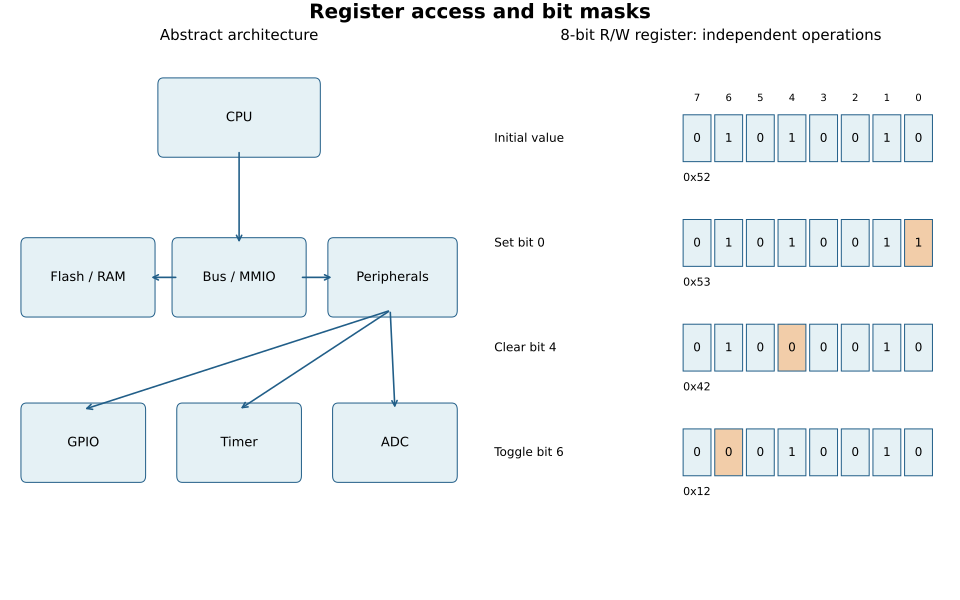

# M24-L1 – Microcontrollers and C: Registers, Bit Masks and Peripheral Interfaces {#L1}

**Course area:** M24 – Bachelor–Master Bridge: Transition to Embedded Systems

**Level:** Bachelor · Bachelor–Master Bridge

**Prerequisites:** [M15-L1](M15-L1.md), [M23-L3](M23-L3.md), basic C programming.

**Learning objective:** Formulate register operations correctly and recognise their limitations with real peripherals.

## Diagnostic self-test {#S1}

1. What distinguishes a microcontroller from a standalone logic device? 2. What is the difference between a register as a hardware state and a C variable in RAM? 3. Why cannot an individual status bit always be cleared by an ordinary write?

**Answers:** 1. CPU, memory and peripherals are integrated. 2. A peripheral access can trigger hardware actions in addition to accessing the stored value. 3. The semantics depend on the data sheet; for example, with write-one-to-clear, writing a one clears an event bit.

## Address space and peripherals {#S2}

A microcontroller combines a processor core, memory, clock sources and interfaces. The CPU addresses memory and peripheral registers via a bus. Memory-mapped I/O (MMIO) allows device registers to be accessed through designated addresses. Address decoding selects hardware: a read can remove a FIFO entry; a write can start a timer. A register is therefore not necessarily an ordinary memory cell.

Typical functional blocks:

| Block | Function | Verifiable property |
| --- | --- | --- |
| GPIO | Digital input/output | Levels, direction, pin assignment |
| ADC | Analogue-to-digital conversion | Reference, resolution, conversion time |
| Timer | Time base, trigger | Prescaler, counting range, period |
| SPI / I²C | Communication | Clock, protocol, electrical constraints |
| DMA | Transfer without CPU copying each word | Memory boundaries, coherency, completion event |

The abstract registers in this lesson have **no real addresses**. Register fields, reset values and side effects must be obtained from the reference manual of the target device. CMSIS illustrates how a specific processor core can be accessed through structured register definitions.

{alt="Abstract microcontroller data path and three bit operations on an example 8-bit register."}

## Derivation of bit operations {#S3}

An unsigned word $r$ with $w$ bits can be written as $r=\sum_{i=0}^{w-1}b_i2^i$. The mask for bit $k$ is $m=2^k$. OR sets a selected bit; AND with the inverted mask clears it; XOR toggles it. AND with the original mask isolates the bit. For a field of width $n$ starting at bit $k$, provided $n<w$ and $k+n\le w$, the mask is $m=(2^n-1)2^k$; the replacement is

$$r_{\mathrm{neu}}=(r\ \&\ \sim m)\ |\ ((v\ll k)\ \&\ m).$$

The original subscript neu denotes the new value. This notation denotes bitwise AND, complement, OR and left shift. First check the field value $v$ against $0\le v<2^n$ if an oversized value is to be treated as an error.

**Example:** An ordinary 8-bit R/W register contains `0x52` (`01010010`). Setting bit 0 gives `0x53`; clearing bit 4 of the original value gives `0x42`; toggling bit 6 gives `0x12`. Setting field [3:2] to 3 gives `0x5E`. Each operation is calculated independently from the original value.

## C and safe access {#S4}

The following host example models only an R/W register; no hardware is addressed.

```c
#include <stdint.h>
#include <assert.h>
int main(void) {
    uint8_t r = 0x52u;
    assert((uint8_t)(r | 1u) == 0x53u);
    assert((uint8_t)(r & ~(1u << 4)) == 0x42u);
    assert((uint8_t)(r ^ (1u << 6)) == 0x12u);
    const unsigned mask = 3u << 2;
    assert((uint8_t)((r & ~mask) | (3u << 2)) == 0x5Eu);
}
```

In firmware, MMIO accesses are usually implemented through `volatile`-qualified objects or device-specific access functions. `volatile` alone guarantees neither atomicity, thread safety, memory ordering nor correct device behaviour. A read-modify-write sequence reads, modifies and writes. If an interrupt changes another bit in the meantime, that change may be lost. With a W1C status register, care must be taken not to write back all the bits that were set when read: under the assumed W1C semantics, acknowledgement is performed by writing the selected ones directly. Depending on the hardware, separate SET/CLR registers or protected accesses must be used.

It is not valid to assume that all bit patterns, addresses and access widths are portable. Even a correct C operation requires the correct hardware configuration.

## Exercises and review {#S5}

1. Clear bit 7 of `0xA6` and set bit 0. **Solution:** `0x27`.
2. Extract field [5:3] from `0xA6`. **Solution:** `(0xA6u >> 3) & 7u` gives 4.
3. An 8-bit W1C register shows `0x09`; acknowledge bit 0 only. **Solution:** Write `0x01`; an RMW with `| 1u` could also clear bit 3.
4. Why is a host-program test insufficient? **Solution:** It tests C bit logic, not bus width, electrical properties, concurrency or register semantics. In the project [M24-L5](M24-L5.md), this distinction is maintained by using a simulated sensor source.

## Sources {#S6}


- [ETH Zürich – Embedded Systems, 227-0124-00L (Curriculum G5)](https://www.vvz.ethz.ch/Vorlesungsverzeichnis/lerneinheit.view?ansicht=KATALOGDATEN&lang=en&lerneinheitId=204662&semkez=2026W)
- [Arm CMSIS-Core – Register Mapping](https://arm-software.github.io/CMSIS_6/latest/Core/regMap_pg.html)
- [AVR-LibC – Atomic Blocks](https://avrdudes.github.io/avr-libc/avr-libc-user-manual/group__util__atomic.html)
