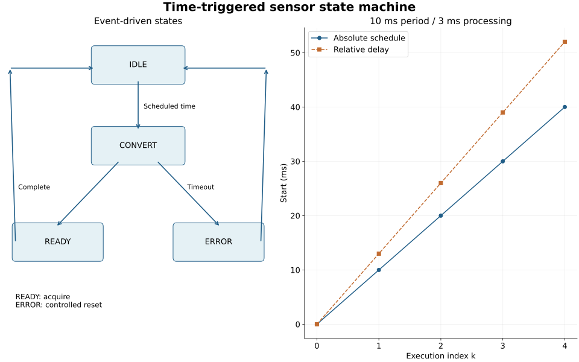

# M24-L2 – State Machines and Time-Triggered Processing {#L2}

**Course area:** M24 – Bachelor–Master Bridge: Transition to Embedded Systems

**Level:** Bachelor · Bachelor–Master Bridge

**Prerequisites:** [M23-L3](M23-L3.md), [M12-L4](M12-L4.md).

**Learning objective:** Specify a non-blocking sequence and distinguish periodic scheduled times from actual execution times.

## States instead of blocking waits {#S1}

A measurement node is to acquire data regularly while processing status messages and faults. A long wait loop blocks other tasks if they run on the same execution path. A state machine separates waiting states from short processing actions. A typical sequence is IDLE → CONVERT → READY → IDLE. On timeout, ERROR follows; error handling can return to IDLE in a controlled manner. Unlike a loop waiting for the ADC, the main loop can handle other tasks between events.

A model consists of state $x$, input/event $u$ and time $t$. The transition function $x^+=F(x,u,t)$ and action $A(x,u,t)$ must be defined separately. In a Moore model, outputs depend only on the state; in a Mealy model, they also depend on current inputs. Actions on transitions must be specified explicitly.

| State | Condition | Next state/action |
| --- | --- | --- |
| IDLE | Scheduled time reached | CONVERT, store trigger and scheduled time |
| CONVERT | Conversion complete before/at deadline | READY, save result |
| CONVERT | Deadline reached, no result | ERROR, count fault |
| READY | Record handled | IDLE, next period |
| ERROR | Reset/recovery permitted | IDLE, new time base according to rule |

A priority must be defined for simultaneous events (here, valid completion at the deadline counts as on time). If the period elapses while CONVERT remains active, no second conversion is started here; the missed trigger is counted. Even if a timeout leads to recovery, the measurement gap must be documented.

## Periods and drift {#S2}

A periodic task with period $T$ and start time $t_0$ has scheduled releases

$$r_k=t_0+kT.$$

With a relative delay $T$ *after* processing of duration $C_k$, the result is instead $t_{k+1}=t_k+C_k+T$. With constant $C$, the phase deviation after $k$ intervals is $kC$. Absolute scheduling avoids this systematic accumulation but does not guarantee an immediate start. Actual release to the scheduler may be shifted by time quantisation and priorities.

**Worked example:** $T=10$ ms, $C=3$ ms. With relative delay, five executions start at 0, 13, 26, 39 and 52 ms. With ideal fixed periodic scheduling, the values are 0, 10, 20, 30 and 40 ms. The fifth relative start is 12 ms late. Over a long running time this corresponds to a rate of about 76.9 Hz versus 100 Hz.

{alt="Sensor state transitions and comparison of fixed periods with relative delay."}

## Tick wraparound and missed periods {#S3}

A 32-bit tick counter with a millisecond clock wraps after $2^{32}$ ms, or about 49.71 days. A relational comparison `now >= due` is unreliable across the boundary. The difference between two `uint32_t` timestamps, by contrast, can be interpreted modulo $2^{32}$. For a fully observed interval shorter than one complete counter cycle, the correct elapsed duration is obtained.

```c
#include <stdint.h>
#include <stdbool.h>
static bool elapsed(uint32_t now, uint32_t start, uint32_t dt) {
    return (uint32_t)(now - start) >= dt;
}
```

Example: Start `0xFFFFFFFD`, followed by `now=2`. The difference is 5 ticks. Ordering arbitrary timestamps requires an additional half-range convention; the example above checks only elapsed duration from a known start.

If invocation is late, distinguish the strategies: catch up on all missed releases, skip to the next future release, or deliberately restart the time base. A sensor usually cannot reconstruct past physical measurement instants. An ADC value read later must not be given the timestamp of a missed measurement. In [M24-L5](M24-L5.md), there is an independent ideal producer; the consumer may be delayed temporarily.

## Designing a main loop {#S4}

A cooperative main loop invokes short services: poll events, update the state, acquire data and handle communication. Each service must bound its maximum execution time. An RTOS can put blocked tasks to sleep and execute other tasks; for periodic execution, an absolute release function (for example, the FreeRTOS delay-until family) can stabilise phase. However, an RTOS does not replace analysis of execution time, priorities and shared resources.

Verification: first test transitions at the thresholds, then events in a different order, timeout, duplicate completion events and restart. An invalid event in the wrong state should be ignored or counted rather than triggering an uncontrolled transition. Timestamps for the trigger and data acquisition make it possible to distinguish measurement latency from processing latency afterwards.

## Exercises and review {#S5}

1. $T=20$ ms and $C=4$ ms. Relative delay: how large is the start deviation after ten intervals? **Solution:** 40 ms.
2. The ADC reports completion exactly at the deadline. **Solution:** READY according to the priority chosen above; result valid. The opposite convention could also be specified but would have to be tested consistently.
3. A polling service sees `start=0xFFFFFFFE`, `now=3`. **Solution:** 5 ticks elapsed.
4. With $T=10$ ms, each execution takes 12 ms. **Solution:** The desired frequency cannot be sustained by a single serial consumer; an absolute time base cannot create missing computing capacity.

## Sources {#S6}


- [ETH Zürich – Embedded Systems, 227-0124-00L (Curriculum G5)](https://www.vvz.ethz.ch/Vorlesungsverzeichnis/lerneinheit.view?ansicht=KATALOGDATEN&lang=en&lerneinheitId=204662&semkez=2026W)
- [FreeRTOS – vTaskDelayUntil](https://freertos.org/Documentation/02-Kernel/04-API-references/02-Task-control/02-vTaskDelayUntil)
