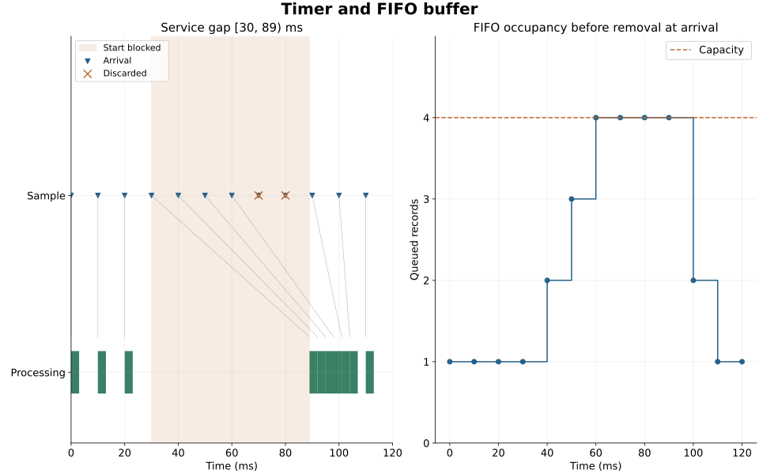

# M24-L3 – Sampling, Timers, Interrupts and Data Buffers {#L3}

**Course area:** M24 – Bachelor–Master Bridge: Transition to Embedded Systems

**Level:** Bachelor · Bachelor–Master Bridge

**Prerequisites:** [M16-L2](M16-L2.md), [M24-L1](M24-L1.md), [M24-L2](M24-L2.md).

**Learning objective:** Size a sampling time base and a bounded data buffer, and make data losses detectable.

## From the measured quantity to the timestamp {#S1}

A sensor value without a time reference is incomplete for discrete-time signal processing. A periodic hardware timer can trigger the ADC; on completion, an interrupt reports the available sample. The timestamp can denote either the trigger or the actual sampling instant. The time of the interrupt is not automatically identical to either. With a hardware trigger and fixed conversion time, the timing of sampling can be determined much more precisely than with a software-triggered individual measurement.

A timer with input clock $f_{\mathrm{clk}}$, integer divider $P$ and a counter from 0 to $A$ inclusive produces the period in this model

$$T_s=\frac{P(A+1)}{f_{\mathrm{clk}}}.$$

At 48 MHz, $P=48$ and $A=9999$, the counter clock is 1 MHz and $T_s=10$ ms, or 100 Hz. Some devices encode the divider as the register value minus one, others differently. Timer mode and clock tree must also be checked. For a sinusoidal signal at 40 Hz, the frequency is below the ideal Nyquist limit of 50 Hz; higher spectral components must be limited by suitable analogue filters.

## Interrupts and data handover {#S2}

An interrupt service routine (ISR) responds to an event. Hardware priorities, masking times and higher-priority sources affect the time until processing begins. The ISR should service the device according to its acknowledgement rules, acquire the record with sequence number and timestamp, and delegate longer processing to another context. A single flag for several rapid events may combine multiple samples and thus conceal data loss.

A FIFO (first in, first out) preserves chronological order. For a capacity $K$ and separate write and read indices $h,l$, an additional occupancy counter $n$ can be maintained. The following holds:

$$0\le n\le K,\qquad h^+=(h+1)\bmod K,\qquad l^+=(l+1)\bmod K.$$

When the queue is full, the **new** sample is discarded here (drop newest) so that previously acquired data remain in order. The source sequence number is incremented even when data are lost. An alternative would be to overwrite the oldest sample if recency matters more than the complete history. Both approaches require fault statistics. A record with two 32-bit values and one 16-bit value requires at least 10 bytes of payload; four records require 40 bytes, but the actual size of a C array can be larger due to alignment and padding. The `sizeof` result on the target device is authoritative.

## Calculating the buffer limit {#S3}

A service gap of length $B$ during which no records are removed produces at most $\lceil B/T_s\rceil$ releases at period $T_s$ in the half-open interval $[t,t+B)$. At initial occupancy $n_0$, this interval requires at least

$$K\ge n_0+\lceil B/T_s\rceil.$$

This does not yet account for an additional arrival before the first removal at the interval boundary. Event ordering and further blocking must be considered in practical sizing. For $B=59$ ms, $T_s=10$ ms, $n_0=0$, up to six slots are required. A capacity of four causes the samples at 70 and 80 ms to be lost in the scenario [30,89) from L5. The sample at 30 ms is the first in the service gap.

Long-term stability is a separate question: an average service rate below the arrival rate eventually causes loss with a finite buffer. With a serial service time $C=12$ ms, the maximum service rate is 83.3/s, while 100/s arrive. More memory postpones the problem but does not eliminate it. With $C=3$ ms and the consumer available after the service gap, however, the backlog can be cleared.

## Concurrency and boundary cases {#S4}

The FIFO in this lesson and the final lesson runs in a single simulation context. A real ISR and a task share memory. They must not both modify a shared occupancy counter without synchronisation. Even individual multibyte accesses can be interrupted on small CPUs. Safe alternatives include short, correctly protected critical sections, a single-producer/single-consumer structure verified for the target system with suitable memory ordering, or the designated RTOS queues. In the FreeRTOS example, the ISR must use the ISR-specific queue function, check the return value and account for any required context switch; permitted interrupt priorities depend on the port.

The queue stores records by value; when using pointers, the lifetime of the referenced memory must also be ensured. Tests should cover at least reading when empty, writing when full, index wraparound, reuse after removal and simultaneous events at a boundary. Sequence gaps identify lost samples; timestamp differences enable jitter analysis. Hardware overrun flags are also needed because a missed trigger before sequence-number assignment may otherwise remain invisible.

## Exercises and review {#S5}

1. Timer 24 MHz, divider 24, final count 4999. **Solution:** 5 ms, or 200 Hz.
2. An empty buffer has $K=4$, arrivals every 10 ms, removal stops during [30,89). **Solution:** six arrivals, two losses with drop newest.
3. The FIFO contains two records and the next service gap lasts 21 ms. **Solution:** in the worst case, three additional releases; at least five slots for the interval, possibly one additional slot if events coincide at the boundary.
4. Why must `volatile unsigned count` not be regarded as complete protection? **Solution:** an increment/decrement operation is a compound access; interleaving can produce an inconsistent counter.

## Sources {#S6}

- [ETH Zürich – Embedded Systems, 227-0124-00L (Curriculum G5)](https://www.vvz.ethz.ch/Vorlesungsverzeichnis/lerneinheit.view?ansicht=KATALOGDATEN&lang=en&lerneinheitId=204662&semkez=2026W)
- [Arm CMSIS-Core – Interrupts and Exceptions (NVIC)](https://arm-software.github.io/CMSIS_6/latest/Core/group__NVIC__gr.html)
- [FreeRTOS – xQueueSendToBackFromISR](https://community.freertos.org/Documentation/02-Kernel/04-API-references/06-Queues/06-xQueueSendToBackFromISR)
- [AVR-LibC – Atomic Blocks](https://avrdudes.github.io/avr-libc/avr-libc-user-manual/group__util__atomic.html)
