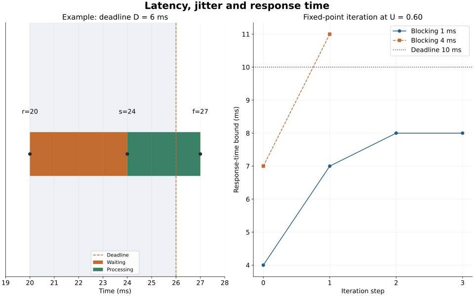

# M24-L4 – Real-Time Fundamentals: Latency, Jitter and Deadlines {#L4}

**Course area:** M24 – Bachelor–Master Bridge: Transition to Embedded Systems

**Level:** Bachelor · Bachelor–Master Bridge

**Prerequisites:** [M15-L3](M15-L3.md), [M24-L2](M24-L2.md), [M24-L3](M24-L3.md).

**Learning objective:** Evaluate deadline misses using defined timing quantities and derive simple response-time bounds.

## Measurable timing quantities {#S1}

A real-time task is characterised not only by its numerical output but also by the permissible time at which that output is produced. Let $r_k$ be the release time, $s_k$ the start time and $f_k$ the completion time. The start latency is $W_k=s_k-r_k$, and the response time is $R_k=f_k-r_k$; a relative deadline $D_k$ is met if $R_k\le D_k$. When service is uninterrupted, the processing duration $C_k$ is equal to $f_k-s_k$. If execution is interrupted, this difference includes the duration of the interruptions and must not be equated with CPU execution time.

Jitter is a deviation in timing. For sampling, it can be defined as $j_k=r_k-(r_0+kT)$ or as the deviation of the intervals $r_{k+1}-r_k-T$. These two quantities must be distinguished. In the case study, releases are ideally periodic; the *start latency and response time* vary. This is not the same as sampling jitter.

A hard real-time system must guarantee that its deadlines are met under the specified conditions. With soft deadlines, occasional late results may reduce quality. A mean alone is not proof: with 99 responses in 3 ms and one in 503 ms, the mean is 8 ms but the maximum is 503 ms.

## Utilisation and response time {#S2}

For periodic tasks on a single CPU, the modelled utilisation is

$$U=\sum_i\frac{C_i}{T_i}.$$

$U>1$ means that, with periodic work continuing indefinitely and no jobs being discarded, one CPU cannot perform the required computation. $U\le1$ does not guarantee feasibility for arbitrary deadlines, priorities, blocking or overheads.

For a simple pre-emptive system with fixed priorities, independent periodic tasks, no release jitter and known upper bounds on execution times, a response-time bound for task $i$ can be determined iteratively:

$$R_i^{(0)}=C_i+B_i,\qquad R_i^{(k+1)}=C_i+B_i+\sum_{h\in hp(i)}\left\lceil\frac{R_i^{(k)}}{T_h}\right\rceil C_h.$$

$hp(i)$ denotes the higher-priority tasks, and $B_i$ is an assumed upper bound on blocking time. Each higher-priority task may require up to the indicated number of executions within the window under consideration. Iteration stops at the fixed point or when the deadline is exceeded; in the latter case, this procedure provides no proof that the deadline is met. For this example, deadlines are assumed not to exceed periods. Overheads must be accounted for separately unless already included in $C_i$ or $B_i$.

**Example:** Three tasks, highest priority first: $T_1=5$ ms, $C_1=1$ ms; $T_2=8$ ms, $C_2=2$ ms; $T_3=20$ ms, $C_3=3$ ms, $B_3=1$ ms, $D_3=10$ ms. $U=0.60$. The iteration for the third task is $4\to7\to8\to8$ ms. The deadline is met under the model assumptions. With $B_3=4$ ms, iteration starts at 7 ms, proceeds as $7\to11$ ms and exceeds the deadline despite identical CPU utilisation. With $B_1=B_2=0$ and deadlines equal to periods, the first two tasks also meet their deadlines: $R_1=1$ ms, $R_2=3$ ms.

## From estimation to testing {#S3}

An analytical bound is only as reliable as its parameters. The execution time of a host program is not the worst-case execution time (WCET) of a microcontroller. On the target system, cache behaviour, flash wait states, interrupt masking, compiler optimisation, DMA bus accesses and contention affect timing. Timestamps with a reliably calibrated time base, traces or GPIO measurements reveal observed timings. Even extensive testing does not prove complete coverage of all operating conditions.

A minimum report includes the number of generated, processed and lost samples, deadline misses, definitions of the timing quantities, mean and maximum values, and peak queue occupancy. Quantiles are useful when the sample size and operating conditions are documented. Losses must not disappear from performance evaluation: a sensible success metric relates on-time completed samples to the **generated** samples.

## Application: non-pre-emptive consumer {#S4}

The sensor node in the following lesson uses a single serial consumer rather than a pre-emptive multitasking scheduler. Its waiting time before starting can increase because of queue occupancy or blocking of job starts. Once processing of a record has begun, it runs to completion without interruption in the model. The pre-emptive response-time analysis above must not be applied to this case without adaptation. Instead, release, queue and completion events are simulated directly.

In normal operation, with $C=3$ ms, $T_s=10$ ms and a free consumer, $R_k=3$ ms for all samples. Blocking job starts for three milliseconds exactly at release produces $R_k=6$ ms for that sample. Both values are below the model deadline of 8 ms. For prolonged start blocking or chronic overload, these individual calculations are insufficient; see [M24-L5](M24-L5.md).

## Exercises and checks {#S5}

1. $r=20$, $s=24$, $f=27$ ms, $D=6$ ms. **Solution:** Start latency 4 ms, response time 7 ms, deadline missed by 1 ms.
2. Two periodic tasks with $C/T=2/5$ and $3/4$. **Solution:** $U=1.15$; impossible on one CPU if jobs must continue to be performed indefinitely.
3. In the fixed-point example above, let $D_3=8$ ms. **Solution:** Fixed point 8 ms; deadline met exactly under the assumptions.
4. A node generates 100 samples, loses 2 and completes another 5 too late. **Solution:** 93% on-time complete results. A fraction based on the 98 received samples would conceal the effect of losses.

## Sources {#S6}

- [ETH Zürich – Embedded Systems, 227-0124-00L (Curriculum G5)](https://www.vvz.ethz.ch/Vorlesungsverzeichnis/lerneinheit.view?ansicht=KATALOGDATEN&lang=en&lerneinheitId=204662&semkez=2026W)
- [FreeRTOS – vTaskDelayUntil](https://freertos.org/Documentation/02-Kernel/04-API-references/02-Task-control/02-vTaskDelayUntil)
- [Arm CMSIS-Core – Interrupts and Exceptions (NVIC)](https://arm-software.github.io/CMSIS_6/latest/Core/group__NVIC__gr.html)
