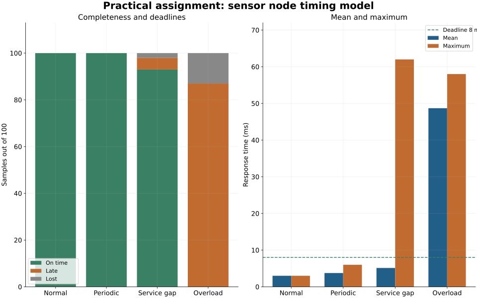

# M24-L5 – Practical Assignment: Testing Data and Timestamps of a Simulated Sensor Node {#L5}

**Course area:** M24 – Bachelor–Master Bridge: Transition to Embedded Systems

**Level:** Bachelor · Bachelor–Master Bridge

**Prerequisites:** [M24-L1](M24-L1.md) through [M24-L4](M24-L4.md).

**Learning objective:** Run a reproducible C model, check data integrity and timing constraints, and explain design limitations.

## Assignment and verifiable specification {#S1}

Develop a simulation that runs on a host computer for a measurement node whose hardware timer ideally generates one sample every 10 ms. Actual device peripherals, sensor physics and conversion duration are not part of the model. The ADC code $1000+(37k\bmod500)$ is a deterministic synthetic test sequence used to detect data corruption and swaps. The timestamp is the ideal sampling time $r_k=10k$ ms. The source generates 100 samples, $k=0$ to 99. The consumer retrieves data from a FIFO queue with four waiting slots and can additionally process exactly one active sample.

Requirements: preserve order, prevent silent losses, pass timestamps on unchanged, and achieve a response time of at most 8 ms in the intended normal operating conditions. When the queue is full, the newly arriving sample is discarded. The consumer does not suspend the source. A deadline miss and a loss are two distinct error categories; the deadline is inclusive. The simulation uses integer milliseconds and processes simultaneous events in this order: arrival, completion, then possible start. Blocking affects only the start of a job; an active job is not interrupted.

| Case | Service time | Start blocking |
| --- | ---: | --- |
| 0 Normal | 3 ms | None |
| 1 Periodic | 3 ms | $t\bmod40<3$ ms |
| 2 Service gap | 3 ms | $30\le t<89$ ms |
| 3 Overload | 12 ms | None |

The time limit of 3000 ms allows all accepted samples to be drained; reaching it with unfinished work is considered an error.

## Reference calculation and invariants {#S2}

For the free consumer without a backlog, $f_k=r_k+C$. In the periodic case, 25 of 100 releases are followed by a start delay of 3 ms; 75 responses take 3 ms and 25 take 6 ms. This gives $\bar R=(75\cdot3+25\cdot6)/100=3.75$ ms. During the service gap, six samples arrive before the next service begins, four of which are stored. The first completion is at 92 ms for the sample from 30 ms, so $R_{\max}=62$ ms. The stored samples from 40, 50 and 60 ms complete at 95, 98 and 101 ms. The sample at 90 ms completes at 104 ms; the following sample at 100 ms completes at 107 ms and meets the deadline again. The two lost samples are 7 and 8. In the overload case, $U=12/10=1.2$; even with an empty queue, every response takes longer than 8 ms.

The following invariants must be checked: FIFO occupancy between zero and four; consecutive sequence numbers at generation; strictly increasing sequence numbers and correct payload data at completion; after draining, $N_{\mathrm{erzeugt}}=N_{\mathrm{fertig}}+N_{\mathrm{verloren}}$. The number of missing sequence numbers, including any gaps at the beginning or end, must match the loss count. For $N_{\mathrm{fertig}}>0$, $\bar R=\sum R_k/N_{\mathrm{fertig}}$. The success fraction is $q=(N_{\mathrm{fertig}}-N_{\mathrm{zu\ spät}})/N_{\mathrm{erzeugt}}$. The original subscripts erzeugt, fertig, verloren and zu spät mean generated, completed, lost and late, respectively.

## Reproducible C11 program {#S3}

Save the program as `sensor.c`. It requires a C11 implementation supporting the fixed-width types used. With GCC or Clang, for example, compile it using `cc -std=c11 -Wall -Wextra -Werror -pedantic sensor.c -o sensor` and run it using `./sensor`. With GCC, `-fsanitize=undefined` can also be enabled. Assertions must remain active (no `-DNDEBUG`). The queue is correctly synchronised only within the simulated sequential execution; it is **not ISR-safe production code**.

```c
#include <assert.h>
#include <stdint.h>
#include <stdbool.h>
#include <stdio.h>
#define CAP 4u
#define N 100u
#define PERIOD 10u
#define DEADLINE 8u
typedef struct { uint32_t seq, stamp; uint16_t adc; } Sample;
typedef struct { Sample a[CAP]; unsigned head, tail, count; } Queue;
static bool push(Queue *q, Sample s) {
    if(q->count == CAP) return false;
    q->a[q->head] = s; q->head = (q->head+1u)%CAP; ++q->count; return true;
}
static bool pop(Queue *q, Sample *s) {
    if(!q->count) return false;
    *s=q->a[q->tail]; q->tail=(q->tail+1u)%CAP; --q->count; return true;
}
static uint16_t code(uint32_t seq) { return (uint16_t)(1000u+(37u*seq)%500u); }
static bool blocked(unsigned mode, uint32_t t) {
    return (mode==1u && t%40u<3u) || (mode==2u && t>=30u && t<89u);
}
static void run(unsigned mode) {
    Queue q={0}; Sample active={0}; bool busy=false;
    uint32_t finish=0, last=0, maxlat=0, sumlat=0;
    unsigned sent=0, lost=0, done=0, late=0, peak=0, gaps=0;
    unsigned service=mode==3u?12u:3u;
    for(uint32_t t=0; t<3000u; ++t) {
        if(t<N*PERIOD && t%PERIOD==0u) {
            Sample s={sent,t,code(sent)}; ++sent;
            if(!push(&q,s)) ++lost;
            if(q.count>peak) peak=q.count;
        }
        if(busy && t==finish) {
            uint32_t lat=t-active.stamp;
            assert(active.adc==code(active.seq));
            assert(active.stamp==active.seq*PERIOD);
            if(done) { assert(active.seq>last); gaps+=active.seq-last-1u; }
            else gaps+=active.seq;
            last=active.seq; ++done; sumlat+=lat;
            if(lat>maxlat) maxlat=lat;
            if(lat>DEADLINE) ++late;
            busy=false;
        }
        if(!busy && !blocked(mode,t) && pop(&q,&active)) {
            busy=true; finish=t+service;
        }
        if(sent==N && !busy && q.count==0u) break;
    }
    assert(sent==N && done+lost==sent && !busy && !q.count);
    gaps+=N-1u-last; assert(gaps==lost);
    printf("%u,%u,%u,%u,%u,%u,%u,%u\n",mode,sent,done,lost,late,peak,maxlat,sumlat);
}
int main(void) {
    Queue q={0}; Sample s={0}; assert(!pop(&q,&s));
    for(unsigned i=0;i<CAP;++i) assert(push(&q,(Sample){i,0,0}));
    assert(!push(&q,(Sample){99,0,0}));
    for(unsigned i=0;i<CAP;++i) { assert(pop(&q,&s)); assert(s.seq==i); }
    assert(!pop(&q,&s));
    uint32_t start=UINT32_MAX-2u, now=2u;
    assert((uint32_t)(now-start)==5u);
    puts("mode,sent,done,lost,late,peak,maxlat,sumlat");
    for(unsigned m=0;m<4;++m) run(m);
}
```

The program checks payload data, timestamps, sequence order, the loss balance, empty and full FIFO states, and tick wraparound. Starting at index 0 and performing numerous write and read operations also checks index wraparound in the scenarios. The console output contains one CSV row per model case. `sumlat` sums only response times of completed records. A real implementation would require a defined API with separate timekeeping, hardware abstraction, ISR handover and processing.

## Results and interpretation {#S4}

Executed host reference simulation (100 samples per scenario):

| Case | Completed | Lost | Late | Peak queue | Max R (ms) | Mean R (ms) | On time |
| --- | ---: | ---: | ---: | ---: | ---: | ---: | ---: |
| Normal | 100 | 0 | 0 | 1 | 3 | 3.00 | 100% |
| Periodic | 100 | 0 | 0 | 1 | 6 | 3.75 | 100% |
| Service gap | 98 | 2 | 5 | 4 | 62 | 5.13 | 93% |
| Overload | 87 | 13 | 87 | 4 | 58 | 48.69 | 0% |

Peak occupancy is measured after arrival and before removal. The mean response time of approximately 5.13 ms after the service gap is below the deadline, yet five results miss the deadline and two are missing. In the overload case, neither the completed nor the lost samples meet the requirements. Increasing the buffer size may reduce losses during a limited service gap, but the delay of additionally stored older samples can increase. With sustained $U>1$, a finite-capacity queue will still overflow. A shorter maximum blocking interval, faster processing, dividing the work or changing the sampling frequency should be considered; reducing the frequency, however, changes the signal-theory requirements.

{alt="Comparison of four operating cases by on-time, late and lost samples and maximum response time."}

## Independent extensions and submission {#S5}

1. Change the queue capacity to 6 and retest case 2. Expected: all six arrivals during the service gap fit. At the 90 ms arrival, one sample is already being processed; the buffer can accommodate this arrival too. No losses, but some deadlines are still missed. Compare the deadline statistics with the reference.
2. Change the service time in the overload case to 7 ms. Expected with unblocked starts: all 100 samples complete in 7 ms, with no losses or deadline misses.
3. Add the number of on-time results and the maximum interval between sampling timestamps of retained samples to the CSV output. Expected in case 2: 93 on time; largest gap 30 ms between samples 6 and 9. Distinguish this gap test from completion timing.
4. Test an intentionally incorrect timestamp or sequence number and explain which assertion detects it. A positive test alone does not establish that faults are detected.

Submission: specification with event order, C file, compilation command and output for the four reference cases, two selected variants and a reasoned evaluation. Record the compiler, changes and aspects not tested. Assessment criteria: 25% correct data integrity, 25% timing definitions and event order, 25% reproducible tests with evaluation, 25% reasoned limitations and follow-up measures. No actual ADC, interrupt or WCET measurements were performed; these remain a separate validation step for the later master's specialisation M29.

## Sources {#S6}

- [ETH Zurich – Embedded Systems, 227-0124-00L (Monowlith internal curriculum group G5)](https://www.vvz.ethz.ch/Vorlesungsverzeichnis/lerneinheit.view?ansicht=KATALOGDATEN&lang=en&lerneinheitId=204662&semkez=2026W) · Autumn 2026 catalogue: course description and objectives; curricular orientation, no equivalence assessment · Last accessed: 2026-11-22
- [AVR-LibC – Atomic Blocks](https://avrdudes.github.io/avr-libc/avr-libc-user-manual/group__util__atomic.html) · ATOMIC_BLOCK and AVR-specific interrupt masking; context for atomic data capture · Last accessed: 2026-11-22
- [Espressif – ESP-Techpedia: Task Control](https://docs.espressif.com/projects/esp-techpedia/en/latest/esp-friends/get-started/code-development/common-freertos-api/task-control.html) · vTaskDelayUntil(): periodic execution and drift; supplementary ESP32 documentation, relevance to S1: Assignment and verifiable specification · Last accessed: 2026-11-25
- [FreeRTOS Reference Manual V10.0.0](https://www.freertos.org/media/2018/FreeRTOS_Reference_Manual_V10.0.0.pdf) · § 2.11, pp. 51–53: periodic release using absolute time; historical API manual · Last accessed: 2026-11-25
- [Espressif – ESP-IDF Programming Guide v3.3.4: FreeRTOS](https://docs.espressif.com/projects/esp-idf/en/v3.3.4/api-reference/system/freertos.html) · xQueueSendToBackFromISR(): data transfer from interrupts; version-specific ESP-IDF reference, relevance to S1: Assignment and verifiable specification · Last accessed: 2026-11-25
- [FreeRTOS Reference Manual V10.0.0](https://www.freertos.org/media/2018/FreeRTOS_Reference_Manual_V10.0.0.pdf) · § 3.23, pp. 206–209: ISR queue, return value and context switch; historical API manual · Last accessed: 2026-11-25
