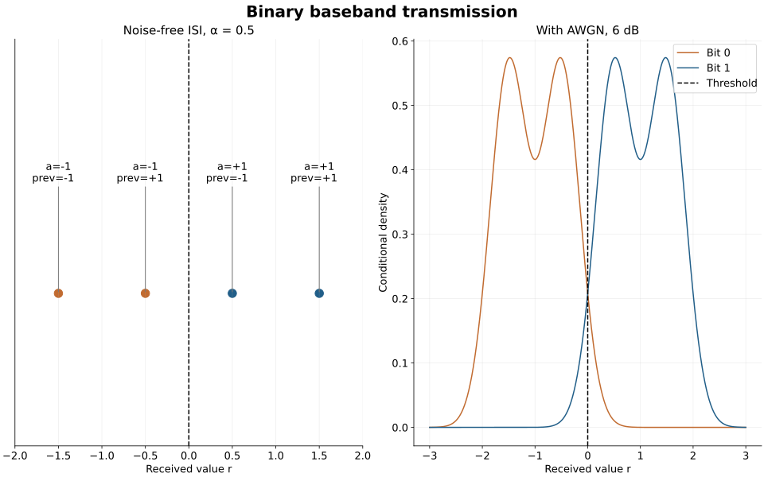

# M25-L4 – Digital Transmission: Baseband, Symbol Decisions and Intersymbol Interference {#L4}

**Course area:** M25 – Bachelor–Master Bridge: Transition to Digital Signal Processing and Communication

**Level:** Bachelor · Bachelor–Master Bridge

**Prerequisites:** [M17-L2](M17-L2.md), [M25-L3](M25-L3.md).

**Learning objective:** Derive symbol decisions from a signal model and distinguish different sources of errors.

## From bit to received symbol {#S1}

A binary antipodal baseband model maps bits $b_k\in\{0,1\}$ to symbols $a_k=2b_k-1\in\{-1,+1\}$. A pulse $p(t)$ with unit energy $\int |p(t)|^2dt=1$ shapes the signal

$$s(t)=\sqrt{E_b}\sum_k a_k p(t-kT).$$

$E_b$ is the energy per bit and $T$ is the symbol interval. The corresponding modulated BPSK can be modelled as a projection onto a real carrier basis function. Only the equivalent real baseband dimension is considered here. With one bit per symbol, the bit rate and symbol rate are equal; this is not generally the case for other modulation schemes.

A filter matched to $p(t)$ (matched filter) correlates the received signal with the pulse. In additive white Gaussian noise with two-sided power spectral density $N_0/2$, it maximises the signal-to-noise ratio at the decision instant for an isolated pulse. If the shifted pulses are orthogonal, or if there is no ISI at the sampling instant, the observed real quantity is

$$r_k=\sqrt{E_b}a_k+w_k,\qquad w_k\sim\mathcal N(0,N_0/2).$$

## Decision rule and theoretical error rate {#S2}

For equally probable bits, symmetric costs and known amplitude, a zero threshold minimises the probability of error. For $r_k\ge0$, the decision is bit 1; otherwise it is bit 0. The conditional probability of error for the positive symbol is $P(w_k<-\sqrt{E_b})$. With the Gaussian tail probability $Q(x)=\frac{1}{\sqrt{2\pi}}\int_x^\infty e^{-u^2/2}du$, it follows that

$$P_b=Q\left(\sqrt{\frac{2E_b}{N_0}}\right)=\frac12\operatorname{erfc}\left(\sqrt{E_b/N_0}\right).$$

At $E_b/N_0=1$ (0 dB), the result is approximately 0.07865; at 6 dB it is approximately 0.00239. Noise variance in this real normalised model: set $E_b=1$, $\gamma=10^{\mathrm{dB}/10}$ and $\sigma=1/\sqrt{2\gamma}$. Confusing $N_0$ with $N_0/2$ introduces a factor of two in the variance, corresponding to a 3 dB discrepancy.

## Intersymbol interference (ISI) {#S3}

A dispersive channel or non-ideal pulse can cause neighbouring symbols to overlap at the decision instant. The model of the effective channel chain, after sampling, is

$$r_k=a_k+\alpha a_{k-1}+w_k.$$

For $\alpha=0.5$, the noise-free levels are $-1.5$, $-0.5$, $+0.5$, $+1.5$. The sign of the symbol decision remains correct, but for opposite preceding symbols the distance to the threshold decreases from one to 0.5. Errors now depend on the symbol sequence. For i.i.d. equiprobable bits and independent Gaussian noise samples, with the same zero-threshold detector, the result is

$$P_b(\alpha)=\tfrac12 Q((1+\alpha)/\sigma)+\tfrac12 Q((1-\alpha)/\sigma).$$

At $\alpha=0.5$ and 6 dB, the model value rises to 0.03958. This relation applies to the specified channel and detector, not to arbitrary radio channels. Here $E_b/N_0$ refers to the input symbol energy; the channel is not energy-normalised when $\alpha$ changes. An exact physical comparison requires calibration of the effective channel and noise models.

{alt="Four possible noise-free received levels of the two-tap channel and noisy signal distributions."}

## Pulse shaping and equalisation {#S4}

A Nyquist pulse shape has zero crossings at integer symbol intervals away from its main pulse. A raised-cosine overall filter satisfies this condition under ideal synchronisation; the real baseband bandwidth is $(1+\beta)/(2T)$ for roll-off $0\le\beta\le1$. Root-raised-cosine filters are often used at both the transmitter and receiver. An equaliser can reduce ISI after channel estimation; however, a zero-forcing equaliser also amplifies noise in regions of low channel gain. A decision-feedback equaliser can subtract preceding symbols, but requires correct previous decisions and may propagate errors.

In [M25-L5](M25-L5.md), pulse shaping, timing and carrier synchronisation remain idealised. Only the real discrete channel at the optimal decision instant is investigated. This makes it possible to verify the theoretical BER without pretending to model a complete RF system.

## Exercises and checks {#S5}

1. A BPSK transmitter transmits 100 kbit/s. **Solution:** 100 ksymbols/s, $T=10$ µs; with an ideal raised-cosine overall filter and $\beta=0.25$, the one-sided baseband bandwidth is 62.5 kHz.
2. $\alpha=0.3$, $a_k=+1$, $a_{k-1}=-1$. **Solution:** Noise-free received value 0.7.
3. For $\gamma=2$, what is the standard deviation? **Solution:** $1/\sqrt4=0.5$ for normalised $E_b=1$.
4. Why does higher RF transmit power alone not guarantee correct symbol decisions? **Solution:** ISI, synchronisation errors, non-linearity, interference and other errors outside the model may remain; power is only one part of system design.

## Sources {#S6}

- [ETH Zurich – Course Catalogue, Autumn Semester 2026: Communication (Monowlith internal curriculum group G6)](https://www.vvz.ethz.ch/Vorlesungsverzeichnis/sucheLehrangebot.view?abschnittId=122815&ansicht=1&lang=en&seite=0&semkez=2026W) · Foundation Core: Discrete-Time and Statistical Signal Processing; Communication Systems; curriculum reference only · Last accessed: 2026-11-25
- [MIT OpenCourseWare – 6.450 Principles of Digital Communication I, Lecture Notes](https://ocw.mit.edu/courses/6-450-principles-of-digital-communication-i-fall-2009/pages/lecture-notes/) · 6.450 Principles of Digital Communication I, Lecture Notes (overview/index page); Thematic relevance to lesson: S2: Decision rule and theoretical error rate · Last accessed: 2026-11-22
