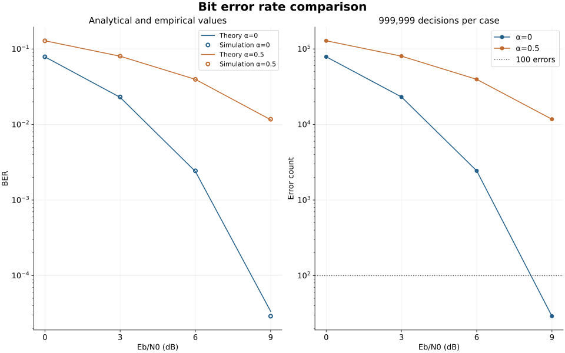

# M25-L5 – Practical Assignment: Simulation of Binary Transmission and Comparison with the Theoretical Bit Error Rate {#L5}

**Course area:** M25 – Bachelor–Master Bridge: Transition to Digital Signal Processing and Communication

**Level:** Bachelor · Bachelor–Master Bridge

**Prerequisites:** [M25-L1](M25-L1.md) to [M25-L4](M25-L4.md).

**Learning objective:** Reproduce a computational study, check it against an analytical reference and recognise the limits of statistical conclusions.

## Assignment and reference model {#S1}

Create a reproducible experiment for binary antipodal transmission with real AWGN and optional intersymbol interference. Use uniformly distributed independent bits, a zero threshold, unit input symbol energy and an ideally known sampling instant. Compare four values $E_b/N_0=0,3,6,9$ dB for each of $\alpha=0$ (AWGN) and $\alpha=0.5$ (discrete two-tap channel). Exclude the first symbol from the evaluation because of the artificial zero initial history. A total of 999,999 valid bit decisions per case are considered.

The independent analytical reference value comes from the Gaussian distribution: for pairs of current and previous symbols, the distances to the threshold are $1+\alpha$ and $1-\alpha$, each with probability 50%. Therefore, the formula from [M25-L4](M25-L4.md#S3) applies. For $\alpha=0$, it reduces to the BPSK-AWGN formula. At 9 dB without ISI, the theoretical BER is approximately $3.36\cdot10^{-5}$; on average, about 34 errors are expected in one million bits. This illustrates why very small error rates require very large numbers of bits.

## Executable experiment {#S2}

The program requires Python 3 and NumPy. `default_rng` uses a fixed seed. The same bit and noise sequences are reused for all cases to facilitate comparison; the cases are therefore not independent. The noise samples themselves are independent across symbol times. The theoretical error rate is compared with the empirical rate, not with a second simulation using the same model equations.

```python
import numpy as np
from math import erfc, sqrt
rng=np.random.default_rng(2505)
N=1_000_000
b=rng.integers(0,2,N); a=2*b-1
z=rng.standard_normal(N)
prev=np.r_[0,a[:-1]]
for db in (0,3,6,9):
    gamma=10**(db/10); sigma=1/sqrt(2*gamma)
    for alpha in (0.,0.5):
        y=a+alpha*prev+sigma*z
        # exclude first symbol (zero initial history)
        errors=np.count_nonzero((y[1:]>=0)!=b[1:]); n=N-1
        q=lambda x:0.5*erfc(x/sqrt(2))
        theory=(q((1+alpha)/sigma)+q((1-alpha)/sigma))/2
        se=sqrt(theory*(1-theory)/n)
        assert abs(errors/n-theory)<6*se+1/n
        print(db,alpha,errors,n,f'{errors/n:.8f}',f'{theory:.8f}')
```

The final test uses a broad statistical plausibility band based on the theoretical Bernoulli standard deviation and one additional error-count increment. It is not an exact confidence bound, a certification test or proof for an arbitrary channel model. For very small expected error counts, discrete binomial or Poisson methods are more suitable. A systematic confidence analysis must consider additional independent seeds and the dependence between decision errors.

## Results of the reference run {#S3}

| $E_b/N_0$ (dB) | $\alpha$ | Errors | Simulated BER | Theory |
| ---: | ---: | ---: | ---: | ---: |
| 0 | 0.0 | 78725 | 0.07872508 | 0.07864960 |
| 0 | 0.5 | 128262 | 0.12826213 | 0.12834874 |
| 3 | 0.0 | 23148 | 0.02314802 | 0.02287841 |
| 3 | 0.5 | 80245 | 0.08024508 | 0.08015396 |
| 6 | 0.0 | 2436 | 0.00243600 | 0.00238829 |
| 6 | 0.5 | 39571 | 0.03957104 | 0.03957699 |
| 9 | 0.0 | 29 | 0.00002900 | 0.00003363 |
| 9 | 0.5 | 11744 | 0.01174401 | 0.01156816 |

{alt="Eight simulated and theoretical bit error rates for AWGN and a two-tap channel at four energy-to-noise ratios."}

The values are interpreted as dimensionless fractions rather than percentages. At 6 dB, the result is 0.2436% without ISI and 3.9571% with ISI. In both model cases, the measured error rate decreases as the input energy relative to the noise power spectral density increases. With ISI, the decrease is slower; even a correct threshold is no substitute for a suitable equaliser. At 9 dB, only 29 errors remain without ISI; relative deviations become large for small error counts. The simulation must therefore be assessed on the basis of absolute statistical variation, not agreement to the same decimal places.

## Validation and extension {#S4}

First perform a deterministic check: without noise samples, every symbol must be decided correctly for $|\alpha|<1$. This follows from $a_kr_k=1+\alpha a_ka_{k-1}>0$. For $\alpha=0$, the theoretical expression and the scalar AWGN formula must agree. As a further check, the four symbol pairs can be counted and the two conditional error rates evaluated separately. The empirical noise variance is checked against $1/(2\gamma)$. In the test model, each valid bit decision is counted exactly once; if the initial history changes, the evaluation range must be adjusted accordingly.

Optionally extend the model with an ideal detector that knows the preceding symbol and subtracts $\alpha a_{k-1}$ before the threshold detector. This yields exactly the AWGN model. It is an ideal reference for equalisation with an error-free history, not a realisable detector without additional knowledge. A real decision-feedback equaliser uses its own preceding decision and can therefore cause subsequent errors. The difference from the ideal reference is a useful metric. The model includes no frequency offsets, phase errors, oversampling, real channel impulse response, coloured noise, RF power calibration or channel coding.

## Practical assignment and transition to the Master’s level {#S5}

Prepare a short report with a parameter table, Python/NumPy version, seed, error count, number of evaluated bits, analytical reference value, BER plot and model limitations. Increase the sample size or repeat with new seeds if the error count is below 100 and greater estimation accuracy is required. If necessary, store the counts instead of only rounded BER values. In this course, the bridge is considered complete when you can work through the following tasks yourself:

1. Explain aliasing and choose a sampling rate ([M25-L1](M25-L1.md)).
2. Determine a digital filter from its impulse response or difference equation ([M25-L2](M25-L2.md)).
3. Relate noise variance and autocorrelation to model assumptions ([M25-L3](M25-L3.md)).
4. Derive a decision rule and its error rate ([M25-L4](M25-L4.md)).
5. Compare the simulation and reference calculation, stating the uncertainty.

**Check question:** What does zero observed errors in one million independent bits mean? **Solution:** Not zero BER. The one-sided 95% upper bound is $1-0.05^{1/10^6}\approx3\cdot10^{-6}$ under independent, identically distributed error indicators with constant error probability. For dependent errors, this evaluation does not apply without further assumptions.

The Master's specialisation M30 goes beyond the error rate to entropy, coding, capacity and optical transmission. The other bridges M21–M24 open up alternative Master's profiles; they are not replaced by a single BER experiment.

## Sources {#S6}

- [ETH Zurich – Communication, Foundation Core (Curriculum G6)](https://www.vvz.ethz.ch/Vorlesungsverzeichnis/sucheLehrangebot.view?abschnittId=124625&ansicht=1&lang=de&seite=1&semkez=2026W)
- [MIT OpenCourseWare – 6.450 Principles of Digital Communication I, Lecture Notes](https://ocw.mit.edu/courses/6-450-principles-of-digital-communication-i-fall-2009/pages/lecture-notes/)
