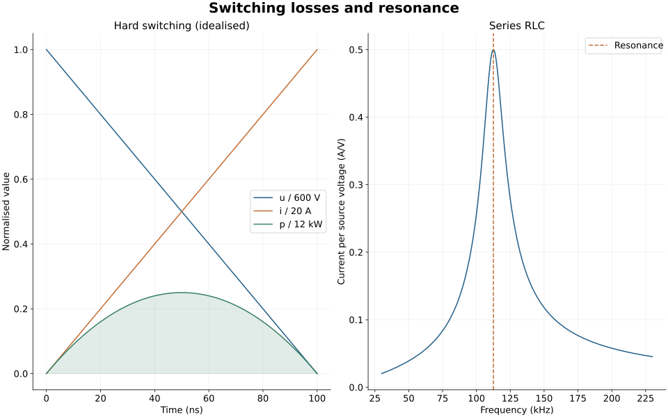

# M27-L4 – Power Electronic Systems: Switching Losses, Resonance and Soft Switching {#L4}

**Course area:** M27 – Master’s Specialisation: Analysis of Modern Power Networks and Power Electronics

**Level:** Master · Master’s Specialisation

**Prerequisites:** [M9-L2](M9-L2.md), [M22-L2](M22-L2.md).

**Learning objective:** Estimate the contributions to converter losses and justify the conditions for lower-loss commutation.

## Separating losses in time and energy {#S1}

During conduction, a MOSFET produces losses approximated by $P_{cond}=R_{DS,on}I_{rms}^2$ (RMS current over the entire period, including the off interval). The resistance depends on junction temperature and gate drive. For a device turned on and off once per period, $P_{sw}=f_s(E_{on}+E_{off})$. The energies are determined by integrating the product of the simultaneous voltage and current during switching:

$$E=\int_{t_0}^{t_1}u(t)i(t)dt.$$

If the voltage falls linearly from 600 V to zero over 100 ns while the idealised current rises linearly from zero to 20 A, then $E=UI\Delta t/6=0.2$ mJ. If the current were constant during the voltage fall, the energy would be $UI\Delta t/2=0.6$ mJ. The losses therefore depend on the waveforms, not merely on the transition time. This calculation is not a measurement of an actual semiconductor device.

## Resonant energy transfer {#S2}

A series RLC circuit has impedance $Z=R+j(\omega L-1/(\omega C))$ and natural angular frequency $\omega_0=1/\sqrt{LC}$. At resonance, the reactances cancel. The stored energies are $W_L=Li^2/2$ and $W_C=Cu^2/2$. For L = 20 µH, C = 100 nF and R = 2 Ω, $f_0\approx112.54$ kHz and $Q=\omega_0 L/R\approx7.07$. With constant excitation amplitude, the sinusoidal current in the series circuit reaches its maximum at resonance. Individual component voltages can then exceed the source voltage.

{alt="Idealised linear voltage and current waveforms during hard turn-on, and series RLC resonance."}

## ZVS and ZCS {#S3}

Zero voltage switching (ZVS) aims for a very low switch voltage at the onset of turn-on; zero current switching (ZCS) aims for a very low switch current at the relevant transition. A resonant branch or appropriately controlled load-current commutation can charge or discharge the output capacitance before turn-on. A rough necessary energy balance for an ideal constant C is $LI^2/2\ge CU^2/2$. For L = 10 µH, C = 1 nF and U = 600 V, this gives I ≥ 6 A. This is merely an energetic lower bound; real nonlinear capacitances, parasitic inductances, current direction and dead time can prevent commutation. With constant $C$ and approximately constant I, the time required to transfer the charge is $CU/I$, about 100 ns here at 6 A.

## Assessment at the operating point {#S4}

A resonant converter does not automatically have lower losses. Circulating currents increase conduction losses; diode reverse recovery, gate drivers, magnetic components and filters introduce further losses. Higher frequencies often allow smaller passive components but increase frequency-dependent losses. An efficiency map must account for input voltage, current, temperature and switching strategy. The assignment in L6 therefore uses a deliberately simple aggregate model. It makes no claims about safe semiconductor operation or whether ZVS commutation is actually achieved.

## Exercises and self-check {#S5}

1. $E_{on}+E_{off}=2$ mJ, 10 kHz. **Solution:** 20 W per switch.
2. Double C while keeping L constant. **Solution:** $f_0$ decreases by a factor of $1/\sqrt2$.
3. For an RMS current of 40 A and 5 mΩ: **Solution:** 8 W conduction loss.
4. Why is demonstrating ZVS at rated load insufficient? **Solution:** The current available for charging and discharging the capacitance and the dead time change with load; the condition may fail at partial load.

## Sources {#S6}

- [ETH Zurich – Electric Energy Engineering (Monowlith internal curriculum group G3)](https://www.vvz.ethz.ch/Vorlesungsverzeichnis/sucheLehrangebot.view?abschnittId=124619&ansicht=1&lang=en&seite=1&semkez=2026W) · Autumn 2026 course list: track and foundation core; curricular orientation, no equivalence assessment · Last accessed: 2026-11-22
- [MIT OpenCourseWare – 6.622, Power Electronics, Lectures 33–36](https://ocw.mit.edu/courses/6-622-power-electronics-spring-2023/video_galleries/video-lectures/) · Lectures 33–36; Reference listed for the lesson “Power Electronic Systems: Switching Losses, Resonance and Soft Switching” · Last accessed: 2026-11-22
