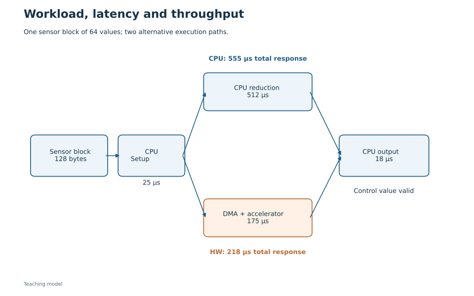

# M29-L1 – Hardware–Software Interface and Performance Model: Workload and Bottlenecks {#L1}

**Course area:** M29 – Master’s Specialisation: Embedded Computer Architectures and Hardware–Software Design

**Level:** Master · Master’s Specialisation

**Prerequisites:** [M24-L1](M24-L1.md), [M24-L4](M24-L4.md), [M28-L5](M28-L5.md).

**Learning objective:** Break down a workload into operations, data traffic, latency and utilisation, and quantify architectural limits.

## The interface as a contract {#S1}

An embedded computer architecture is more than a processor core. It includes sensor and actuator interfaces, memory, interconnects, accelerators and the software that coordinates these resources. Design starts with the processing contract: which data must be available and when, what constitutes a valid result, and how can an error be detected? A fast algorithm with the wrong data order is just as unsuitable as a correct algorithm that misses its deadline.

Throughout this module we use a virtual chain: each job receives 64 previously acquired 12-bit sensor values stored in 16-bit words. Processing determines the mean and derives a bounded control value. Under nominal conditions a job arrives every 1,000 µs; the deadline is 700 µs **from availability of the last sample**, not from the beginning of acquisition. All timing values are model parameters, not datasheet specifications. One CPU variant processes everything locally; the second variant transfers a block to an accelerator. Both must produce identical integer control values.

{alt="Two execution models for a sensor–controller chain with separate timing and resource budgets."}

## Time, throughput and workload {#S2}

For a processor with clock frequency $f$ and average cycles per instruction (CPI), the time for $I$ executed instructions is

$$T=\frac{I\cdot\mathrm{CPI}}{f}.$$

A program with 40,000 instructions, CPI 1.5 and 120 MHz takes 500 µs in the model. CPI depends, among other factors, on memory wait times and pipeline dependencies. Changing the compiler changes the instruction count; clock rate alone is not a performance comparison. For a continuous stream of jobs in a serial model with job period $P$ and service time $C$, the offered utilisation is $\rho=C/P$. If $\rho>1$, the backlog grows unless jobs are dropped. Even if $\rho<1$, short bursts and blocking can cause deadline violations.

A pipeline with three stages taking 30, 80 and 20 µs has a single-job latency of 130 µs without register overhead. If the stages are independent and can process different jobs simultaneously, the ideal initiation interval after filling the pipeline is 80 µs (12,500 jobs/s). A shared bus or feedback dependencies can prevent overlap. Project L6 deliberately omits this overlap to isolate the effect of partitioning.

## Bottlenecks and limits to acceleration {#S3}

If a fraction $p$ of the execution time is accelerated by a factor $s$, with the remaining work unchanged, the speedup is

$$S=\frac{1}{(1-p)+p/s}.$$

For $p=0.8$ and $s=8$, $S=3.33$. Even infinitely fast specialised hardware gives a limit of 5. Any additional data transfers and setup must be added separately. This calculation applies to the fixed workload, not automatically to the maximum throughput of a pipelined system.

For the sensor–controller chain we assume 25 µs of preparation, 8 µs per sample and 18 µs for output. The CPU takes 555 µs. The specialised path takes 218 µs including two DMA transfers and setup (derived in L4), a speedup of approximately 2.55. At a period of 1,000 µs, the modelled CPU time fractions are 55.5% and 7.3%, respectively. CPU utilisation and end-to-end latency are different quantities: the CPU can perform other work during autonomous transfers, provided the operating system actually allows this.

## Metrics and measurement boundaries {#S4}

| Metric | Definition | Observation point |
| --- | --- | --- |
| Response time | Completion minus release time | Sensor block ready to valid control value |
| Throughput | Completed jobs per unit time | Output counter |
| Jitter | Temporal variation of a specified quantity | Release or output timestamps |
| Resource demand | Cycles, bytes, memory, energy | Separate counters for each resource |
| Error rate | Lost, late or incorrectly computed jobs | Sequence number, deadline, reference |

Average response time is not a worst-case guarantee. A measurement report should specify at least sample count, maximum value, observation interval, workload and loss rate. Measuring energy also requires power data; a time saving alone does not imply a particular energy saving.

## Exercises and review {#S5}

1. A core executes 30,000 instructions at CPI 2 and 100 MHz. **Solution:** 600 µs. At a period of 500 µs, the offered load is 1.2; an unbounded serial buffer grows.
2. Two independent stages take 40 and 60 µs. **Solution:** 100 µs single-job latency and an ideal output interval of 60 µs, provided overlap is possible.
3. Explain why an accelerator with a computation time of 10 µs can still perform worse. **Solution:** Transfers, setup and synchronisation can exceed the computation time saved; a new shared bottleneck can also arise.

## Sources {#S6}

- [ETH Zurich – Computers and Networks (Monowlith internal curriculum group G5)](https://www.vvz.ethz.ch/Vorlesungsverzeichnis/sucheLehrangebot.view?abschnittId=122815&ansicht=1&lang=en&seite=0&semkez=2026W) · Autumn 2026 course catalogue: track listing; curricular orientation, no equivalence assessment · Last accessed: 2026-11-25
- [MIT OCW – 6.004, Lecture Notes: Pipelining, Memory Hierarchy, Parallel Processing](https://ocw.mit.edu/courses/6-004-computation-structures-spring-2009/pages/lecture-notes/) · Lecture Notes: Pipelining, Memory Hierarchy, Parallel Processing; Reference listed for the lesson “Hardware–Software Interface and Performance Model: Workload and Bottlenecks” · Last accessed: 2026-11-22
