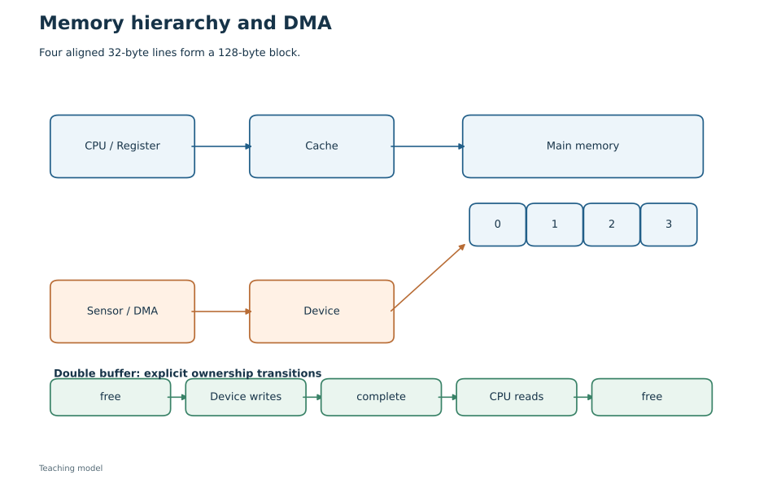

# M29-L2 – Memory Hierarchy: Cache, Main Memory and DMA for Continuous Data Streams {#L2}

**Course area:** M29 – Master’s Specialisation: Embedded Computer Architectures and Hardware–Software Design

**Level:** Master · Master’s Specialisation

**Prerequisites:** [M24-L3](M24-L3.md), [M29-L1](M29-L1.md).

**Learning objective:** Analyse cache behaviour, transfer time and buffer ownership for continuous measurement data.

## Locality and cache organisation {#S1}

Registers are small and located directly in the data path. Caches hold copies of parts of slower memory. Temporal locality means repeatedly using the same data; spatial locality means using neighbouring data. A cache typically loads entire lines. A direct-mapped cache with $K$ lines of size $B$ maps a byte address $a$ to a line via $\lfloor a/B\rfloor\bmod K$. The tag distinguishes different memory blocks that map to the same location. A set-associative cache provides several locations per index; it requires more comparison logic but reduces certain conflicts.

Example: 4 KiB cache capacity, 32 bytes per line, 128 lines in a direct-mapped cache. Addresses 0x0000 and 0x1000 have the same index but different tags. Alternating accesses evict one another even if the cache is almost empty. A four-way set-associative cache with 32 sets can hold both. Conflict misses, capacity misses and first accesses must be treated differently from ordinary hits.

{alt="Cache lines, memory path and ownership transitions of a DMA double buffer."}

## Average access time and upper bound {#S2}

For hit time $t_h$, miss rate $m$ and additional miss penalty $t_m$,

$$T_{\mathrm{avg}}=t_h+m t_m.$$

For 2 ns, 5% and 60 ns, the result is 5 ns. At 20%, it is 14 ns. The formula is an average-value model; overlapping misses, writebacks and DRAM row conflicts change the result. An aligned 128-byte sensor block occupies four 32-byte lines; an unaligned block can occupy five. With a cold cache and 64 sequential 16-bit read accesses, the simple model yields four misses and 60 hits. Two concurrent streams with an unfavourable spacing can increase the miss rate.

Write-through propagates changes to the next memory level; write-back marks a changed line as dirty and transfers it later. A copy in main memory can be stale until then. In real-time systems, techniques such as dedicated SRAM, scratchpad memory and controlled cache occupancy can simplify timing verification, at the cost of additional capacity and programming effort.

## DMA and ownership {#S3}

DMA moves data without a CPU copying loop. The CPU sets up descriptors, hands over the buffer and handles completion. A DMA address can differ from a CPU address because of an IOMMU. Memory that is not coherent between CPU and device must be mapped and synchronised appropriately according to the platform contract. Linux distinguishes between persistent coherent mappings and streaming mappings. Even coherent memory requires suitable ordering guarantees for descriptors and notifications. An arbitrary `volatile` replaces neither cache maintenance nor a driver contract.

A double buffer is useful for continuous acquisition: while block A is processed, the device writes to block B. This requires processing and return to finish in time. A block must never be silently overwritten while another agent is reading it. The sequence of states is free → device writes → complete → CPU/accelerator reads → free. Explicit ownership, a sequence number and completion status facilitate verification. On non-coherent systems, independent buffers should not share a cache line whose maintenance could corrupt unrelated data.

## Transfer limits {#S4}

For payload $D$, effective bandwidth $b$ and setup time $h$, the linear model gives $T_{\mathrm{DMA}}=h+D/b$. In L6, $b=8$ bytes/µs, corresponding to 8 MB/s (decimal). An input of 128 bytes requires 16 µs of transfer plus 20 µs of setup; the 4-byte output requires a transfer time rounded up to a whole microsecond of 1 µs plus 10 µs of setup. Setup time is CPU work; transfer time is not. Interference from bus arbitration can delay the transfer without causing additional CPU instructions. Here the calculation assumes separate serial transfers per job; actual burst and cache effects are not simulated.

At 1,000 jobs/s, 132 kB/s of accelerator payload is required. This is not the entire bus traffic: descriptors, coherence transactions, sensor acquisition and actuator output are omitted. An average far below the bus capacity does not prove a maximum waiting time either.

## Exercises and review {#S5}

1. A block in a cache with 32-byte lines begins at address 16 and spans 128 bytes. **Solution:** five distinct lines (0 to 4).
2. Compare DMA transfers of 16 bytes and 128 bytes at 20 µs setup time and 8 bytes/µs. **Solution:** 22 and 36 µs, respectively; the payload transfer fraction of the time rises from 9.1% to 44.4%.
3. The CPU reads stale data after DMA completion. **Solution:** In addition to completion status and addressing, check cache coherence, ownership transitions and the required synchronisation calls; merely waiting for the interrupt is not generally sufficient.

## Sources {#S6}

- [ETH Zürich – Computers and Networks (Curriculum G5)](https://www.vvz.ethz.ch/Vorlesungsverzeichnis/sucheLehrangebot.view?abschnittId=122815&ansicht=1&lang=en&seite=0&semkez=2026W)
- [MIT OCW – 6.004, Lecture Notes: Pipelining, Memory Hierarchy, Parallel Processing](https://ocw.mit.edu/courses/6-004-computation-structures-spring-2009/pages/lecture-notes/)
- [Linux Kernel – Dynamic DMA mapping Guide (6.12)](https://docs.kernel.org/6.12/core-api/dma-api-howto.html)
