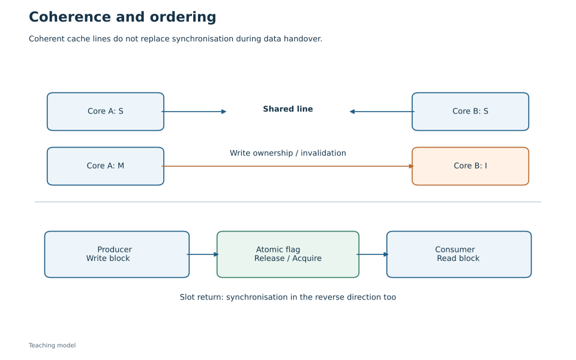

# M29-L3 – Parallel Systems, Coherence and Consistency: Implications for Embedded Processing {#L3}

**Course area:** M29 – Master’s Specialisation: Embedded Computer Architectures and Hardware–Software Design

**Level:** Master · Master’s Specialisation

**Prerequisites:** [M29-L2](M29-L2.md), [M24-L3](M24-L3.md), [M23-L4](M23-L4.md).

**Learning objective:** Distinguish coherence from consistency and design an ownership transition between two processing units.

## Parallelism and shared visible state {#S1}

Parallelism can occur in instructions, SIMD data operations, threads, processor cores or independent accelerators. The throughput gain depends on whether the work is independent. Two cores that repeatedly modify the same shared variable can slow each other down. In particular, a correct program must work even when execution is interleaved differently in time.

Coherence concerns the view of a single memory location or its corresponding cache line. When a copy is written, the protocol must ensure that other agents receive an appropriate version and that writes to one location are ordered consistently. Memory consistency, by contrast, describes the permitted observation order of accesses to different addresses. Even a coherent multicore system can be weakly ordered. Source-code order does not guarantee correct publication in an unsynchronised exchange.

{alt="Shared cache lines, invalidation and release–acquire publication of a block."}

## Cache line states {#S2}

A common teaching model is MESI: Modified (exclusive modified copy), Exclusive (sole clean copy), Shared (multiple clean copies) and Invalid (no valid copy). Writing to a shared line requires exclusive write permission, for example by invalidating other copies. A particular system may have other states, a directory-based service instead of snooping, or separate coherence domains.

Two variables can be logically independent but still reside on the same line. If core A and core B alternately write different variables on that line, write ownership repeatedly changes. This false sharing reduces throughput without a real data dependency at variable level. As a model calculation, one million handovers/s at a cost of 80 ns per serialised transition yield 80 ms/s, or 8% of a second spent waiting for transfers. This is not measured CPU utilisation. Placing write regions on separate lines can help but increases memory requirements.

## Publishing a sensor block {#S3}

The following C11 scheme uses one atomic ownership flag for exactly one shared slot. A producer waits or drops data according to its own policy when the slot is full. The consumer may read the data only after a successful acquire. The reverse handover also protects reuse. This assumes exactly one producer and one consumer on CPU cores in supported shared memory; it is not a direct DMA protocol.

```c
#include <stdatomic.h>
#include <stdbool.h>
#include <stdint.h>
static uint16_t block[64];
static atomic_bool full = ATOMIC_VAR_INIT(false);
bool publish(const uint16_t src[64]) {
    if (atomic_load_explicit(&full, memory_order_acquire)) return false;
    for (unsigned i=0; i<64; ++i) block[i]=src[i];
    atomic_store_explicit(&full, true, memory_order_release);
    return true;
}
bool consume(uint16_t dst[64]) {
    if (!atomic_load_explicit(&full, memory_order_acquire)) return false;
    for (unsigned i=0; i<64; ++i) dst[i]=block[i];
    atomic_store_explicit(&full, false, memory_order_release);
    return true;
}
```

The release operation publishes preceding block accesses; the matching acquire operation that observes this state establishes the synchronisation relationship. The same applies in the opposite direction when returning the slot. Under these assumptions the block elements do not need to be individually atomic. A second producer would violate the contract. The C implementation is not required to guarantee that every atomic type is lock-free; interrupts require platform-specific guarantees. For peripherals, device and driver rules are decisive rather than this language-level model.

## Partitioning and verification {#S4}

Data parallelism for a sum can be achieved using partial sums. The results must be combined only after all partial calculations have finished. For 64 unsigned 12-bit numbers, the maximum sum is $64\cdot4095=262080$; 18 bits suffice. A 16-bit accumulator can overflow and produce a different control value. With sufficiently wide integers, the reduction is exact; floating-point addition is not generally associative and requires a different comparison (tolerance and error analysis).

Tests include repeated sequence handovers, varying producer and consumer speeds, and boundary values. A test on a single architecture does not prove memory-order correctness for all platforms. In the original development work, a local C11 test with two POSIX threads over 20,000 block handovers and 64 individually checked values per block was executed successfully. This is a functional test on the development computer, not a cross-platform proof. A hardware coherence test must additionally be run on the relevant cores with the relevant memory attributes.

## Exercises and review {#S5}

1. Why is `volatile bool full` insufficient in the C scheme? **Solution:** It establishes no atomic synchronisation between threads and does not prevent a data race on the buffer.
2. Two cores modify independent variables within a 64-byte line. **Solution:** False sharing is possible; separate lines or batched local updates reduce handovers.
3. What accumulator width is needed for the sum of 128 12-bit values? **Solution:** 19 bits, because $128\cdot4095=524160<2^{19}$.

## Sources {#S6}

- [ETH Zürich – Computers and Networks (Curriculum G5)](https://www.vvz.ethz.ch/Vorlesungsverzeichnis/sucheLehrangebot.view?abschnittId=122815&ansicht=1&lang=en&seite=0&semkez=2026W)
- [MIT OCW – 6.004, Lecture Notes: Pipelining, Memory Hierarchy, Parallel Processing](https://ocw.mit.edu/courses/6-004-computation-structures-spring-2009/pages/lecture-notes/)
- [Arm – Memory Systems, Ordering, and Barriers](https://support.arm.com/documentation/102336/0100/Memory-ordering)
- [Linux Kernel – Dynamic DMA mapping Guide (6.12)](https://docs.kernel.org/6.12/core-api/dma-api-howto.html)
