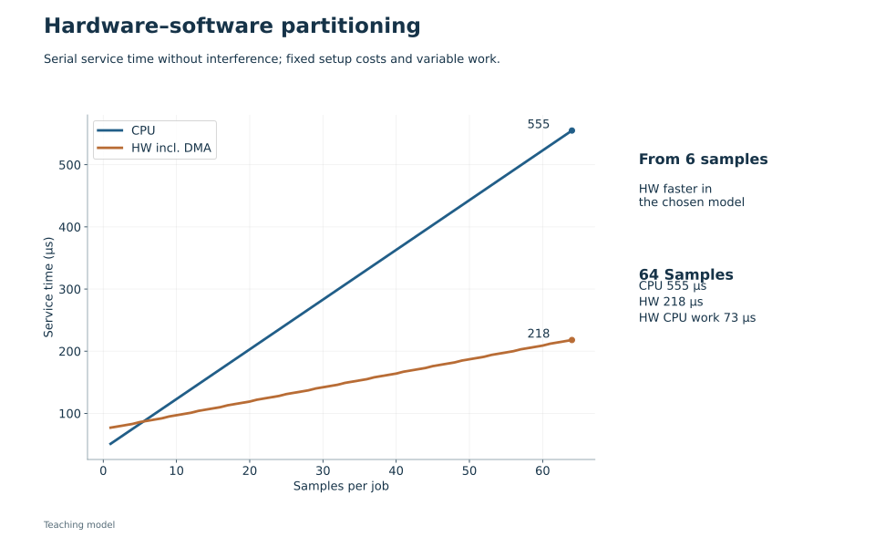

# M29-L4 – Specialised Acceleration: Hardware–Software Partitioning and Data Transfer {#L4}

**Course area:** M29 – Master’s Specialisation: Embedded Computer Architectures and Hardware–Software Design

**Level:** Master · Master’s Specialisation

**Prerequisites:** [M29-L1](M29-L1.md), [M29-L2](M29-L2.md), [M28-L5](M28-L5.md).

**Learning objective:** Derive the acceleration gain from computation time, transfer costs and setup overhead.

## What belongs in hardware? {#S1}

An accelerator is optimised for particular operations: for example, filters, matrix operations, cryptographic primitives or signal conversion. Hardware can provide a datapath with several computational units, while software performs the same operation on a general-purpose CPU. Software remains flexible for configuration, diagnostics and changes in behaviour. Partitioning is therefore a design problem involving several objectives, not simply a choice in favour of the greatest computational performance.

A filter with $M$ coefficients requires $M$ multiplications per output value for direct computation. A datapath with several parallel multipliers can reduce the initiation interval. Registers between stages may increase the latency of an individual operation in clock cycles but allow a higher frequency. Memory ports and the data supply must actually feed the parallel units. For variable data lengths and infrequent operations, the overhead of handing work over to hardware may dominate.

{alt="Timing budgets for the CPU and hardware paths, and the size-dependent break-even point."}

## Timing model for the reference chain {#S2}

We consider the number $n$ of sensor values (16-bit word), a 4-byte response and no overlap between stages. The common preparation takes 25 µs and output takes 18 µs. CPU computation takes $8n$ µs and accelerator computation takes $2n$ µs. The input transfer requires 20 µs of setup and $\lceil 2n/8\rceil$ µs of transfer time; the response requires 10 µs of setup and 1 µs of transfer time. Hence,

$$T_{\mathrm{CPU}}=43+8n,\qquad T_{\mathrm{HW}}=74+2n+\lceil n/4\rceil$$

in µs. The equation is a teaching model for timing. For $n$ divisible by four, the hardware-side slope is 2.25 µs/sample. The continuous intersection occurs at $n=31/5.75\approx5.39$. With rounding, the hardware path is faster for six or more whole samples (five samples: 83 and 86 µs respectively; six: 91 and 88 µs respectively). Small jobs therefore do not automatically benefit.

For $n=64$, the times are 555 µs and 218 µs. The CPU time of the hardware path is 73 µs; the remainder is spent on autonomous transfers and computational logic. The CPU does not actively wait in this model. If DMA transfers are awaited by polling, the CPU demand changes. With 300 µs of bus interference per transfer, the affected hardware-side response time from an idle system rises to 818 µs; the CPU variant is unaffected in this particular model. The bottleneck shifts.

## Arithmetic and resources {#S3}

The project algorithm averages $n=64$ values. For hardware reduction, eight groups of eight values can be formed, followed by an adder tree. An unsigned partial sum requires 15 bits and the total sum requires 18 bits. Division by 64 is a right shift by six bits, with rounding down as agreed. The control output is

$$u=\operatorname{clip}_{[0,4095]}(2048+2(2048-\lfloor S/64\rfloor)).$$

The difference and scaling are computed with signed arithmetic of sufficient width; the intermediate control expression ranges from −2046 to 6144. Otherwise, unsigned subtraction yielding a negative result may cause incorrect saturation. A software model and the tree must agree exactly for every identical input. Resources such as LUTs, registers and memory ports cannot be specified without a concrete technology and synthesis; the 2 µs per sample therefore does not claim that a particular FPGA clock rate is achievable.

## Interface contract {#S4}

| Aspect | Project specification |
| --- | --- |
| Data type | 12-bit payload value in a 16-bit word |
| Length | 64 values per job |
| Response | Model assumption: 4 bytes for control output and status |
| Arithmetic | Round the non-negative mean down, then saturate |
| Start/end | Job ready, control output valid |
| Error | Count missing and late responses separately |

A real interface additionally specifies byte order, alignment, status bits, reset after errors and transaction IDs. The hardware interface must be versioned. Measurable latencies, memory usage and power consumption must be recorded with an identical data stream in a later implementation. A benchmark of the algorithm alone excludes transport costs and is therefore not equivalent to the end-to-end metric.

## Exercises and review {#S5}

1. Calculate $T_{\mathrm{HW}}$ for 16 samples. **Solution:** $74+32+4=110$ µs versus 171 µs for the CPU.
2. For 64 values of 4095 each: **Solution:** sum 262080, mean 4095, control output before clipping −2046, output 0.
3. The input DMA bandwidth halves to 4 bytes/µs; the output bandwidth remains unchanged. **Solution:** input takes an additional 16 µs, giving a new total latency of 234 µs in the interference-free model.

## Sources {#S6}

- [ETH Zurich – Computers and Networks (Monowlith internal curriculum group G5)](https://www.vvz.ethz.ch/Vorlesungsverzeichnis/sucheLehrangebot.view?abschnittId=122815&ansicht=1&lang=en&seite=0&semkez=2026W) · Autumn 2026 course catalogue: track listing; curricular orientation, no equivalence assessment · Last accessed: 2026-11-25
- [MIT OCW – 6.004, Lecture Notes: Pipelining, Memory Hierarchy, Parallel Processing](https://ocw.mit.edu/courses/6-004-computation-structures-spring-2009/pages/lecture-notes/) · Lecture Notes: Pipelining, Memory Hierarchy, Parallel Processing; Reference listed for the lesson “Specialised Acceleration: Hardware–Software Partitioning and Data Transfer” · Last accessed: 2026-11-22
- [Linux Kernel – Dynamic DMA mapping Guide (6.12)](https://docs.kernel.org/6.12/core-api/dma-api-howto.html) · Thematic relevance to lesson: S4: Interface contract · Last accessed: 2026-11-22
