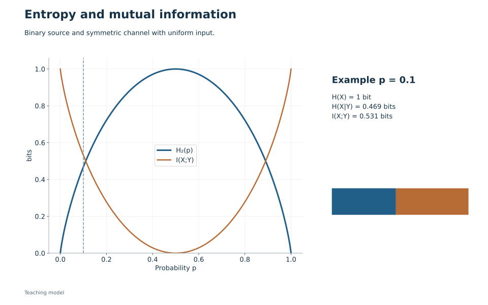

# M30-L1 – Entropy and Mutual Information: What a Signal Reveals about Its Source {#L1}

**Course area:** M30 – Master’s Specialisation: Information Theory and Optical Communication

**Level:** Master · Master’s Specialisation

**Prerequisites:** [M25-L1](M25-L1.md), [M25-L5](M25-L5.md).

**Learning objective:** Calculate entropy, conditional entropy and mutual information, and distinguish between them.

## Information as a measure of surprise {#S1}

Information theory asks how many independent decisions a message contains statistically. The meaning of a text to a human reader is not measured by this quantity. For a symbol $x$ with probability $p(x)>0$, $i(x)=-\log_2 p(x)$ is its self-information in bits. A certain event yields zero bits, whereas an event with probability $1/8$ yields three bits. The self-information of independent events adds up because their probabilities multiply.

The mean self-information of a discrete random variable is the Shannon entropy

$$H(X)=-\sum_x p(x)\log_2 p(x).$$

The convention $0\log_2 0=0$ avoids an undefined boundary term. For $m$ possible symbols, $0\le H(X)\le\log_2 m$; the maximum requires a uniform distribution. An individual symbol need not be representable in exactly $H(X)$ bits: entropy is a mean and becomes an asymptotic rate only over many symbols.

{alt="Binary entropy function and decomposition of uncertainty for a binary symmetric channel."}

## Joint and conditional entropy {#S2}

Joint entropy uses the joint distribution $p(x,y)$. From $p(x,y)=p(y)p(x|y)$, the chain rule follows:

$$H(X,Y)=H(Y)+H(X|Y),\qquad H(X|Y)=\sum_y p(y)H(X|Y=y).$$

If a receiver knows $Y$, the mean remaining uncertainty about $X$ may be smaller. For independent variables, $H(X|Y)=H(X)$. For a deterministically invertible relationship, this uncertainty vanishes. For a uniformly distributed bit $X$ that is inverted with probability $p=0.1$, $Y$ is also uniformly distributed. Using the binary entropy function

$$h_2(p)=-p\log_2 p-(1-p)\log_2(1-p)$$

we obtain $H(X|Y)=h_2(0.1)=0.469$ bits and $H(X,Y)=1.469$ bits. This channel model is used in L3 to study capacity.

## Mutual information and divergence {#S3}

The mean information that $Y$ provides about $X$ is

$$I(X;Y)=H(X)-H(X|Y)=\sum_{x,y}p(x,y)\log_2\frac{p(x,y)}{p(x)p(y)}.$$

The formula is symmetric. It corresponds to the Kullback–Leibler divergence between the joint distribution and the product of the marginal distributions. In general, $D(P\Vert Q)=\sum_x P(x)\log_2[P(x)/Q(x)]\ge0$ (potentially infinite if support is missing), but it is not a symmetric metric. In the binary example, $I=0.531$ bits per channel use. An incorrectly detected bit is not equivalent to losing an entire bit of information: error probability and mean uncertainty are distinct quantities.

For a Markov chain $X\to Y\to Z$, $I(X;Z)\le I(X;Y)$. A hard threshold decision can therefore discard information that a subsequent decoder could have used with soft values.

## Estimation from data {#S4}

For a measured sequence of length $n$, the relative frequencies $\hat p_i=n_i/n$ can be substituted into the entropy formula. A sample with 800 zeros and 200 ones yields $h_2(0.2)=0.722$ bits per symbol. For finite samples, the plug-in estimate is usually downward-biased; rare unobserved events are missing. Temporal dependence additionally requires analysing the joint distribution of several symbols. An alternating sequence, for example, has a marginal entropy of about 1 bit, but if the initial phase is known it contains no new information per subsequent symbol. The entropy rate of a stationary source is the limit of $H(X_1,\ldots,X_n)/n$, provided it exists. Histogram entropy alone is therefore not a reliable promise of compression.

## Exercises and review {#S5}

1. Calculate $H$ for four equally probable symbols. **Solution:** 2 bits/symbol.
2. For a binary symmetric channel, let $p=0.5$. **Solution:** $H(X|Y)=1$ for a uniform input and $I=0$.
3. A channel always inverts every bit. **Solution:** $H(X|Y)=0$, $I=1$ for a uniform input; a known inversion can be completely reversed.

## Sources {#S6}

- [ETH Zurich – Course Catalogue, Autumn Semester 2026: Communication (Monowlith internal curriculum group G6)](https://www.vvz.ethz.ch/Vorlesungsverzeichnis/sucheLehrangebot.view?abschnittId=122815&ansicht=1&lang=en&seite=0&semkez=2026W) · Advanced Core: Information Theory I; Optical Communication Fundamentals; curriculum reference only · Last accessed: 2026-11-25
- [MIT OCW – 6.441 Information Theory, Lecture Notes](https://ocw.mit.edu/courses/6-441-information-theory-spring-2010/pages/lecture-notes/) · 6.441 Information Theory, Lecture Notes; Lesson relevance: information and entropy (S1: Information as a measure of surprise) · Last accessed: 2026-11-22
