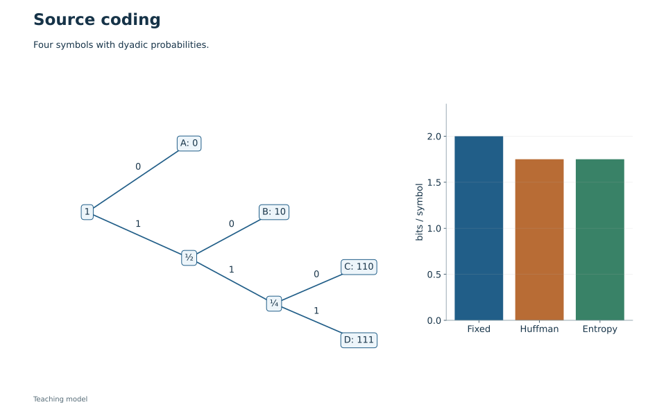

# M30-L2 – Source Coding, Typical Sequences and Compression Limits {#L2}

**Course area:** M30 – Master’s Specialisation: Information Theory and Optical Communication

**Level:** Master · Master’s Specialisation

**Prerequisites:** [M30-L1](M30-L1.md).

**Learning objective:** Construct prefix codes and distinguish between mean codeword lengths and asymptotic compression limits.

## Lossless representation {#S1}

A lossless source code has a unique inverse mapping. For four symbols $A,B,C,D$ with $p=(1/2,1/4,1/8,1/8)$, a fixed-length code requires two bits per symbol. A prefix code, by contrast, is $A=0$, $B=10$, $C=110$, $D=111$. No codeword is a prefix of another. A bitstream can therefore be decoded from left to right without separators, provided the initial codeword boundary is known.

The mean length $\bar \ell=\sum_i p_i\ell_i$ is 1.75 bits/symbol. The entropy is also 1.75 bits/symbol. Equality is possible here because the probabilities are negative integer powers of two. In the selected model, the code is 12.5% shorter than the fixed-length code. Transmission errors can, however, disrupt synchronisation in variable-length codes.

{alt="Comparison of fixed-length coding, Huffman coding and entropy for a four-symbol source."}

## Kraft inequality and the Huffman algorithm {#S2}

For binary prefix codes, $\sum_i 2^{-\ell_i}\le1$. The codewords can be imagined as leaves of a binary tree: a word of length $\ell$ occupies the fraction $2^{-\ell}$ of the tree. Conversely, a prefix code exists for integer lengths satisfying this inequality. The Huffman algorithm repeatedly combines the two smallest weights into a node. The branches are then labelled with 0 and 1. It minimises the mean length for symbol-by-symbol binary prefix codes with known probabilities.

For a discrete memoryless source, in the non-trivial case,

$$H(X)\le\bar\ell_{\mathrm{Huffman}}<H(X)+1.$$

The gap of up to nearly one bit per symbol is large for highly skewed binary sources. Block coding of $k$ independent symbols reduces the additive gap to less than $1/k$ bits per original symbol, but requires up to $m^k$ code leaves.

## Typical sequences and the compression limit {#S3}

For independent, identically distributed symbols, the law of large numbers also applies to the self-information of the sequence. The asymptotic equipartition property (AEP) states that

$$-\frac1n\log_2 p(X_1,\ldots,X_n)\longrightarrow H(X)$$

in probability. A typical set contains sequences whose normalised self-information differs from the entropy by at most $\epsilon$. Its probability tends to one, and its size asymptotically lies between approximately $2^{n(H-\epsilon)}$ and $2^{n(H+\epsilon)}$ (with the lower bound additionally multiplied by the probability mass of the typical set). For 100 Bernoulli symbols with $p=0.25$, $H\approx0.8113$ bits per symbol. The dominant region can be described asymptotically by approximately 81 bits per 100 source bits; this is not a guarantee for any single block. Rare sequences require a fallback representation if the code is to be strictly lossless. A fixed-length code allowing a vanishing block error probability is a different problem from an always-lossless variable-length code.

## Compression in a transmission system {#S4}

A continuous sensor producing 10,000 symbols/s with the four-symbol source above yields an average Huffman payload of 17.5 kbit/s instead of 20 kbit/s. A codebook, block headers, integrity checks and synchronisation require additional bits. A source with memory can be exploited more effectively through prediction or context-dependent modelling. For audio and image data, lossy coding permits additional reduction if a distortion measure and tolerable quality are defined. The entropy of a quantised signal is not equivalent to the differential entropy of the analogue signal. L3 discusses the deliberate introduction of redundancy for error correction: compression removes statistical redundancy, whereas channel coding adds controlled redundancy.

## Exercises and review {#S5}

1. Check the lengths $(1,2,3,3)$. **Solution:** Kraft sum $1/2+1/4+1/8+1/8=1$.
2. Encode $ABCD$. **Solution:** `010110111`, nine bits (not the expected value of seven bits for four random symbols).
3. For blocks of eight symbols, what is the maximum additive Huffman gap? **Solution:** less than 0.125 bits per symbol for independent symbols.

## Sources {#S6}

- [ETH Zurich – Communication (Curriculum G6)](https://www.vvz.ethz.ch/Vorlesungsverzeichnis/sucheLehrangebot.view?abschnittId=124625&ansicht=3&lang=de&seite=1&semkez=2026W)
- [MIT OCW – 6.441 Information Theory, Lecture Notes](https://ocw.mit.edu/courses/6-441-information-theory-spring-2010/pages/lecture-notes/)
