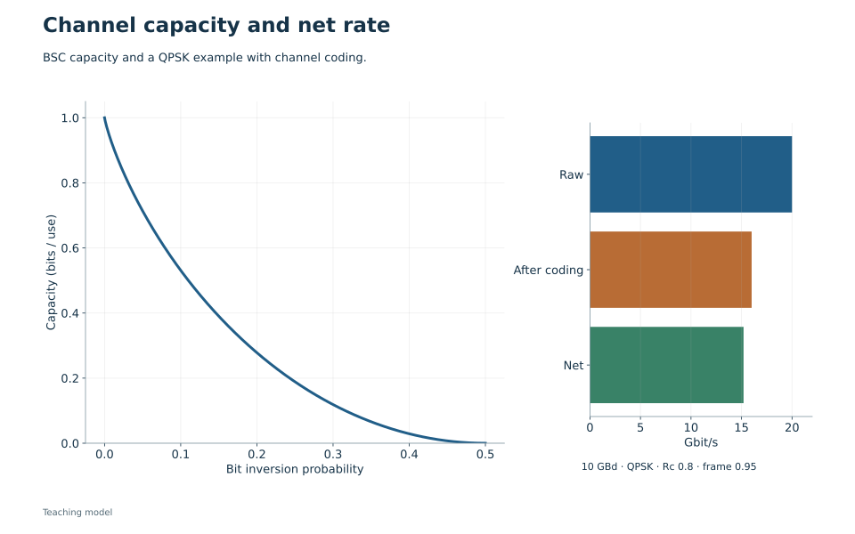

# M30-L3 – Channel Capacity, Channel Coding and the Difference between Information Rate and Raw Bit Rate {#L3}

**Course area:** M30 – Master’s Specialisation: Information Theory and Optical Communication

**Level:** Master · Master’s Specialisation

**Prerequisites:** [M30-L1](M30-L1.md), [M30-L2](M30-L2.md), [M25-L5](M25-L5.md).

**Learning objective:** Determine capacity per channel use and per second, and understand the limitations of finite codes.

## From the transition law to capacity {#S1}

A discrete memoryless channel is specified by $p(y|x)$. For successive independent channel disturbances, the block transition probability factorises. Capacity is

$$C=\max_{p(x)} I(X;Y)$$

in bits per channel use, possibly subject to constraints on $p(x)$. For the binary symmetric channel (BSC) with inversion probability $p$, a uniform input maximises mutual information: $H(Y)=1$, while $H(Y|X)=h_2(p)$ is independent of the input distribution. Consequently, $C=1-h_2(p)$. For $p=0.01$, this yields $C=0.9192$; for $p=0.1$, only $0.5310$ bits/use. For $p>0.5$, an inverting receiver makes sense; a known complete inversion has capacity one.

{alt="Capacity of the binary symmetric channel and illustrative payload data rates of a coded link."}

## Continuous Gaussian channel {#S2}

For an ideal bandlimited AWGN channel with bandwidth $B$ in Hz, mean signal power $P$ and noise power $N$ in the band under consideration, the usual Shannon model assumptions give

$$C=B\log_2(1+P/N).$$

With $B=10$ MHz and an SNR of 15 dB ($P/N=31.62$), the capacity is approximately 50.28 Mbit/s. This formula allows continuous Gaussian-distributed signalling under an average power constraint. A fixed discrete modulation alphabet and a hard decision device do not automatically achieve the formula. An optical intensity channel additionally has non-negative intensity, optical power limits and potentially signal-dependent noise. The AWGN formula cannot then be applied directly to optical power without further modelling.

## Channel coding and finite block length {#S3}

The channel coding theorem guarantees, at a rate below capacity, the existence of codes whose error probability tends to zero as the block length increases. It promises neither an immediately available code for every rate below capacity nor a specific latency or BER value. A simple example is the triple repetition code with majority decision. Independent BSC errors give

$$p_3=3p^2(1-p)+p^3.$$

For $p=0.1$, the error probability falls from 0.1 to 0.028, but three channel uses carry only one payload bit. A block code $(n,k)$ has code rate $R_c=k/n$; its minimum Hamming distance $d_{\min}$ guarantees correction of up to $\lfloor(d_{\min}-1)/2\rfloor$ errors with suitable decoding. FEC methods such as LDPC use considerably longer blocks and often soft decisions. The theoretical existence of reliable coding must be distinguished from measured decoder performance.

## Raw bit rate, net rate and requirements {#S4}

For symbol rate $R_s$, a modulation alphabet with $M=2^m$ symbols and code rate $R_c$, a simple fixed mapping gives

$$R_{\mathrm{roh}}=R_s\log_2 M,\qquad R_{\mathrm{netto}}=R_{\mathrm{roh}}R_c\eta_{\mathrm{frame}}.$$

The subscripts `roh` and `netto` denote the raw and net rates, respectively. $\eta_{\mathrm{frame}}$ accounts for pilot and header overhead, for example. For 10 GBd QPSK, $R_c=0.8$ and $\eta=0.95$, the result is 20 Gbit/s raw and 15.2 Gbit/s net for one polarisation. Capacity must match the channel definition and the number of independent degrees of freedom used. For 10 GBd BPSK or OOK with one bit/symbol, by contrast, the raw bit rate is 10 Gbit/s. The optical case study uses uncoded bits; a target BER of $10^{-3}$ is a didactic comparison value, not proof of FEC performance.

## Exercises and review {#S5}

1. BSC with $p=0.2$: **Solution:** $C=0.2781$ bits/use. A reliable rate of 0.5 is asymptotically impossible in this model.
2. Repetition with $p=0.02$: **Solution:** $p_3=0.001184$ at rate 1/3.
3. 25 GBd, 16-QAM, $R_c=0.75$, frame factor 0.9: **Solution:** 100 Gbit/s raw, 67.5 Gbit/s net (one polarisation).

## Sources {#S6}

- [ETH Zurich – Course Catalogue, Autumn Semester 2026: Communication (Monowlith internal curriculum group G6)](https://www.vvz.ethz.ch/Vorlesungsverzeichnis/sucheLehrangebot.view?abschnittId=122815&ansicht=1&lang=en&seite=0&semkez=2026W) · Advanced Core: Information Theory I; Optical Communication Fundamentals; curriculum reference only · Last accessed: 2026-11-25
- [MIT OCW – 6.441 Information Theory, Lecture Notes](https://ocw.mit.edu/courses/6-441-information-theory-spring-2010/pages/lecture-notes/) · 6.441 Information Theory, Lecture Notes; Lesson relevance: channel capacity (S1: From the transition law to capacity) · Last accessed: 2026-11-22
