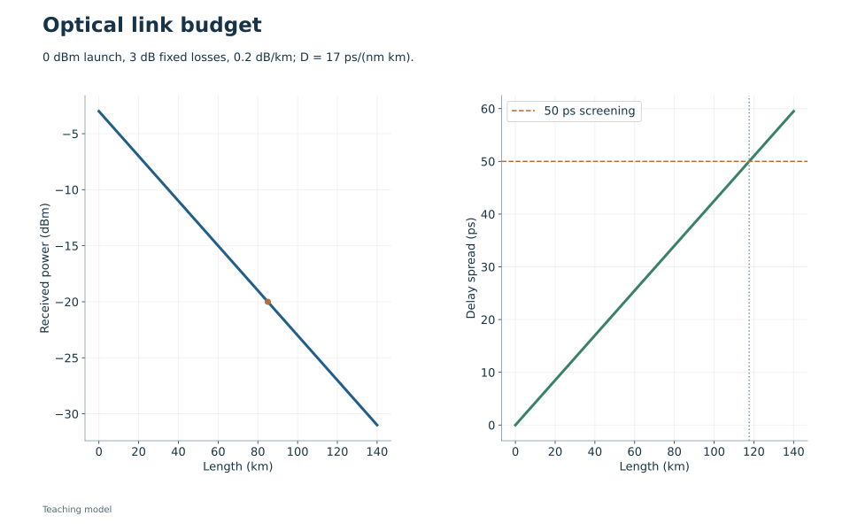

# M30-L4 – Optical Transmission Chains: Fibre Attenuation, Dispersion and Receiver Noise {#L4}

**Course area:** M30 – Master’s Specialisation: Information Theory and Optical Communication

**Level:** Master · Master’s Specialisation

**Prerequisites:** [M19-L3](M19-L3.md), [M19-L5](M19-L5.md), [M30-L3](M30-L3.md).

**Learning objective:** Calculate power and dispersion budgets separately and understand photodetector noise.

## Optical chain and power {#S1}

A transmitter modulates an optical carrier, and a fibre guides it to the receiver. In the receiver path, attenuation, temporal distortion and noise affect the decision. Optical power in dBm is $P_{\mathrm{dBm}}=10\log_{10}(P/1\,\mathrm{mW})$. For an average transmit power $P_T=0$ dBm, fixed losses $A_0=3$ dB and a fibre attenuation coefficient $\alpha=0{.}2$ dB/km, the teaching model gives

$$P_R[\mathrm{dBm}]=P_T-A_0-\alpha L.$$

At 85 km this yields $-20$ dBm or 10 µW, and at 105 km it yields $-24$ dBm or 3.981 µW. These values are synthetic assumptions for an unamplified link, not the specifications of a particular fibre. In real-world planning, a margin for ageing, connectors and additional losses must be stated separately. A 2 dB margin reduces the reach determined solely by this linear power limit by 10 km.

{alt="Received power and chromatic delay spread of a modelled optical fibre link."}

## Chromatic dispersion {#S2}

Frequency-dependent group delay broadens optical pulses. For a small spectral width, the delay spread can be roughly estimated as

$$\Delta t\approx |D|L\Delta\lambda$$

with $D$ in ps/(nm km), $\Delta\lambda$ in nm and $L$ in km. With $D=17$ ps/(nm km) and an illustrative effective spectral width of 0.025 nm, the spread at 85 km is 36.125 ps. At 10 GBd, $T_s=100$ ps. A separate screening criterion for the intensity receiver without equalisation is chosen as $\Delta t\le T_s/2=50$ ps. This corresponds to a maximum of 117.65 km. It is not a universal BER limit; pulse shape, chirp, the definition of width and receiver filtering determine the actual effect on the eye diagram. The spectrum is taken as given in this calculation, rather than derived from a particular modulator pulse. The coherent model path assumes idealised dispersion equalisation. It is therefore not automatically free of real dispersion limits.

## Photodetector and noise contributions {#S3}

For a photodetector with responsivity $\mathcal R$ in A/W, $I=\mathcal R P$. With $\mathcal R=0{.}8$ A/W and 10 µW average power, the average photocurrent is 8 µA. In the simple Poisson model, the one-sided shot-noise current variance is $\sigma_{\mathrm{shot}}^2=2q_e(I+I_d)B_e$, where $I_d$ is the dark current and $B_e$ is the effective electrical noise bandwidth. An ohmic resistor $R$ at temperature $T$ yields $\sigma_{\mathrm{th}}^2=4k_BT B_e/R$ in the ideal current-noise model. At 300 K, 50 Ω and 5 GHz, thermal noise is approximately 1.29 µA RMS, and shot noise (at 8 µA, with no dark current) is about 0.113 µA RMS. A real TIA has frequency-dependent current- and voltage-noise contributions; this simple circuit is merely an order-of-magnitude example and does not calibrate the L6 study.

Laser intensity noise, amplifier ASE, polarisation, nonlinear effects and receiver saturation can introduce additional contributions. Independent noise sources add in variance, not by summing their RMS amplitudes.

## Limitations and verification strategy {#S4}

A power budget alone does not determine the bit error rate. The mapping from received power to decision statistics must also be known. A two-stage comparison first examines the noise channel and then checks whether the idealised decision conditions (such as negligible intersymbol interference) are plausible. L5 introduces two explicitly synthetic receiver characteristics. A realistic extension requires measured or specified noise parameters, actual modulated waveforms, the fibre transfer function, sampling and, where needed, equalisation. Optical signal-to-noise ratios (OSNR) are stated with a specified optical reference bandwidth; they cannot be interchanged with electrical SNR or $E_b/N_0$ without conversion.

## Exercises and review {#S5}

1. What is $P_R$ at 95 km? **Solution:** −22 dBm or 6.31 µW.
2. What delay spread occurs at 130 km? **Solution:** 55.25 ps; OOK fails the chosen 50 ps screening criterion.
3. With the same power and half the symbol duration: **Solution:** the relative dispersion $\Delta t/T_s$ doubles; the electrical noise bandwidth may also increase.

## Sources {#S6}

- [ETH Zurich – Communication (Curriculum G6)](https://www.vvz.ethz.ch/Vorlesungsverzeichnis/sucheLehrangebot.view?abschnittId=124625&ansicht=3&lang=de&seite=1&semkez=2026W)
- [University of Stuttgart – Optical Communications, course](https://www.inue.uni-stuttgart.de/teaching/OpticalComms/)
- [ITU-T G Supplement 39 (03/2025) – Optical system design and engineering considerations](https://www.itu.int/epublications/publication/itu-t-g-suppl-39-2025-03-optical-system-design-and-engineering-considerations/en)
