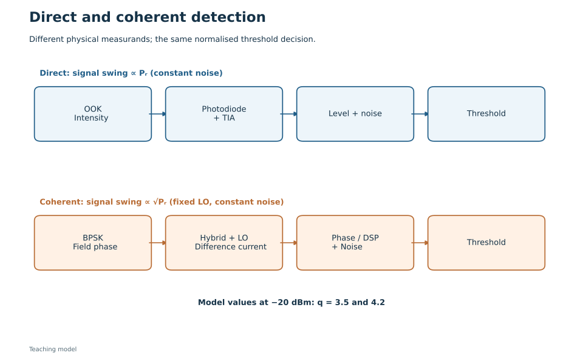

# M30-L5 – System Comparison: Direct Detection, Coherent Reception and Presentation of Results {#L5}

**Course area:** M30 – Master’s Specialisation: Information Theory and Optical Communication

**Level:** Master · Master’s Specialisation

**Prerequisites:** [M30-L3](M30-L3.md), [M30-L4](M30-L4.md), [M25-L4](M25-L4.md).

**Learning objective:** Distinguish intensity and field measurements and derive two simplified BER characteristics.

## Intensity versus field {#S1}

In direct intensity detection, a photodiode generates a current proportional to optical power, i.e. to the square of the field magnitude. A simple OOK (on-off keying) signal switches between two power levels. An intensity measurement alone cannot distinguish two fields of equal magnitude and opposite phase. In coherent detection, the received field is optically mixed with a local oscillator. The difference between two photocurrents in an ideal balanced mixer contains a cross term proportional to $\sqrt{P_RP_{LO}}\cos\phi$. A 90-degree hybrid and multiple balanced detectors enable I and Q measurements. BPSK uses two opposite phases. QPSK and QAM use multiple states; for a fair comparison at the same raw bit rate, the case study considers only binary BPSK with an ideal phase reference.

## Gaussian threshold decision {#S2}

For equiprobable bits and the symmetric decision variable $z|b\sim\mathcal N((2b-1)q,1)$, zero is the optimal threshold. The probability of error follows directly from the standard normal distribution:

$$p_e=Q(q)=\frac12\operatorname{erfc}\left(\frac{q}{\sqrt2}\right).$$

For OOK with two current levels $I_0,I_1$ subject to equal noise variance, $q=(I_1-I_0)/(2\sigma)$. For ideal extinction, $I_1=2\mathcal R P_R$ (equiprobable bits, average power), so the Q value is proportional to $P_R$ if $\sigma$ is constant. With signal-dependent noise or unequal variances, the optimal threshold generally differs. For ideal coherent BPSK in an AWGN channel, $q=\sqrt{2E_b/N_0}$ and the BER is $Q(\sqrt{2E_b/N_0})$. In the strong-LO limiting model with a fixed LO and approximately constant noise level, the useful signal current is proportional to $\sqrt{P_R}$. These are separate regimes, not a universal ranking of performance.

## A transparently calibrated teaching model {#S3}

At the reference power $P_0=-20$ dBm, we set the decision values $q_{\mathrm{OOK},0}=3{.}5$ and $q_{\mathrm{BPSK},0}=4{.}2$. They are freely chosen synthetic calibration values, neither measurements nor manufacturer sensitivity specifications. With the power ratio $r=10^{(P_R[\mathrm{dBm}]+20)/10}$, we obtain

$$q_{\mathrm{OOK}}=3{.}5r,\qquad q_{\mathrm{BPSK}}=4{.}2\sqrt r.$$

At −20 dBm this gives $p_e\approx2{.}326\cdot10^{-4}$ and $1{.}335\cdot10^{-5}$ respectively. At −22 dBm the ratio is 0.631, hence $q=2{.}208$ and 3.336 respectively. The BPSK characteristic is flatter at lower powers. At −16 dBm, by contrast, OOK has the larger Q value (8.792 rather than 6.657). The comparison specifically does not prove that coherent receivers are better under all conditions. Equal average received power, equal symbol rate and equal raw bit rate form the basis of comparison here; LO energy, DSP effort, laser linewidth, costs and power consumption are not included.

## Presentation of results and decision {#S4}

BER curves are usually plotted on a logarithmic scale against received power or distance. Zero observed errors do not establish BER=0; with no errors in $n$ independent bit decisions, the exact one-sided 95% upper bound is $1-0{.}05^{1/n}\approx3/n$. A comparison should specify both receivers and their assumptions, raw bit rate, target BER and separate distortion criteria. The L6 study uses $10^{-3}$ as an uncoded comparison target and first makes a decision based on the theoretical BER. A real system selection must additionally consider the delivered payload rate, costs, power demand, availability, operational risks and implemented error correction.

## Exercises and review {#S5}

1. What BER results from $q=3$? **Solution:** approximately $1{.}35\cdot10^{-3}$.
2. Halving optical power: **Solution:** OOK Q is halved, and BPSK Q decreases by a factor of $\sqrt{1/2}$ in the chosen model.
3. Why does the coherent variant require phase recovery? **Solution:** an unknown phase rotation shifts the decision axis; without a reference, even a low-noise signal may be decoded incorrectly.

## Sources {#S6}

- [ETH Zurich – Communication (Curriculum G6)](https://www.vvz.ethz.ch/Vorlesungsverzeichnis/sucheLehrangebot.view?abschnittId=124625&ansicht=3&lang=de&seite=1&semkez=2026W)
- [University of Stuttgart – Optical Communications, course](https://www.inue.uni-stuttgart.de/teaching/OpticalComms/)
- [ITU-T G Supplement 39 (03/2025) – Optical system design and engineering considerations](https://www.itu.int/epublications/publication/itu-t-g-suppl-39-2025-03-optical-system-design-and-engineering-considerations/en)
- [MIT OCW – 6.441 Information Theory, Lecture Notes](https://ocw.mit.edu/courses/6-441-information-theory-spring-2010/pages/lecture-notes/)
