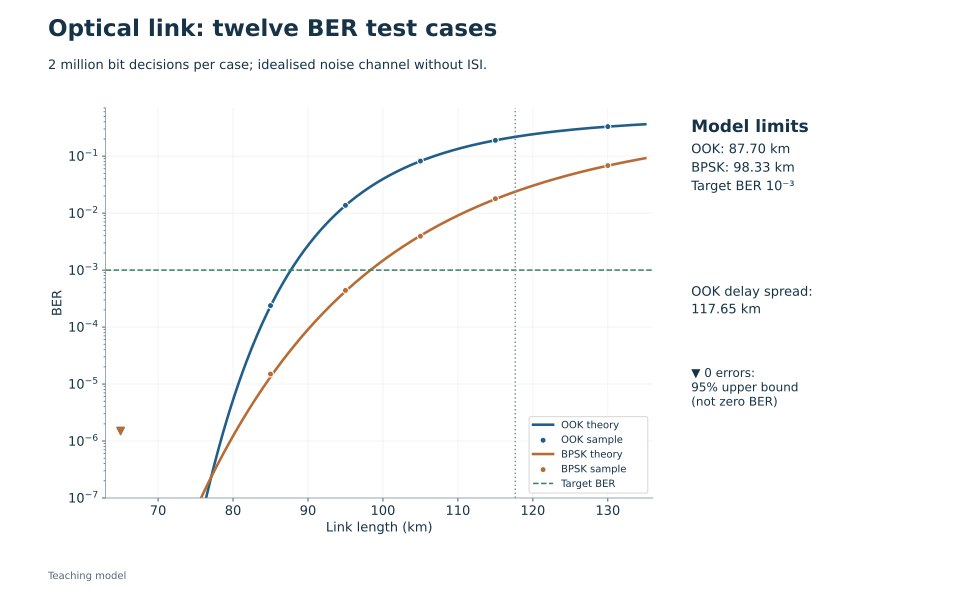

# M30-L6 – Specialisation Project: Evaluating the Bit Error Rate and Reach of a Modelled Optical Link {#L6}

**Course area:** M30 – Master’s Specialisation: Information Theory and Optical Communication

**Level:** Master · Master’s Specialisation

**Prerequisites:** [M30-L1](M30-L1.md), [M30-L2](M30-L2.md), [M30-L3](M30-L3.md), [M30-L4](M30-L4.md), [M30-L5](M30-L5.md).

**Learning objective:** Conduct a reproducible comparison of two optical decision models and document the limits of their applicability.

## Project brief and acceptance criteria {#S1}

A virtual unamplified fibre link is to be compared at 10 GBd (10 Gbit/s gross, binary, uncoded, one polarisation). Variant A uses OOK with direct detection; variant B uses idealised coherent BPSK reception. The theoretical BER must not exceed $10^{-3}$; a separate dispersion screening criterion, $\Delta t\le50$ ps, also applies to OOK. Ideal equalisation and phase recovery are assumed for BPSK. This is a symbol-by-symbol decision model without a time-domain fibre waveform, not a physical link simulator.

| Model parameter | Value |
| --- | --- |
| Average launch power | 0 dBm |
| Fixed losses | 3 dB |
| Fibre attenuation | 0.2 dB/km |
| Dispersion parameter / effective width | 17 ps/(nm km) / 0.025 nm |
| Reference power | −20 dBm |
| Q at reference power | 3.5 OOK / 4.2 BPSK |
| Symbol rate | 10 GBd |
| Bit decisions per case | 2,000,000 |
| Random number generator seed | 3006 |

The values are chosen for teaching purposes. Neither a specific optical fibre nor a particular receiver product is specified. Using the same reference power permits comparison of the model characteristics, not of the actual power consumption of the receivers.

{alt="Theoretical BER curves and Monte Carlo points with reach and dispersion criteria."}

## Calculation procedure and independent reference {#S2}

For each distance $L$, calculate $P_R=-3-0.2L$ (dBm), $r=10^{(P_R+20)/10}$ and the Q values from L5. The random number generator produces equiprobable bits and independent normalised Gaussian noise. An error occurs when the threshold decision differs from the original bit. Theory serves as the reference: $p_e=\operatorname{erfc}(q/\sqrt2)/2$. In addition, the normal distribution tail is integrated numerically using the trapezoidal rule and compared with the closed-form expression. The stochastic check uses a generous limit of six standard deviations plus five errors; it is not a confidence interval construction and does not establish the realism of the Gaussian model.

The code requires Python and NumPy (at least NumPy 2.0 for `trapezoid`). The printed German label `BER-Grenze km` means BER-limited reach in kilometres.

```python
import numpy as np
from math import erfc, sqrt, log10
N = 2_000_000
LENGTHS = (65, 85, 95, 105, 115, 130)
def theory(q):
    return 0.5 * erfc(q / sqrt(2))
def simulate():
    rng = np.random.default_rng(3006)
    rows = []
    for length in LENGTHS:
        pr = -3 - 0.2 * length
        ratio = 10**((pr + 20)/10)
        spread = 17 * 0.025 * length
        for mode, q in [('OOK', 3.5*ratio), ('BPSK', 4.2*sqrt(ratio))]:
            bits = rng.integers(0, 2, N, dtype=np.int8)
            y = (2*bits-1)*q + rng.standard_normal(N)
            errors = int(np.count_nonzero((y >= 0) != bits))
            p = theory(q)
            # Conservative statistical check, not a confidence interval.
            assert abs(errors-N*p) <= 6*sqrt(N*p*(1-p))+5
            # Independent numerical integration of normal tail (trapezoids).
            x = np.linspace(q, max(12., q+8), 40001)
            integral = np.trapezoid(np.exp(-x*x/2)/sqrt(2*np.pi), x)
            assert abs(integral-p) <= 1e-8 + 1e-5*p
            rows.append((length, mode, pr, spread, q, errors, p))
    return rows
if __name__ == '__main__':
    for l,m,pr,s,q,e,p in simulate():
        print(f'{l:3} {m:4} {pr:6.1f} {s:6.2f} {q:6.3f} {e:7} {e/N:.5g} {p:.5g}')
    for mode, q0, exponent in [('OOK',3.5,1),('BPSK',4.2,.5)]:
        lo, hi = 0., 200.
        for _ in range(60):
            mid = (lo+hi)/2
            q = q0*10**(exponent*(17-.2*mid)/10)
            if theory(q) <= 1e-3: lo = mid
            else: hi = mid
        print(mode, 'BER-Grenze km:', lo)
```

## Results of the executed model calculation {#S3}

| Length (km) | Mode | Received power (dBm) | Spread (ps) | q | Errors / 2 million | Sample BER | Theoretical BER |
| --- | --- | --- | --- | --- | --- | --- | --- |
| 65 | OOK | -16.0 | 27.63 | 8.792 | 0 | 0 | 7.3721e-19 |
| 65 | BPSK | -16.0 | 27.63 | 6.657 | 0 | 0 | 1.4016e-11 |
| 85 | OOK | -20.0 | 36.13 | 3.500 | 476 | 0.000238 | 0.00023263 |
| 85 | BPSK | -20.0 | 36.13 | 4.200 | 30 | 1.5e-05 | 1.3346e-05 |
| 95 | OOK | -22.0 | 40.38 | 2.208 | 27356 | 0.013678 | 0.01361 |
| 95 | BPSK | -22.0 | 40.38 | 3.336 | 881 | 0.0004405 | 0.00042469 |
| 105 | OOK | -24.0 | 44.63 | 1.393 | 164075 | 0.082037 | 0.081753 |
| 105 | BPSK | -24.0 | 44.63 | 2.650 | 7871 | 0.0039355 | 0.0040243 |
| 115 | OOK | -26.0 | 48.88 | 0.879 | 378933 | 0.18947 | 0.18966 |
| 115 | BPSK | -26.0 | 48.88 | 2.105 | 35805 | 0.017902 | 0.017646 |
| 130 | OOK | -29.0 | 55.25 | 0.441 | 659996 | 0.33 | 0.32974 |
| 130 | BPSK | -29.0 | 55.25 | 1.490 | 136542 | 0.068271 | 0.068084 |

All twelve cases satisfy the statistical comparison and the numerical integral check. At 65 km, neither sample contains errors; this implies only a one-sided 95% upper bound of approximately $1.50\cdot10^{-6}$ for each sample. Extremely small theoretical BER values from the Gaussian assumption cannot be confirmed directly with two million bits. At 85 km, both cases meet the theoretical BER target, and OOK meets the spread criterion. At 95 km, only BPSK meets the BER requirement. At 105 and 115 km, neither meets the BER requirement; at 130 km, the OOK dispersion criterion is also violated. All simulated BER values are noise-only results; in particular, the OOK point at 130 km must not be interpreted as a complete transmission prediction.

## Reach, sensitivity and further validation {#S4}

From $Q(q_*)=10^{-3}$, it follows that $q_*\approx3.0902$. The power limit follows from the monotonic Q characteristic; bisection in the code gives 87.704 km for OOK and 98.326 km for BPSK. The separate OOK screening gives 117.647 km, so noise is the limiting factor first in this model. An additional fixed 2 dB loss margin reduces both power-limited reaches by 10 km. If the effective spectral width of the OOK model is doubled to 0.05 nm, the dispersion limit falls to 58.824 km; the screening then becomes the stricter condition. The BPSK value still refers to ideally compensated dispersion and does not constitute a general reach advantage of 10.6 km.

A further investigation should define a pulse shape from which the actual spectral width follows. The frequency-dependent fibre phase, receiver filters, sampling instant and, where appropriate, adaptive equalisation should then be simulated. Several independent seeds and suitable confidence intervals should quantify rare errors. For FEC, the code, decoder, frame structure, pre- and post-FEC errors and net rate must be documented separately. No real optical measurement or hardware validation is available.

## Exercises and checks {#S5}

1. Add 90 km. **Solution for checking:** $P_R=-21$ dBm, $q_{\mathrm{OOK}}\approx2.780$, $q_{\mathrm{BPSK}}\approx3.743$; only BPSK meets the BER requirement.
2. Determine the spread at 85 km for twice the effective width. **Solution:** 72.25 ps, screening violated; the noise-only BER remains unchanged in the simplified code and must not be interpreted as the total BER.
3. Design a results summary for a real experiment. **Solution:** record at least fibre type, wavelength, power, temperature, losses, modulation rate, filters, DSP/FEC configuration, number of measured bits and errors, uncertainty and reference measurement.

## Sources {#S6}

- [ETH Zurich – Course Catalogue, Autumn Semester 2026: Communication (Monowlith internal curriculum group G6)](https://www.vvz.ethz.ch/Vorlesungsverzeichnis/sucheLehrangebot.view?abschnittId=122815&ansicht=1&lang=en&seite=0&semkez=2026W) · Advanced Core: Information Theory I; Optical Communication Fundamentals; curriculum reference only · Last accessed: 2026-11-25
- [MIT OCW – 6.441 Information Theory, Lecture Notes](https://ocw.mit.edu/courses/6-441-information-theory-spring-2010/pages/lecture-notes/) · Lecture notes index for channels and information theory; index only, individual proofs not reviewed · Last accessed: 2026-11-22
- [University of Stuttgart – Optical Communications, course](https://www.inue.uni-stuttgart.de/teaching/OpticalComms/) · Thematic relevance to lesson: S1: Project brief and acceptance criteria (overview/metadata page) · Last accessed: 2026-11-22
- [ITU-T – G Supplement 39 (03/2025): Optical system design and engineering considerations](https://www.itu.int/rec/dologin_pub.asp?id=T-REC-G.Sup39-202503-S%21%21PDF-E&lang=e&type=items) · Sections 9.1.1–9.1.4: sensitivity, BER target and link budget as design background; not validation of the teaching model; historical, non-normative edition · Last accessed: 2026-11-25
