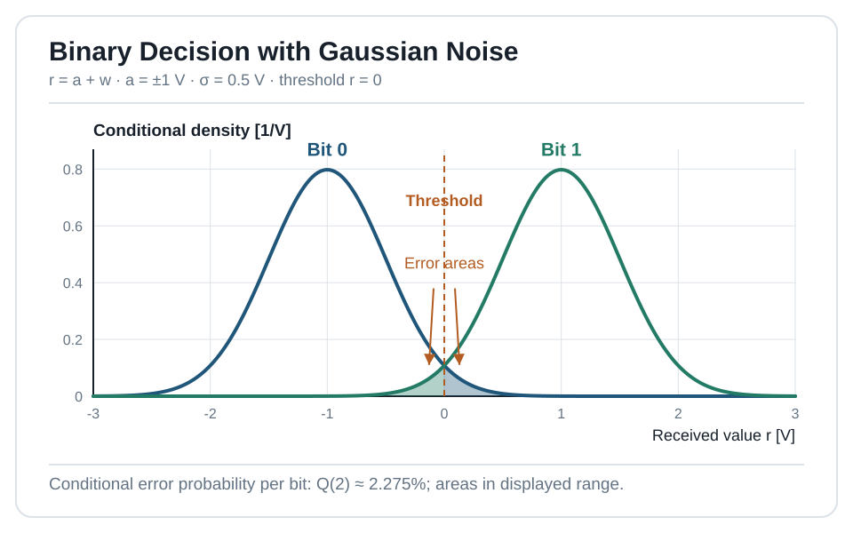

# M5-L7 – Principles of Digital Transmission {#L7}

**Course area:** M5 – Bachelor: Signals, Systems and Data Transmission

**Level:** Bachelor

**Prerequisites:** Sampling and quantisation from [M5-L5](M5-L5.md) and noise models from [M5-L6](M5-L6.md).

**Learning objective:** Distinguish the functional blocks of a digital transmission chain, calculate payload bit rate, transmitted bit rate and symbol rate in an example, and derive the error probability of a threshold decision from a channel model.

## The transmission chain {#S1}

The **source** provides measurements or messages. Their numerical representation and, where applicable, compression belong to **source coding**. **Channel coding** deliberately adds redundancy so that the receiver can detect or correct transmission errors. A parity check is an example of detection. **Modulation** maps bits or groups of bits to physical symbols, for example two baseband amplitudes or several states of a carrier signal. Pulse shaping specifies the time waveform for the symbols.

In the **channel**, a pulse may spread in time and be affected by noise. The **receiver** estimates symbol timing, filters the signal and makes decisions based on the received signal. It then reconstructs the payload bits using the agreed channel and source coding rules. The blocks address different questions. A timing assignment error is a different finding from invalid parity with correct synchronisation.

## Bits, symbols and parity {#S2}

A channel is to carry $250$ digital measurements per second. Each measurement consists of $12$ payload bits. One additional bit per measurement ensures even parity. The payload bit rate is $250\cdot12=3000\,\mathrm{bit/s}$. After parity bits are appended, $3250\,\mathrm{bit/s}$ are transmitted, provided that no additional characters are required. With binary symbols, each symbol carries exactly one transmitted bit and the symbol rate is $3250\,\mathrm{Bd}$. If two bits per symbol are encoded continuously, $1625\,\mathrm{Bd}$ are sufficient in principle, with defined grouping across word boundaries. The required bandwidth also depends on the modulation method and pulse shape.

The transmitter appends a one to the shorter demonstration word $1011$, so that $10111$ contains four ones. A single bit error changes the parity. An even number of flipped bits remains undetected. The position of an erroneous bit therefore cannot be determined from a parity mismatch. In a real link, framing, synchronisation signals and, where applicable, longer check codes must also be considered.

## Threshold decision in the channel model {#S3}

An ideal binary baseband receiver observes $r=a+w$ at the correct time. Let $a=-1\,\mathrm V$ for bit zero and $a=+1\,\mathrm V$ for bit one. Assume additive noise that is normally distributed, has zero mean and has $\sigma=0.5\,\mathrm V$. With equal bit probabilities and equal error costs, a threshold of zero is appropriate. The receiver decides on one when $r>0$.

For a transmitted one, an error occurs when $w<-1\,\mathrm V$. For a transmitted zero, the corresponding condition is $w>+1\,\mathrm V$. The error rate of the idealised individual decision follows from the standard normal distribution:

$$
P_\mathrm b=Q(A/\sigma)=Q(2)\approx0.02275,
\qquad
Q(z)=\int_z^\infty \frac{\mathrm e^{-u^2/2}}{\sqrt{2\pi}}\,\mathrm du.
$$

Here $A=1\,\mathrm V$ denotes the distance of a signal amplitude from the threshold. Under the model assumptions, $0.02275$ corresponds to approximately $2.28\,\%$ incorrect individual decisions in expectation. Channel coding, actual error sequences and possible retransmissions affect the observed quality depending on the method used.

The shaded blue area corresponds to a transmitted zero being received as a positive value; the green area corresponds to a transmitted one being received as a negative value. The densities are conditional on the bit transmitted. With equal bit probabilities, the overall error rate is the mean of the two conditional error probabilities.

## Self-check {#S4}

1. A data source produces $4000$ payload bits per second. Channel coding maps each four payload bits to five transmitted bits. How many transmitted bits and how many symbols per second result with two transmitted bits per symbol?
2. In the binary channel, the noise standard deviation is halved from $0.5\,\mathrm V$ to $0.25\,\mathrm V$. How does the argument of $Q$ change, and what follows for the error rate?

### Solutions

1. The transmitted bit rate is $4000\cdot5/4=5000\,\mathrm{bit/s}$. This gives $2500\,\mathrm{Bd}$ when codewords are grouped continuously for symbol mapping.
2. The argument doubles from two to four. Since $Q$ is strictly decreasing, the error rate decreases. $Q(4)\approx0.0000317$ corresponds to approximately $0.00317\,\%$.

## Scope and further study {#S5}

The simple threshold assumes known levels, appropriate timing and the symmetric noise model. Overlapping symbols, unequal probabilities and clock errors require an extended model. The [study pathway](pages/study-path.md) connects signal processing with measurement chains and control.

## Sources {#S6}

- [MIT OpenCourseWare, 6.450 Principles of Digital Communications I, Lecture Notes](https://ocw.mit.edu/courses/6-450-principles-of-digital-communications-i-fall-2006/pages/lecture-notes/), chapters 1–2 and 6–8 on the transmission chain, coding, modulation and detection, accessed 19 November 2026.
